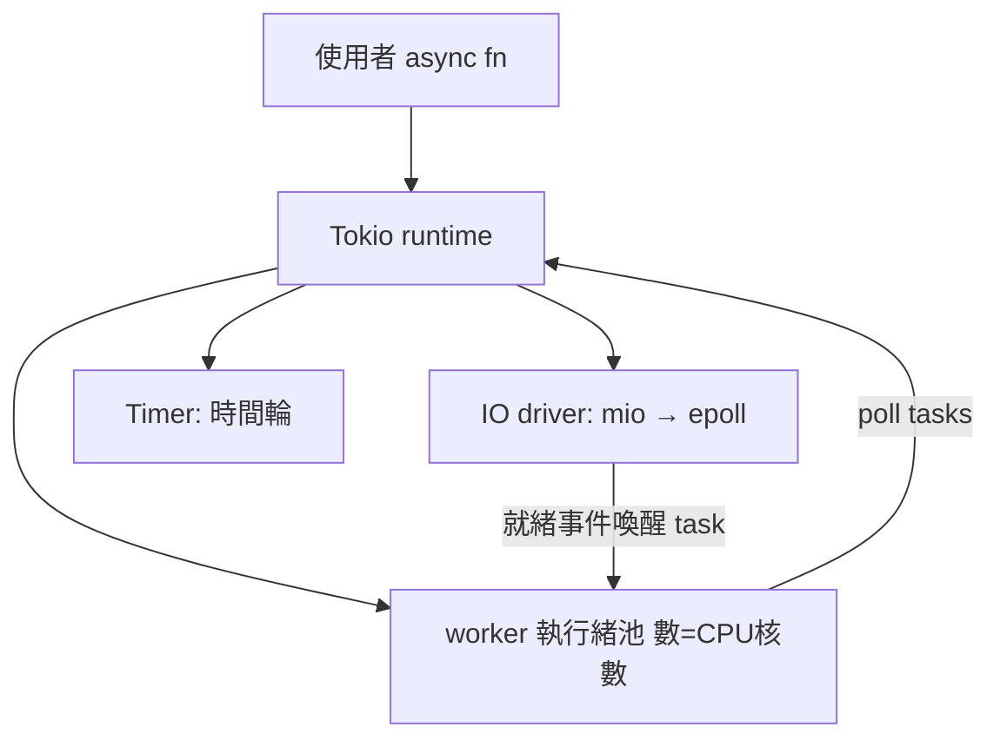

# 3.3 async/await 與 tokio 的原理

## 從 callback 地獄到 async/await

3.2 節的事件迴圈解決了 C10K，但帶來新的程式結構問題：**控制流被切成碎片**。每個「等 I/O 之後繼續做」的點都是一個回呼，狀態要手動存進連線結構。2009 年 Node.js 讓 callback 風格流行，隨後整個業界都在處理「callback hell」；Python（2015, PEP 492）、JavaScript（2017, ES2017）先後給出 `async/await` 語法，把事件驅動寫成看似同步的程式碼。

Rust 的 async 較晚（語法穩定於 **2019 年 Rust 1.39**，歷經 2016-2019 三年 RFC 討論，核心貢獻者包括 withoutboats 與 Niko Matsakis），但設計上有獨特決策：**語言只提供機制，執行期（runtime）交給生態系**。std 只定義 `Future` trait 與 `async/await` 語法；真正的 timer、I/O、排程器由 tokio、async-std（2019）等 crate 提供——對照 Go 把 goroutine 內建進語言，Rust 選了「零成本 + 可替換」的路。

## Future：一個狀態機

Rust 的 `Future` 定義驚人地小：

```rust
pub trait Future {
    type Output;
    fn poll(self: Pin<&mut Self>, cx: &mut Context<'_>) -> Poll<Self::Output>;
}

pub enum Poll<T> { Ready(T), Pending }
```

與 JavaScript 的 Promise（建立時就開始跑、由微工作佇列驅動）不同，Rust 的 future 是**惰性的**：`poll` 被叫才推進一步。`async fn` 會被編譯器**轉成狀態機**（1990 年代 C++ coroutine 提案 TS 與 2017 年 C++20 coroutine 的同款思路）：每個 `.await` 是一個暫停點，編譯器把局部變數按暫停點分組存進狀態機結構。

```rust
async fn fetch(url: &str) -> Vec<u8> { /* ... */ }

async fn download_all() {
    let a = fetch("http://a").await;   // 暫停點 1
    let b = fetch("http://b").await;   // 暫停點 2
    println!("{} {}", a.len(), b.len());
}
// 編譯器大致生成：
// enum DownloadAllFut {
//     Start,
//     WaitingA { future_a: FetchFut },
//     WaitingB { future_b: FetchFut, a: Vec<u8> },
//     Done,
// }
```

所有權系統在此展現威力：**狀態機的欄位就是局部變數**，借用檢查在編譯期驗證「跨 await 持有的借用不會懸垂」。C++20 coroutine 對此靠程式設計師自律（懸垂引用照樣編譯），Rust 靠型別系統。這也是為什麼 Rust 需要 `Pin`：future 可能自我引用（局部變數的指標指向同一狀態機的另一欄位），移動它就懸垂，所以 poll 收 `Pin<&mut Self`>——「此值不會再被移動」的型別承諾。

## tokio 的架構



- **mio**（2014）：epoll/kqueue 薄封裝，即 3.2 節手寫迴圈的工業版。
- **任務（task）**：輕量協程，初始 stack 很小、按需成長，一個 worker 執行緒用工作竊取（work stealing，源自 Cilk，1994）跑數十萬個 task。
- **waker**：I/O driver 註冊任務的 waker 到 epoll；事件到來時 `wake()` 把 task 放回佇列，worker 再 poll 它。

最小手寫執行期（教育版，約 60 行）：

```rust
use std::collections::VecDeque;
use std::future::Future;
use std::pin::Pin;
use std::sync::{Arc, Mutex};
use std::task::{Context, Poll, RawWaker, RawWakerVTable, Waker};

struct Queue(VecDeque<Pin<Box<dyn Future<Output = ()>>>>);

fn main() {
    let q = Arc::new(Mutex::new(Queue(VecDeque::new())));

    // 一個「立刻就緒」與一個「 yield 一次」的任務
    let t1: Pin<Box<dyn Future<Output = ()>>> = Box::pin(async {
        println!("task 1 step 1");
        std::future::yield_now().await;
        println!("task 1 step 2");
    });
    let t2: Pin<Box<dyn Future<Output = ()>>> = Box::pin(async {
        println!("task 2");
    });

    q.lock().unwrap().0.push_back(t1);
    q.lock().unwrap().0.push_back(t2);

    loop {
        let mut q = q.lock().unwrap();
        let Some(mut task) = q.0.pop_front() else { break };
        drop(q);
        let waker = noop_waker();            // 教育版：喚醒=重新排隊
        let mut cx = Context::from_waker(&waker);
        match task.as_mut().poll(&mut cx) {
            Poll::Ready(()) => {}
            Poll::Pending => {
                q.lock().unwrap().0.push_back(task);   // 再排回來（真實 runtime 會等 wake）
            }
        }
    }
}

fn noop_waker() -> Waker {
    fn clone(_: *const ()) -> RawWaker { RawWaker::new(std::ptr::null(), &VTABLE) }
    fn wake(_: *const ()) {}
    fn wake_by_ref(_: *const ()) {}
    fn drop(_: *const ()) {}
    static VTABLE: RawWakerVTable =
        RawWakerVTable::new(clone, wake, wake_by_ref, drop);
    unsafe { Waker::from_raw(RawWaker::new(std::ptr::null(), &VTABLE)) }
}
```

真實 tokio 的差異：waker 不是 no-op（它把 task 重新塞進注入佇列）、I/O driver 讓 Pending 的任務真的在 epoll 註冊、timer 用時間輪而不是輪詢。但**骨架就是這個**：佇列 + poll + wake。

## 用 tokio 寫真正的伺服器

```toml
[dependencies]
tokio = { version = "1", features = ["full"] }
```

```rust
use tokio::io::{AsyncReadExt, AsyncWriteExt};
use tokio::net::TcpListener;

#[tokio::main]
async fn main() -> std::io::Result<()> {
    let listener = TcpListener::bind("0.0.0.0:8080").await?;
    loop {
        let (mut sock, _) = listener.accept().await?;
        tokio::spawn(async move {              // 每連線一個 task，非執行緒
            let mut buf = [0u8; 1024];
            loop {
                match sock.read(&mut buf).await {
                    Ok(0) | Err(_) => break,
                    Ok(n) => {
                        if sock.write_all(&buf[..n]).await.is_err() { break; }
                    }
                }
            }
        });
    }
}
```

注意 `spawn(async move { ... })`：`move` 加上所有權系統保證 sock 的所有權進入 task，**不可能有兩個 task 同時寫同一個 socket**——除非明確用 `Arc<Mutex<>>` 或 split。這是 3.1 節 Send/Sync 保證在非同步世界的延伸：編譯器把「task 邊界」也納入檢查。

## 決策指南

| 場景 | 建議 |
|---|---|
| CPU 密集 | 標準執行緒 + rayon（2016，資料並行） |
| I/O 密集、數萬連線 | tokio + async |
| 簡單工具、數十連線 | 執行緒即可，async 是過度工程 |

async 不是銀彈：它是「用複雜的型別換取百萬級併發」的取捨。理解了 3.2 的 epoll 原型與本節的狀態機，你就能判斷自己的專案該選哪條路。

## 習題

1. 在手寫 mini runtime 裡實作一個 `Sleep` future（用 `Instant` 輪詢），體會 timer driver 的必要性。
2. 用 `tokio::spawn` + `move` 寫兩個 task 共享一個 `Arc<Mutex<u64>>` 計數器。
3. 解釋 `Pin` 為什麼必要：構造一個自我引用的 future 情境並說明若可移動會發生什麼。
