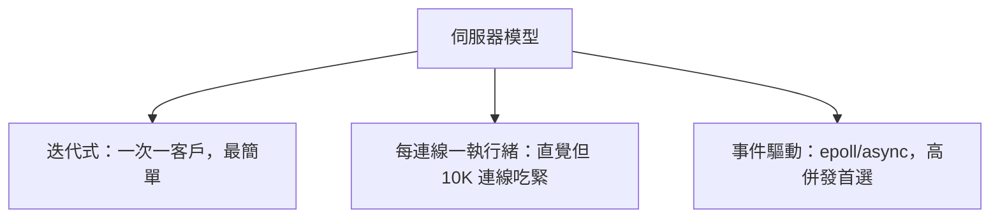

# 4.1 socket 程式設計：TCP/UDP 伺服器與 std::net

## socket 的誕生

1983 年 4.2BSD 引入 socket API（Bill Joy 等人設計，觀念源自 1970 年代 ARPA 網路的研究），一舉統一了 Unix 上的網路與本機 IPC：`socket()` 建立端點、`bind()` 綁位址、`listen()`/`accept()` 接受連線、`connect()` 發起連線。四十年來這組呼叫幾乎原封不動地出現在每台機器上——包括今天你讀這本書的裝置。

TCP（RFC 793, 1981）提供可靠位元組流：三次交握、序號確認、重傳、擁塞控制（1988 年 Van Jacobson 的 slow start，回應 1986 年網路崩潰事件——LBL 到 Berkeley 的吞吐量從 32Kbps 暴跌到 40bps，促成現代 TCP 擁塞控制的誕生）。UDP（RFC 768, 1980）則是「IP 加上埠號」的極簡封包服務。

## 三種伺服器模型



本節先做迭代式與執行緒式（理解模型），事件驅動已在 3.2/3.3 完整涵蓋。

## std::net 的 TCP echo 伺服器

Rust std 從 1.0 起內建 `std::net`（薄包裝 BSD socket API，錯誤轉成 `io::Result`）：

```rust
use std::io::{Read, Write};
use std::net::TcpListener;
use std::thread;

fn main() -> std::io::Result<()> {
    let listener = TcpListener::bind("0.0.0.0:8080")?;
    println!("listening on 8080");
    for stream in listener.incoming() {
        let mut stream = stream?;
        thread::spawn(move || {                 // 每連線一執行緒
            let mut buf = [0u8; 1024];
            loop {
                match stream.read(&mut buf) {
                    Ok(0) => break,             // 對端關閉（EOF）
                    Ok(n) => {
                        if stream.write_all(&buf[..n]).is_err() { break; }
                    }
                    Err(e) => { eprintln!("{e}"); break; }
                }
            }
            // stream drop → 自動 close(fd)
        });
    }
    Ok(())
}
```

與 C 對照，可數出 Rust 消滅的錯誤：

| C 常見錯誤 | Rust 如何防止 |
|---|---|
| 忘記 close fd | `TcpStream` 實作 Drop |
| `recv` 回傳值當長度不檢查 -1 | `io::Result<usize>`，不檢查編譯不過 |
| 對端關閉誤判 | `Ok(0)` 語意明確 |
| sockaddr 結構 cast 錯誤（IPv4/6 大小不同） | `SocketAddr` enum |

其中 sockaddr 的轉型錯誤值得展開：C 的 `accept` 需要你先 `struct sockaddr_storage` 再 cast 成 `sockaddr_in`，型別系統對此完全沉默；Rust 的 `SocketAddr::V4/V6` 是 enum，錯誤的處理路徑根本寫不出來。

## 用 libc 裸寫 socket：看見底層

教學目的，用 libc 實作一次 bind/listen：

```rust
use std::net::Ipv4Addr;

unsafe fn listen(port: u16) -> i32 {
    let fd = libc::socket(libc::AF_INET, libc::SOCK_STREAM, 0);
    assert!(fd >= 0);

    let opt: libc::c_int = 1;   // SO_REUSEADDR：避免 TIME_WAIT 卡住重啟（1984 年 TCP 揮手遺產）
    libc::setsockopt(fd, libc::SOL_SOCKET, libc::SO_REUSEADDR,
                     &opt as *const _ as *const libc::c_void,
                     std::mem::size_of_val(&opt) as u32);

    let addr = libc::sockaddr_in {
        sin_family: libc::AF_INET as u16,
        sin_port: port.to_be(),              // 網路位元組序（大端）！
        sin_addr: libc::in_addr {
            s_addr: u32::from(Ipv4Addr::UNSPECIFIED).to_be(),
        },
        sin_zero: [0; 8],
    };
    let r = libc::bind(fd, &addr as *const _ as *const libc::sockaddr,
                       std::mem::size_of::<libc::sockaddr_in>() as u32);
    assert_eq!(r, 0);
    libc::listen(fd, 128);                   // backlog：核心未 accept 佇列長度
    fd
}
```

位元組序（endianness）是 socket 程式的歷史地雷：1980 年代 Intel（小端）與網路協定（大端）之戰，留下 `htonl/htons` 這組函式。Rust 用 `u16::to_be()` 把轉換變成顯式型別方法，搭配 `Ipv4Addr` 等新式型別（`From` trait），把「忘記轉位元組序」這種 bug 從執行期壞資料變成明顯可見的型別不匹配。

## UDP：無連線的輕量選擇

DNS（1983，Paul Mockapetris）、即時遊戲、串流都用 UDP：沒有交握成本、沒有隊頭阻塞，代價是應用層自管可靠性。

```rust
use std::net::UdpSocket;

fn main() -> std::io::Result<()> {
    let sock = UdpSocket::bind("0.0.0.0:9000")?;
    let mut buf = [0u8; 1500];               // MTU 內，避免 IP 分片
    loop {
        let (n, src) = sock.recv_from(&mut buf)?;
        sock.send_to(&buf[..n], src)?;       // echo
    }
}
```

UDP 的設計啟示：一個封包一個 `recv_from`，訊息有邊界；TCP 的「位元組流」則需要應用層自己定幀（第 4.3 節的 HTTP 解析會遇到：`\r\n\r\n` 分隔 header、Content-Length 分隔 body）。

## 網路位元組序與封包視角

用 `tcpdump` 親眼看三次交握：

```bash
$ sudo tcpdump -i any -n port 8080
IP 192.168.1.5.54321 > 192.168.1.9.8080: Flags [S], seq 1000
IP 192.168.1.9.8080 > 192.168.1.5.54321: Flags [S.], seq 500, ack 1001
IP 192.168.1.5.54321 > 192.168.1.9.8080: Flags [.], ack 501
```

`[S]`（SYN）、`[S.]`（SYN+ACK）、`[.]`（ACK）——1981 年 RFC 793 定義的交握，今天就跑在你剛寫的伺服器上。

## 習題

1. 把 echo 伺服器改成執行緒池版本（固定 4 個 worker + channel 任務佇列），比較 1000 併發下的記憶體用量。
2. 用 libc 版 socket 完成 accept 並回傳 echo，對照 std 版的程式碼量。
3. 寫 UDP 版聊天室（廣播收到訊息給所有已知 peer），思考 UDP 丟包時 UI 會怎麼壞掉。
