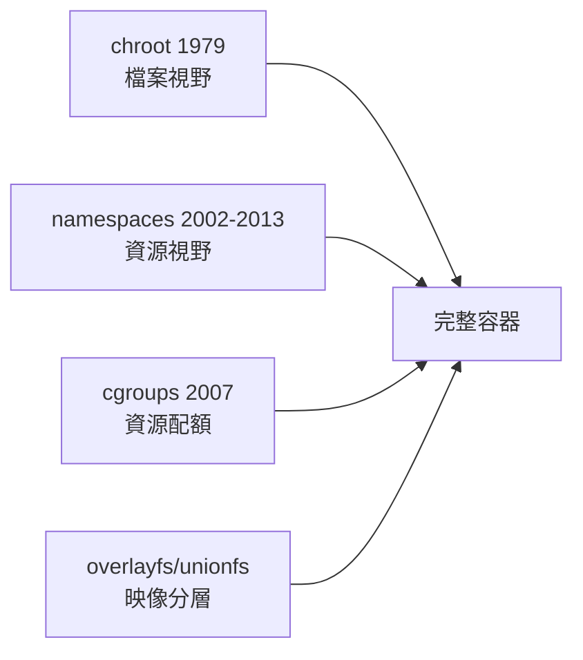

# 5.1 容器技術史：chroot → namespaces（2002）→ cgroups（2007）→ LXC → Docker（2013）

## 起點：chroot（1979）

容器不是 2013 年的發明，而是四十年隔離技術的疊代。第一塊基石是 **chroot**：1979 年隨 Version 7 Unix 出現，1990 年代 FreeBSD 進一步發展 jail（2000 年，欲解決虛擬主機商共用一台機器的隔離需求）。chroot 改變程序的根目錄，讓它「以為」某個子目錄就是 `/`。但它只隔離**檔案系統視野**：程序照樣能看到其他程序、共享網路、共享使用者。單靠 chroot 做出來的「沙箱」歷史上被逃逸無數次（經典手法：利用 chroot 內部仍開著的 fd、`chroot` 之後再 `chdir("..")` 走出，因此 POSIX 規定 chroot 後應 chdir 並再 chroot 一次）。

## namespaces：2002 年的視野切割

真正的轉折在 Linux 2.4.19（**2002 年**）引入第一個 namespace——**mount namespace**（由 Al Viro 實作，受 Plan 9 與 Solaris Zones（2004）啟發），之後逐步補齊：

| namespace | 加入版本/年份 | 隔離什麼 |
|---|---|---|
| mount | 2.4.19 / 2002 | 掛載點視野 |
| UTS | 2.6.19 / 2006 | hostname、domainname |
| IPC | 2.6.19 / 2006 | System V IPC、POSIX 訊息佇列 |
| PID | 2.6.24 / 2008 | 程序號（容器內自己就是 1 號） |
| network | 2.6.29 / 2009 | 網卡、路由表、iptables、埠 |
| user | 3.8 / 2013 | uid/gid 映射（容器內 root ≠ 宿主 root） |
| cgroup | 4.6 / 2016 | cgroup 根視野 |

namespace 的哲學：**每個程序可以有自己的一套「全域資源視野」**。`clone(2)` 加上 `CLONE_NEWPID | CLONE_NEWNET | ...` 就能生成一個活在平行世界的子程序。這是「作業系統層虛擬化」的技術核心——與 VM（hypervisor 虛擬硬體，如 VMware 1998、KVM 2006/2007）完全不同路線：容器共享同一個核心，因此啟動以毫秒計、開銷以個位數百分比計。

## cgroups：2007 年的資源帳本

namespace 解決「看得到什麼」，沒解決「能用多少」。2006 年 Google 工程師 Paul Menage 與 Rohit Seth 開發「process containers」，2007 年更名 **cgroups** 併入 Linux 2.6.24（**2008 年**正式發布）：把程序分組，對每組限制與統計 CPU、記憶體、block I/O 等。cgroup v2（2016，4.6 起，統一階層）是現行標準。systemd（2010 起，Lennart Poettering 主導）把 cgroups 做成服務管理的地基——每個服務天然一個 cgroup。

至此核心零件齊備：

## LXC 與 Docker

**LXC**（LinuX Containers，2010 年前後，由 Canonical/Daniel Lezcano 的成果發展）把 namespace + cgroups 包成 `lxc-create`/`lxc-start` 工具組，但使用門檻高：要自己弄 rootfs、設定網路、理解各種 flag。

**Docker**（2013 年 3 月，Solomon Hykes 在 dotCloud 公司開源，同年 PyCon 演講引爆）的成功不在發明新核心技術——它就是呼叫 LXC（0.9 之後改用 libcontainer，2014 年捐給 OCI 成為 runc 的前身）——而在三個工程決策：

1. **映像分層 + overlayfs**：把 rootfs 做成唯讀層堆疊 + 可寫層，映像可分享、下載增量化（前身是 AUFS，後來 overlayfs 於 2014 年進入 3.18 主線）。
2. **Registry（Docker Hub）**：`docker pull ubuntu`，把「部署環境」變成可版本化的成品。
3. **單一程序哲學 + CLI 體驗**：`docker run -it ubuntu bash`，把數十個系統呼叫封裝成一條命令。

2015 年OCI（Open Container Initiative）成立，Docker、CoreOS、Google 等把容器格式標準化；runc 成為事實上的參考實作。Kubernetes（2014，Google 內部 Borg 的血統）在此地基上把容器變成雲端基礎設施的單位。

## 為什麼用 Rust 造一遍

容器執行器是所有系統呼叫知識的總合考：fork/clone（2.1）、fd 與管線（2.3）、訊號（2.2）、namespace（本章）、cgroups、overlayfs、網路（第 4 章）。而它也是**安全性要求最高的系統軟體之一**——容器逃逸等同主機淪陷。用 Rust 實作的理由與 Linux 核心 2021 年決定接受 Rust 的理由相同：數十萬行的隔離邊界程式碼，每一個記憶體錯誤都是潛在逃逸路徑。市面上已有 Rust 系的容器相關計畫（youki，2021 年由 containers 社群發起的 runc 替代品），本書 5.2/5.3 節將帶你手造一個 500 行的 mini-docker。

## 習題

1. 用 `unshare --pid --fork --mount-proc bash` 建一個 PID namespace，觀察 `ps` 輸出，解釋為什麼需要重新掛 `/proc`。
2. 比較 VM 與容器的啟動時間並實測（`docker run --rm alpine true` vs `kvm`），解釋差異來源。
3. 查 youki 專案：它與 runc 的相容性策略是什麼？
