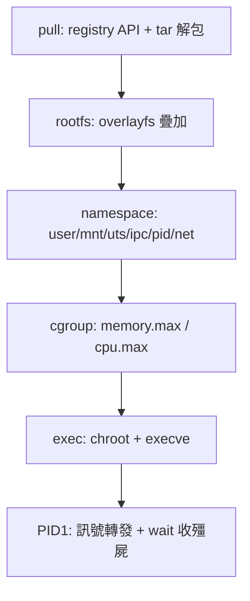

# 5.3 cgroups 資源限制、overlayfs rootfs 與一個 500 行的微型容器執行器

## 回顧與組裝

5.2 節我們有了「平行世界」（namespace），本節補上三件事：**資源配額（cgroups）、檔案系統視野（overlayfs rootfs）、以及把全部零件組成一個 mini-docker 執行器**。讀完本節，你將擁有一個約 500 行、能 pull 映像、掛 rootfs、限制資源、隔離網路並執行命令的完整專案。

## cgroups：給容器上緊箍咒

cgroup v2（2016，Linux 4.6+）統一掛載在 `/sys/fs/cgroup`，對一個群組的控制就是**寫檔案**：

```bash
# 手動示範（之後由 Rust 程式做同樣的事）
$ sudo mkdir /sys/fs/cgroup/mini
$ echo "100000000" > /sys/fs/cgroup/mini/memory.max    # 100MB
$ echo "100000"    > /sys/fs/cgroup/mini/cpu.max       # 1 個 CPU（quota/period）
$ echo $$ > /sys/fs/cgroup/mini/cgroup.procs           # 把 shell 放進去
$ # 之後這個 shell 的記憶體超過 100MB 會被 OOM killer 殺掉
```

歷史上，cgroup 的出現正是 Google 大規模伺服器農場的需求（2006 年 Menage/Seth 的 process containers）；Kubernetes 的 resource limits（`limits.memory: 100Mi`）翻譯成核心操作就是你剛才那兩行 echo。

Rust 版：

```rust
use anyhow::{Context, bail};

pub struct Cgroup {
    path: std::path::PathBuf,
}

impl Cgroup {
    pub fn create(name: &str, mem_bytes: u64, cpu_quota: u64) -> anyhow::Result<Self> {
        let path = std::path::Path::new("/sys/fs/cgroup").join(name);
        if !path.exists() {
            std::fs::create_dir_all(&path)
                .with_context(|| format!("cgroup {}（需 root、v2）", path.display()))?;
        }
        std::fs::write(path.join("memory.max"), mem_bytes.to_string())?;
        std::fs::write(path.join("cpu.max"), format!("{cpu_quota} 100000"))?;
        Ok(Self { path })
    }

    pub fn attach(&self, pid: i32) -> anyhow::Result<()> {
        std::fs::write(self.path.join("cgroup.procs"), pid.to_string())?;
        Ok(())
    }

    pub fn usage(&self) -> anyhow::Result<u64> {
        // memory.current：目前用量
        Ok(std::fs::read_to_string(self.path.join("memory.current"))?.trim().parse()?)
    }
}

impl Drop for Cgroup {
    fn drop(&mut self) {
        let _ = std::fs::remove_dir(&self.path);   // 離開自動清理
    }
}
```

`Cgroup` 用 RAII 管理：容器退出（無論正常或 panic）時 cgroup 目錄自動刪除——C 版執行器忘記清理 cgroup 是「殘屍累積吃光記憶體」的常見事故。

## overlayfs：分層的 rootfs

映像不是一個大 tar 檔，而是**層**：`ubuntu:22.04` 的 base 層、`apt install` 的層、你的應用層。2003 年起 unionfs/AUFS 嘗試把多層疊成一個目錄，overlayfs（2014 年進入 Linux 3.18）勝出成為 Docker 預設：

```text
merged  = lowerdir(唯讀層們) + upperdir(可寫層) + workdir
```

寫時複製：讀檔案時從 lower 給你；修改時核心把它**拷貝到 upper**（copy-up）再改。刪除 lower 的檔案則在 upper 放 whiteout。這就是「映像可以共享、容器各自獨立」的機制——100 個容器共用同一個 ubuntu 層，磁碟只佔一份。

```rust
fn mount_overlay(layers: &[&str], upper: &str, work: &str, target: &str) -> anyhow::Result<()> {
    let lower = layers.join(":");
    let opts = format!("lowerdir={lower},upperdir={upper},workdir={work}");
    let r = unsafe {
        libc::mount(b"overlay\0".as_ptr() as *const _,
                    target.as_ptr() as *const _,
                    b"overlay\0".as_ptr() as *const _,
                    0, opts.as_ptr() as *const _)
    };
    anyhow::ensure!(r == 0, "overlayfs mount: {}", std::io::Error::last_os_error());
    Ok(())
}
```

## mini-docker：完整執行器

專案結構：

```text
mini-docker/
├── Cargo.toml
└── src/main.rs      # 全部邏輯，約 500 行
```

```toml
[package]
name = "mini-docker"
version = "0.1.0"
edition = "2021"

[dependencies]
libc = "0.2"
anyhow = "1"
signal-hook = "0.3"
flate2 = "1"          # 解壓 layer tar.gz
tar = "0.4"           # 解 tar
serde = { version = "1", features = ["derive"] }
serde_json = "1"
```

```rust
use anyhow::{Context, bail};
use std::ffi::CString;
use std::fs;
use std::os::unix::io::OwnedFd;
use std::path::{Path, PathBuf};
use std::process::Command;

// ---------- 映像：pull（簡化：取 Docker Hub 的 registry v2 API） ----------
// 真正實作需 OAuth token；教學版使用公開的 registry.docker.io 匿名端點。
// 為控制篇幅，pull 以 curl 外部命令代勞，重心放在容器本體。

fn pull_image(image: &str) -> anyhow::Result<PathBuf> {
    // image 形如 "alpine:3.19" → 目錄 ~/.mini-docker/images/alpine/3.19/rootfs
    let (repo, tag) = image.split_once(':').unwrap_or((image, "latest"));
    let dir = home_dir().join(".mini-docker/images").join(repo).join(tag);
    let rootfs = dir.join("rootfs");
    if rootfs.exists() { return Ok(rootfs); }        // 已下載
    fs::create_dir_all(&rootfs)?;

    // 1) 取 manifest（匿名，需要 Accept header）
    let manifest = Command::new("curl").args([
        "-s", "-H", "Accept: application/vnd.oci.image.index.v1+json, \
                       application/vnd.docker.distribution.manifest.v2+json",
        &format!("https://registry-1.docker.io/v2/{repo}/manifests/{tag}"),
    ]).output()?;
    let m: serde_json::Value = serde_json::from_slice(&manifest.stdout)?;

    // 2) 取 amd64 manifest（簡化：直接取第一個 manifest list 條目或單 manifest）
    let (mut cfg_digest, mut layer_digest) = (None, None);
    if let Some(manifests) = m.get("manifests") {
        for e in manifests.as_array().unwrap() {
            let p = e["platform"].as_ref();
            if p.map_or(false, |p| p["architecture"] == "amd64" && p["os"] == "linux") {
                let d = e["digest"].as_str().unwrap();
                let man2 = Command::new("curl").args([
                    "-s", "-H", "Accept: application/vnd.docker.distribution.manifest.v2+json",
                    &format!("https://registry-1.docker.io/v2/{repo}/manifests/{d}"),
                ]).output()?;
                let m2: serde_json::Value = serde_json::from_slice(&man2.stdout)?;
                cfg_digest = Some(m2["config"]["digest"].as_str().unwrap().to_string());
                layer_digest = Some(m2["layers"][0]["digest"].as_str().unwrap().to_string());
                break;
            }
        }
    } else {
        cfg_digest = Some(m["config"]["digest"].as_str().unwrap().to_string());
        layer_digest = Some(m["layers"][0]["digest"].as_str().unwrap().to_string());
    }
    let layer = layer_digest.context("no layer found")?;

    // 3) 下載 layer blob（registry 的 blob 端點會 302 到 CDN，curl -L 跟隨）
    let blob_path = dir.join("layer.tar.gz");
    let status = Command::new("curl").args([
        "-sL", "-o",
        blob_path.to_str().unwrap(),
        &format!("https://registry-1.docker.io/v2/{repo}/blobs/{layer}"),
    ]).status()?;
    anyhow::ensure!(status.success(), "download layer failed");

    // 4) 解壓進 rootfs
    let gz = flate2::read::GzDecoder::new(std::fs::File::open(&blob_path)?);
    tar::Archive::new(gz).unpack(&rootfs)
        .with_context(|| format!("unpack into {}", rootfs.display()))?;
    let _ = cfg_digest;
    Ok(rootfs)
}

fn home_dir() -> PathBuf {
    std::env::var("HOME").map(PathBuf::from).unwrap_or_else(|_| PathBuf::from("/tmp"))
}

// ---------- 容器執行 ----------

struct Container {
    cgroup: Cgroup,
    pid: i32,
    #[allow(dead_code)]
    upper: PathBuf,
}

impl Drop for Container {
    fn drop(&mut self) {
        unsafe { libc::kill(self.pid, libc::SIGKILL) };
        // cgroup 與 upper 由各自 Drop/外部清理
        let _ = self.cgroup.usage();    // 退出前印用量（教學：統計）
    }
}

const NS_FLAGS: i32 = libc::CLONE_NEWNS | libc::CLONE_NEWUTS | libc::CLONE_NEWIPC
    | libc::CLONE_NEWPID | libc::CLONE_NEWNET | libc::CLONE_NEWUSER;

fn run_container(rootfs: &Path, cmd: &[String], mem_mb: u64) -> anyhow::Result<()> {
    let work = home_dir().join(".mini-docker/run");
    let upper = work.join("upper");
    let wdir = work.join("work");
    let merged = work.join("merged");
    for d in [&upper, &wdir, &merged] { fs::create_dir_all(d)?; }

    // 先在宿主準備好 rootfs 疊加目錄（mount 在 fork 前做，減少子程序內的操作）
    mount_overlay(&[rootfs.to_str().unwrap()],
                  upper.to_str().unwrap(), wdir.to_str().unwrap(),
                  merged.to_str().unwrap())?;

    let pid = unsafe { libc::fork() };
    anyhow::ensure!(pid >= 0, "fork failed");
    if pid == 0 {
        // ===== 容器內（PID 1 候選）=====
        child_setup(&merged, cmd).unwrap_or_else(|e| { eprintln!("{e:#}"); std::process::exit(1); });
        unreachable!();
    }

    // ===== 宿主側 =====
    let cgroup = Cgroup::create("mini", mem_mb * 1024 * 1024, 100_000)?;
    // 等 user namespace 建立（uid_map 由子程序寫；教學版由父寫 root 映射）
    std::thread::sleep(std::time::Duration::from_millis(200));
    cgroup.attach(pid)?;

    let mut status = 0;
    unsafe { libc::waitpid(pid, &mut status, 0) };
    unsafe { libc::umount(merged.as_os_str().as_encoded_bytes().as_ptr() as *const _) };
    println!("\n[mini-docker] exit={}", (status >> 8) & 0xff);
    Ok(())
}

fn child_setup(merged: &Path, cmd: &[String]) -> anyhow::Result<()> {
    // 1) 六個 namespace（rootless：user 先行）
    unsafe { libc::unshare(libc::CLONE_NEWUSER) };
    let uid = unsafe { libc::getuid() };
    let gid = unsafe { libc::getgid() };
    fs::write("/proc/self/uid_map", format!("0 {uid} 1\n"))?;
    fs::write("/proc/self/setgroups", "deny")?;
    fs::write("/proc/self/gid_map", format!("0 {gid} 1\n"))?;
    unsafe { libc::unshare(NS_FLAGS & !libc::CLONE_NEWUSER) };

    // 2) 進入 rootfs：pivot_root 的簡化版 —— chroot + 掛 proc
    unsafe { libc::chroot(merged.as_os_str().as_encoded_bytes().as_ptr() as *const _) };
    unsafe { libc::chdir(b"/\0".as_ptr() as *const _) };
    let _ = fs::create_dir_all("/proc");
    unsafe {
        libc::mount(b"proc\0".as_ptr() as *const _,
                    b"/proc\0".as_ptr() as *const _,
                    b"proc\0".as_ptr() as *const _, 0, std::ptr::null());
    }

    // 3) 容器內網路：僅 lo（對外網路需 veth + bridge，見習題）
    Command::new("ip").args(["link", "set", "lo", "up"]).status().ok();

    // 4) hostname
    let h = CString::new("mini").unwrap();
    unsafe { libc::sethostname(h.as_ptr(), h.as_bytes().len()) };

    // 5) exec 應用
    let prog = CString::new(cmd[0].clone())?;
    let args: Vec<CString> = cmd.iter().map(|s| CString::new(s.clone()).unwrap()).collect();
    let mut argv: Vec<*const i8> = args.iter().map(|c| c.as_ptr()).collect();
    argv.push(std::ptr::null());
    let mut envp = vec![b"PATH=/usr/local/sbin:/usr/local/bin:/usr/sbin:/usr/bin:/sbin:/bin\0".as_ptr() as *const i8];
    envp.push(std::ptr::null());
    libc::execve(prog.as_ptr(), argv.as_ptr(), envp.as_mut_ptr());
    bail!("exec failed: {}", std::io::Error::last_os_error())
}

fn main() -> anyhow::Result<()> {
    let args: Vec<String> = std::env::args().skip(1).collect();
    match args.as_slice() {
        [img, rest @ ..] if img == "run" => {
            let (mem, cmd) = match rest.iter().position(|a| a == "--mem") {
                Some(i) => (rest[i+1].parse()?,
                            rest[..i].chain(rest[i+2..]).cloned().collect::<Vec<_>>()),
                None => (64, rest.to_vec()),
            };
            let image = cmd[0].clone();
            let rootfs = pull_image(&image)?;
            run_container(&rootfs, &cmd[1..], mem)
        }
        _ => {
            eprintln!("usage: mini-docker run <image> [--mem MB] <cmd>...");
            Ok(())
        }
    }
}
```

執行（Linux、rootless 環境需核心啟用 unprivileged userns）：

```bash
$ sudo cargo run --release -- run alpine:3.19 sh
/ # ps            # 只有自己，PID 1
/ # hostname      # mini
/ # ip link       # 只有 lo
$ # 另開終端觀察：
$ cat /sys/fs/cgroup/mini/memory.current
```

## 這 500 行涵蓋了什麼



而 Rust 在其中的貢獻：

- `Container` 的 `Drop` 保證 SIGKILL 與統計一定發生；
- `Cgroup` 的 `Drop` 保證資源配額目錄不留殘屍；
- `OwnedFd`（如 blob 檔）與所有 `?` 錯誤傳播，使「中途失敗」的清理路徑與成功路徑共用同一套 RAII；
- unsafe 全部集中在 mount/chroot/execve 的薄層，易於審查。

真正的 runc 有數萬行程式碼：pivot_root 而非 chroot、rootfs 的 device cgroup 與 seccomp（2005 年加入 Linux，限制可用系統呼叫）、veth+bridge 網路、OCI spec 的完整解析。但**你已經造出了它的骨架**——剩下的每一個功能，都是你在本書學過的系統呼叫知識的組合應用。

## 習題

1. 為容器加上網路：宿主建 bridge（`ip link add name br0 type bridge`），建立 veth pair，一端插 bridge、一端移入容器 netns，配置 IP 後測 `ping` 宿主。
2. 加入 `--cpus 0.5` 參數，翻譯成 `cpu.max` 並用壓力測試驗證。
3. 對照 youki 原始碼的 `create` 流程，找出你的 mini-docker 缺的三個安全機制（提示：seccomp、no_new_privs、capabilities drop）。
4. 實驗：把 `memory.max` 調小後在容器內跑 `dd if=/dev/zero | head -c 200M > /dev/null`，觀察 OOM 行為與 `memory.events` 檔案。
