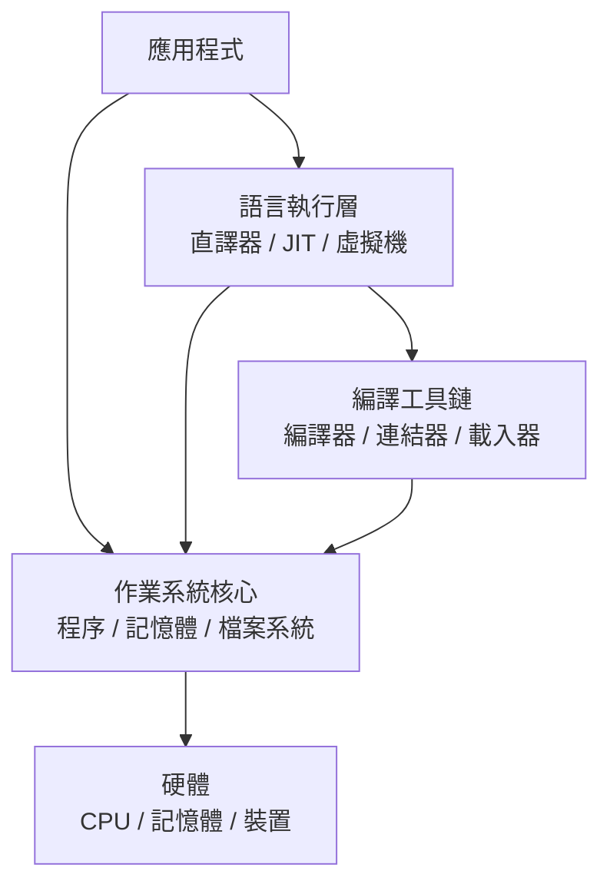
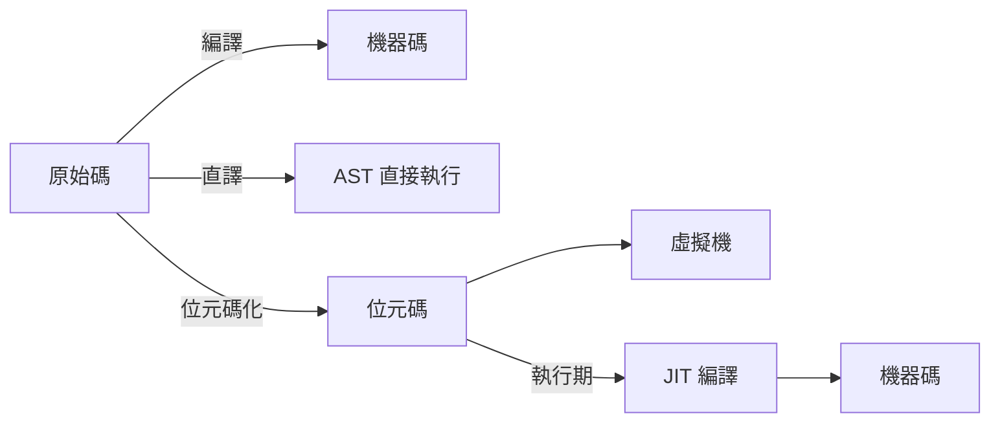
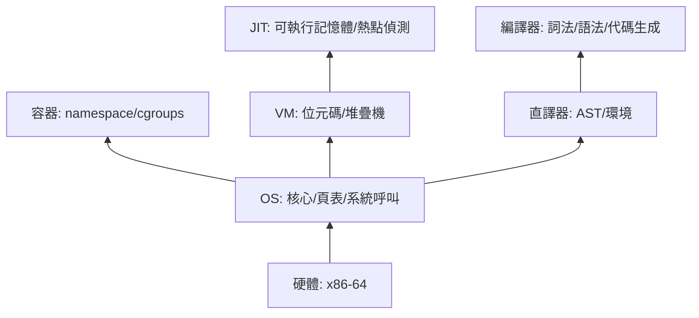

# 1.1 系統軟體的階層地圖與驅動關係

## 什麼是系統軟體

系統軟體（system software）是「讓其他程式能夠執行」的程式。與之相對的是應用軟體——幫使用者解決問題的程式。這個區分來自 1960 年代 IBM System/360 的行銷術語，但背後的階層結構可以畫成一張圖：



關鍵在於：**每一層都是用下一層的介面寫出來的，而每一層又成為上一層的基礎**。這就是「驅動關係」。

## 四種「跑起來一段程式」的方法

同一段高階語言程式碼，可以被四種系統軟體執行，這四種執行方式正是本書第 2 到第 5 章的主軸：

| 方式 | 產物 | 例子 | 執行速度 | 啟動速度 |
|------|------|------|----------|----------|
| 編譯器 | 機器碼 | gcc, rustc | 最快 | 慢（需先編譯） |
| 直譯器 | 直接執行 AST | 早期 Python, Ruby | 最慢 | 快 |
| 位元碼 VM | 中間位元碼 | JVM, CPython | 中等 | 中等 |
| JIT | 執行期機器碼 | V8, JVM HotSpot | 接近編譯 | 快 |



歷史上這四種方式不是並列選項，而是**互相驅動演化出來的**：

1. 1950 年代：直接寫機器碼，太痛苦 → **編譯器誕生**（FORTRAN, 1957）
2. 1958 年：LISP 想要動態型別與函數當值 → 編譯太難 → **直譯器誕生**（eval 的原始實作）
3. 直譯器太慢 → 把 AST 預先轉成簡單指令 → **位元碼 VM**（BCPL 的 O-code, 1966；Smalltalk-80, 1980）
4. 位元碼 VM 還是慢 → 執行期把熱門位元碼編成機器碼 → **JIT**（Self, 1989 → HotSpot, 1999 → V8, 2008）

這條演化鏈的每一環，都是「上一代技術的效能瓶頸」驅動出來的。本書會沿著這條鏈，用 Rust 把每一代都寫一遍。

## 底層：作業系統與容器

無論直譯器、JIT 或 VM，最後都必須向作業系統要資源：

- **記憶體**：JIT 需要向核心申請「可寫又可執行」的記憶體頁（第 4 章），這正是 2017 年 Linux 加入 W^X 保護後 JIT 必須改寫的原因
- **程序與執行緒**：VM 的 GC 需要停掉所有執行緒（stop-the-world），靠的是核心的訊號機制
- **系統呼叫**：`execve` 是一切的起點——載入器把編譯好的程式變成程序

而作業系統本身在 2013 年之後又長出了新的一層：**容器**。Docker 的本質不是虛擬機，而是用 Linux 的 `namespace` 與 `cgroups` 把「一個程序」包裝成「看起來像一台機器」。容器與 VM 的差別是理解現代雲端架構的關鍵，我們在第 5 章與第 7 章會對比。

## 為什麼用 Rust

寫系統軟體需要三種能力，歷史上沒有一門語言同時具備：

1. **控制記憶體**（C 有）——JIT 要手動管理可執行記憶體，OS 要管理頁表
2. **高階抽象**（LISP 有）——編譯器要處理複雜的語法樹與代數轉換
3. **防止錯誤**（都沒有）——系統軟體的 bug 會影響所有上層程式

Rust 用所有權系統把三種能力合而為一：

```rust
// 同一段 Rust 程式碼，可以同時做「高階抽象」與「低階控制」
let ast = parser::parse(source)?;        // 高階：型別安全的語法樹
let code = backend::compile(&ast)?;      // 中層：中間表示轉換
let page = MmapMut::map_mut_exec(len)?;  // 低階：mmap 可執行記憶體
page[..code.len()].copy_from_slice(&code);
```

更重要的歷史事實是：Rust 本身已經成為新系統軟體的事實標準後端——

- **Cranelift**（Wasmtime 的 JIT 後端）是 Rust 寫的
- **Wasmtime**（WebAssembly 執行器）是 Rust 寫的
- **Rust for Linux**（2022 年起進入 Linux 核心）用 Rust 寫驅動
- **Youki**（Rust 寫的容器執行器，相容 OCI 規格）是 Docker/runc 的挑戰者

所以「用 Rust 學系統軟體」不只是教學選擇，而是**直接使用工業界正在使用的那套工具**。

## 本書的信任鏈



讀完本書，你將擁有一條完整的鏈：從一段文字原始碼開始，親手把它變成語法樹（第 2 章）、變成位元碼（第 3 章）、在自製 VM 裡執行（第 5 章）、在執行期編成機器碼（第 4 章），最後把整個執行環境裝進自製的容器（第 7 章），並理解撐住這一切的核心機制（第 6 章）。

## 習題

1. 畫出你日常使用的一種語言（例如 Python 或 JavaScript）的完整執行路徑，標出它經過哪些層。
2. 為什麼 1958 年的 LISP 選擇直譯而不是編譯？（提示：動態型別、`eval`、garbage collection）
3. 容器與虛擬機的隔離原理有何本質差別？哪一層的「信任假設」更多？
