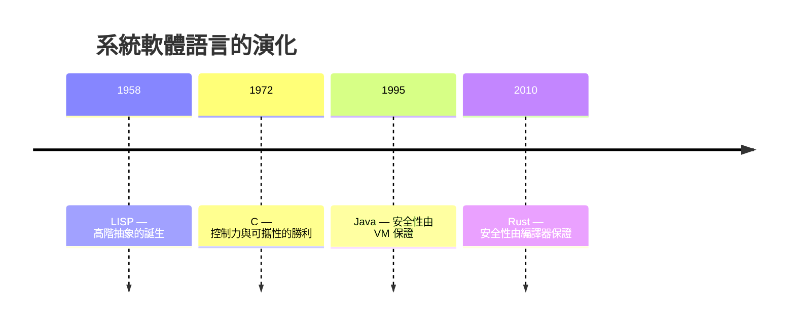

# 1.2 1958-LISP 到 2010-Rust：為何系統軟體需要新的語言

## 語言史的四次浪潮

系統軟體的語言選擇，由兩個互相拉扯的需求驅動：**控制力**（直接操作記憶體與硬體）與**安全性**（不出記憶體錯誤）。回顧歷史，這兩者的組合經歷了四次浪潮：



### 1958：LISP——抽象的誕生

John McCarthy 在 MIT 為了 AI 研究（符號運算、遞迴、函數當值）設計 LISP。它的核心概念：

- 一切皆列表，程式即資料（`eval` 可以吃 `quote` 出來的程式）
- 動態型別：不必事先宣告變數型別
- 自動記憶體管理：garbage collection 誕生於此

這些抽象太超前，1958 年的硬體（真空管、幾 KB 記憶體）無法有效編譯它們，所以 LISP 選了直譯路線——這是直譯器與 JIT（LISP 的後裔 Self 造出 JIT）共同的起源。

### 1972：C——控制力的勝利

Unix 需要可攜（能在 PDP-7、PDP-11 之間搬家），組合語言做不到。Dennis Ritchie 的 C 是「可攜的組合語言」：

- 指標直接對應位址
- `struct` 對應記憶體佈局
- 編譯器只做薄薄一層翻譯，效能與手寫組語相當

Unix 從此用 C 重寫，作業系統 = C 成了五十年的固定搭配。**代價是安全性**：指標可以亂指，緩衝區溢位、use-after-free 成為系統軟體的頭號 bug 來源。1988 年的 Morris 蠕蟲就是靠 fingerd 的緩衝區溢位蔓延全網——用 C 寫的系統軟體第一次證明自己可以成為攻擊面。

### 1995：Java——用 VM 買安全

Sun 的答案：別用 C 的語言寫應用，改用跑在虛擬機上的 Java。安全性由 VM 保證（bytecode verifier、GC、型別檢查都在執行期做）。

代價是：**VM 本身還是用 C 寫的**。HotSpot JVM、V8、CPython——所有主流語言執行器的底層都是 C/C++，bug 只是被推到更深一層。而且 VM 有開銷：啟動慢、記憶體占用大，不適合作業系統與系統工具。

### 2010：Rust——把安全搬進編譯器

Mozilla 為了重寫瀏覽器引擎（Firefox 的 C++ 程式碼庫有數百萬行，其中約 70% 的安全性 bug 是記憶體錯誤），在 2010 年由 Graydon Hoare 開始設計 Rust，2015 年發布 1.0。

Rust 的革命性主張：**記憶體安全不需要 GC、不需要 VM，由編譯器在編譯期用型別系統證明**。核心機制是所有權（ownership）：

```rust
fn main() {
    let s = String::from("hello");
    let t = s;              // 所有權移轉，s 從此無效
    // println!("{}", s);   // 編譯錯誤！use-after-free 在編譯期被擋下
    println!("{}", t);
}
```

規則只有三條：
1. 每個值有唯一的所有者
2. 所有者被 drop（離開作用域）時，值被釋放
3. 借用（reference）要嘛多個不可變（`&T`），要嘛唯一一個可變（`&mut T`）

第三條直接消滅了 C 的兩大殺手：dangling pointer（借用不會活過所有者）與 data race（並行時的 `Send`/`Sync` 型別檢查）。

## 為什麼系統軟體需要 Rust

用 C/C++ 寫系統軟體五十年的結果，微軟與 Google 各自的統計：

| 來源 | 統計 |
|------|------|
| Microsoft (2019) | 約 70% 的嚴重安全性 bug 是記憶體安全問題 |
| Google Chromium (2020) | 約 70% 的嚴重安全性 bug 是記憶體安全問題 |
| Android (2021) | 記憶體安全 bug 佔比從 76% 降到 35%（Rust 程式碼占比上升後） |

這不是巧合，而是 C 型別系統的結構性缺陷：它沒有任何機制阻止你把指標用錯。系統軟體又是所有軟體的底座——核心、語言執行器、容器執行器的 bug 影響面最大。

Rust 出現後，新世代的系統軟體幾乎都選了它：

- **作業系統**：Rust for Linux（2022 進入主線核心 6.1）、Redox OS
- **語言執行器**：Cranelift（JIT 後端）、Wasmtime、swc、rustc 本身
- **容器**：youki（Rust 實作的 OCI 容器執行器，runc 的替代品）
- **基礎設施**：Cloudflare Pingora、Datadog Vector、Linux 的 eBPF 工具 aya

## 所有權如何映射到系統概念

本書各章都會反覆用到同一個直覺：**Rust 的所有權語義，剛好對應系統資源的生命週期語義**。

| 系統資源 | C 的做法 | Rust 的做法 |
|----------|----------|-------------|
| 堆積記憶體 | `malloc`/`free` 手動配對 | `Box<T>`，drop 自動釋放 |
| 檔案描述器 | `open`/`close` 忘記 close 就洩漏 | `File` 實作 `Drop`，離開作用域自動 close |
| mmap 記憶體 | `mmap`/`munmap` 手動配對 | `MmapMut`（memmap2 crate），drop 自動 `munmap` |
| mutex 鎖 | `pthread_mutex_lock`/`unlock` 忘記 unlock 就死鎖 | `MutexGuard`，離開作用域自動 unlock |

這個對應就是 RAII（Resource Acquisition Is Initialization）——C++ 早就有的概念，但 C++ 沒有所有權檢查，所以 RAII 只能防「忘記釋放」，防不了「釋放後又使用」。Rust 的借用檢查把兩邊都防住了。

## unsafe：安全的邊界

寫 JIT 與 OS 一定會碰到編譯器無法驗證的操作（寫機器碼到記憶體、讀寫頁表）。Rust 的答案是 `unsafe` 區塊：

```rust
unsafe {
    // 只有這裡允許解引用裸指標、呼叫不安全的外部函式
    // 責任明確地落在這幾行，而不是整個程式碼庫
    let x = *ptr;
}
```

`unsafe` 不是「關掉安全檢查」，而是「宣告：這一小段程式碼的安全性由我人工保證」。這讓安全審計的範圍從整個程式碼庫縮小到少數標記過的區塊——正好符合系統軟體的分層結構：unsafe 集中在靠近硬體的薄層，其餘全是安全程式碼。

## 習題

1. LISP 為什麼選直譯？C 為什麼能取代組合語言寫 Unix？兩者的驅動需求分別是什麼？
2. 寫一段 C 程式造成 use-after-free，再寫對應的 Rust 程式，觀察 Rustc 的錯誤訊息。
3. 為什麼 JVM 用 C 寫是個問題？「用 VM 保證安全」的假設在哪裡斷掉？
