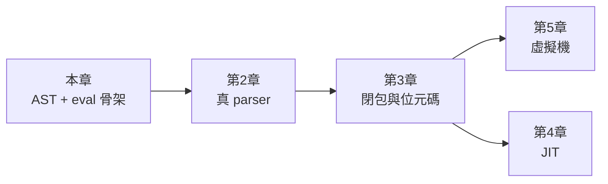

# 1.3 用 Rust 實作一個最小語言來貫穿全書

## 目標：設計語言 MinLang

本書後續六章都會反覆使用同一個例子語言 **MinLang**——一個只有整數算術、變數、`let` 綁定與函式呼叫的迷你語言。它小到可以三百行寫完一個完整實作，又大到足以展示編譯器、直譯器、VM、JIT 的每一個概念。

語法如下（也是第 2 章要解析的目標）：

```
let x = 3 + 4 * 2;      // 變數綁定，* 優先於 +
let add = fn(a, b) { a + b };
add(x, 10)              // 函式呼叫
```

## 第一步：定義 AST

所有四種執行方式（編譯、直譯、VM、JIT）都從同一個 AST 出發。用 Rust 的 enum 表達語法樹是最自然的：

```rust
// src/ast.rs
#[derive(Debug, Clone, PartialEq)]
pub enum Expr {
    Num(i64),
    Var(String),
    BinOp { op: BinOp, lhs: Box<Expr>, rhs: Box<Expr> },
    Let { name: String, value: Box<Expr>, body: Box<Expr> },
    Call { func: String, args: Vec<Expr> },
    If { cond: Box<Expr>, then_e: Box<Expr>, else_e: Box<Expr> },
}

#[derive(Debug, Clone, Copy, PartialEq)]
pub enum BinOp { Add, Sub, Mul, Div, Lt, Eq }
```

注意 Rust 的兩個型別設計選擇如何服務系統軟體：

1. **`Box<Expr>`**：語法樹是遞迴型別，大小無限，必須經由指標（Box）斷開遞迴。C 語言寫 AST 要手動 `malloc` 每個節點，忘記 `free` 就洩漏；Rust 的 Box 讓「釋放整棵樹」變成 drop 一個變數的事。
2. **enum + pattern matching**：後續所有遍歷（直譯的 `eval`、編譯的 `compile`、VM 的 `emit`）都會對 enum 做 `match`。Rust 編譯器會檢查 match 的完備性——**新增一種語法（例如 `While`）而忘記在直譯器裡處理，編譯直接失敗**。這對編譯器寫作者是巨大助益：語法樹的擴充被型別系統強制傳播到所有消費者。

## 第二步：詞法分析（本節先給骨架，第 2 章完整實作）

```rust
// src/lexer.rs
#[derive(Debug, Clone, PartialEq)]
pub enum Token {
    Num(i64), Ident(String),
    Plus, Minus, Star, Slash, Lt, EqEq,
    LParen, RParen, LBrace, RBrace,
    Semi, Comma,
    Let, Fn, If, Else,
}
```

## 第三步：先寫一個最簡單的直譯器（第 3 章的預覽）

「直譯」最直白的定義：**直接在 AST 上遞迴求值**。這是 1958 年 LISP `eval` 的原始形態：

```rust
// src/interp.rs
use std::collections::HashMap;
use crate::ast::*;

pub fn eval(expr: &Expr, env: &mut HashMap<String, i64>) -> Result<i64, String> {
    match expr {
        Expr::Num(n) => Ok(*n),
        Expr::Var(name) => env.get(name).copied()
            .ok_or_else(|| format!("undefined variable: {name}")),
        Expr::BinOp { op, lhs, rhs } => {
            let l = eval(lhs, env)?;
            let r = eval(rhs, env)?;
            apply(*op, l, r)
        }
        Expr::Let { name, value, body } => {
            let v = eval(value, env)?;
            let old = env.insert(name.clone(), v);   // 進入作用域
            let result = eval(body, env)?;
            match old {
                Some(o) => { env.insert(name.clone(), o); }  // 恢復
                None => { env.remove(name); }
            }
            Ok(result)
        }
        _ => Err("not supported yet".into()),
    }
}

fn apply(op: BinOp, l: i64, r: i64) -> Result<i64, String> {
    match op {
        BinOp::Add => Ok(l.wrapping_add(r)),
        BinOp::Sub => Ok(l.wrapping_sub(r)),
        BinOp::Mul => Ok(l.wrapping_mul(r)),
        BinOp::Div if r == 0 => Err("division by zero".into()),
        BinOp::Div => Ok(l / r),
        BinOp::Lt => Ok((l < r) as i64),
        BinOp::Eq => Ok((l == r) as i64),
    }
}
```

注意 Rust 如何處理這裡的三個系統性問題：

1. **錯誤處理**：除以零、未定義變數——直譯器是所有層中最早遇到錯誤的地方。Rust 的 `Result<i64, String>` 用型別強迫呼叫者處理錯誤，不像 C 的 errno 容易被忘記。
2. **環境（env）**：`HashMap<String, i64>` 就是作用域。`Let` 的實作展示了作用域的進入與退出——這正是函式呼叫幀（stack frame）的本質，第 3.2 章會把它升級成真正的環境鏈。
3. **所有權與借用**：`eval(&Expr, &mut HashMap)` ——AST 用唯讀借用（多個直譯器執行緒可以共用同一棵樹），環境用可變借用（同一時刻只有一個執行緒能寫環境）。這正是 Rust 型別系統對「語法樹共享、狀態獨佔」這個直譯器本質結構的表達。

## 專案結構

本書的程式碼共用一個 cargo 專案，逐步擴充：

```
minlang/
├── Cargo.toml
└── src/
    ├── main.rs      # REPL 或讀檔執行
    ├── ast.rs       # 語法樹（本章）
    ├── lexer.rs     # 詞法分析（本章骨架，第2章完整）
    ├── parser.rs    # 語法分析（第2章）
    ├── interp.rs    # 樹直譯器（本章預覽，第3章完整）
    ├── compiler.rs  # AST → 位元碼（第3章）
    ├── vm.rs        # 位元碼虛擬機（第5章）
    └── jit.rs       # JIT 編譯（第4章）
```

```toml
# Cargo.toml
[package]
name = "minlang"
version = "0.1.0"
edition = "2021"
```

## 先跑起來：一個能算數的 REPL

```rust
// src/main.rs（暫時用假 parser，只認單一數字）
mod ast;
mod lexer;
mod interp;

use std::io::{self, Write};
use std::collections::HashMap;

fn main() {
    let mut env = HashMap::new();
    loop {
        print!(">> ");
        io::stdout().flush().unwrap();
        let mut line = String::new();
        if io::stdin().read_line(&mut line).unwrap() == 0 { break; }
        let line = line.trim();
        if line.is_empty() { continue; }
        if let Ok(n) = line.parse::<i64>() {
            let ast = ast::Expr::Num(n);
            match interp::eval(&ast, &mut env) {
                Ok(v) => println!("{}", v),
                Err(e) => println!("error: {}", e),
            }
        } else {
            println!("parse error");
        }
    }
}
```

```
$ cargo run
>> 42
42
>> 0
0
```

現在它只會回顯數字，但整個管線——輸入 → AST → eval → 輸出——已經通了。接下來每一章都是把這條管線的某一段升級：



## 習題

1. 在 `Expr` 加入 `Unary(Minus)`，觀察 `interp.rs` 哪裡編譯失敗——體驗 enum 完備性檢查。
2. 把 `eval` 改成回傳 `Result<i64, EvalError>`，自訂 `EvalError` enum（除零、未定義變數兩種），取代 `String`。
3. 為什麼 AST 節點要 `Clone`？如果改成每次求值都重建樹，會有什麼問題？
