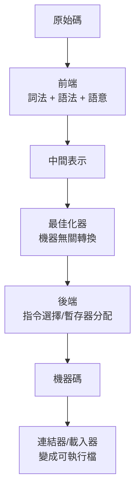

# 2.1 1940-1970：從機器碼到最佳化編譯器

## 前提：1940 年代，程式就是機器碼

最早的電腦（ENIAC, 1945；EDSAC, 1949）沒有語言，程式以數字形式直接輸入機器——撥開關、打孔帶。寫一個兩數相加，你得記住機器的操作碼編號、暫存器編號與記憶體位址。1947 年 Kathleen Booth 為了讓 ARC2 的程式可讀，提出**組合語言**：用助記符（`ADD`）代替數字操作碼，用符號位址代替數字位址。組合器（assembler）做的是一對一的文字翻譯。

組合語言解決了「可讀」，沒解決「可攜」與「抽象」：每種機器的指令集不同，而且寫 `x = a*b + c` 仍要拆成數條指令、自己分配暫存器。

## 1952-1957：自動編程的嘗試與 FORTRAN 的突破

1952 年 Grace Hopper 的 A-0 與 1954 年的 IBM 701 自動編程系統，是第一批「翻譯器」，但生成的程式碼效率低，工程師寧願手寫組語。當時的共識是：**編譯器的開銷不可接受**。

打破共識的是 1957 年 John Backus 團隊的 FORTRAN。他們的目標很明確（Backus 1957 年論文〈The FORTRAN Automatic Coding System〉）：生成的程式碼必須接近手寫組語，否則沒人會用。為此 FORTRAN 團隊發明了編譯器的現代結構：

關鍵創新是**中間表示（IR）**：不直接從語法樹生成組語，而是先轉成一種「介於語言與機器之間」的形式，在上面做機器無關的轉換（常數摺疊、死碼刪除），最後才做機器相關的代碼生成。這個「前端—IR—後端」的分層，是直到今天 LLVM、Cranelift 都在用的架構。

## 1958-1960：語法理論的成熟

FORTRAN 的成功讓「程式語言」成為學術領域，緊接著需要的是**精確描述語法**的數學工具：

- **1956 年，Chomsky 階層**：Noam Chomsky 在語言學研究中提出形式文法階層。第 2 型（context-free grammar，CFG）恰好描述了大多數程式語言的結構。
- **1960 年，BNF**：Backus（FORTRAN）與 Peter Naur（ALGOL 60 報告）把 CFG 引入程式語言規格，ALGOL 60 報告成為第一個用形式文法定義語法的語言。
- **1961 年，遞迴下降**：直觀的由上而下解析法，每個非終端符號對應一個函式——這正是第 2.2 節我們在 Rust 裡要寫的東西。
- **1965 年，LR 分析**：Donald Knuth 提出自下而上的 LR 分析，能處理更多文法但難以手工實作，催生了 1975 年的 yacc（表驅動的解析器產生器）。

歷史的驅動關係：**語言越複雜，語法分析越難，於是誕生了「解析器產生器」這個工具族**（yacc/bison, ANTLR, LALRPOP——後者是 Rust 寫的）。但手工遞迴下降從未消失：手寫的解析器錯誤訊息更好、更好維護，gcc、rustc、V8 都是手寫解析器。

## 1960-1970：最佳化與後端的成型

ALGOL 60 帶來作用域與巢狀函式，迫使編譯器處理新問題：

| 年代 | 問題 | 解法 | 今日對應 |
|------|------|------|----------|
| 1960 | 巢狀作用域 | 符號表堆疊 | 我們第 3.2 節的環境鏈 |
| 1961 | 運算式求值順序 | 語法樹後序遍歷 | `eval` 的遞迴結構 |
| 1962 | 暫存器不足 | 圖著色暫存器分配（Chaitin, 1982 成熟） | LLVM 的 regalloc |
| 1966 | BCPL 的 O-code | 位元碼 IR → 位元碼直譯器 | JVM、CPython |
| 1970 | 迴圈最佳化 | 資料流分析 | LLVM 的 pass 系統 |

特別注意 BCPL（Martin Richards, 1966）：它先編譯成名為 O-code 的位元碼，再用一個小直譯器執行——目的是**可攜性**（把 90% 的編譯工作做成機器無關，換機器只需重寫小直譯器或小後端）。這正是「編譯器技術孕育了虛擬機」的歷史證據：Pascal 的 P-code（1970s）、Smalltalk-80、Java JVM，全是 BCPL 思路的直系後裔。

## 結構確定：三段式架構

到 1970 年，編譯器的三段式架構已經定型，並且驅動了整個軟體工具鏈的形態：

這個架構的經濟學：n 種語言 × m 種機器，只需 n 個前端 + m 個後端，而非 n×m 個編譯器。GCC、LLVM 都靠這個經濟學壯大。LLVM（2000，Chris Lattner）更進一步把 IR 做成函式庫，讓 JIT 也能用編譯器後端——這是第 4 章 Cranelift 的直接前身。

## 為什麼這段歷史對寫編譯器的人重要

每一層結構都是被上一層的痛點逼出來的：

1. 手寫機器碼太痛苦 → 詞法/語法分析自動化
2. 生成的碼太慢 → 中間表示 + 最佳化
3. 換機器要重寫全部 → 前後端分離
4. 語法越來越複雜 → 文法理論 + 解析器產生器
5. 編譯整個程式太慢、互動開發需要 → 直譯與 JIT（第 3、4 章）

用 Rust 實作時你會發現同樣的對應：Rust 的 enum 給你 AST 的完備性檢查（痛點 1）、trait 給你前後端解耦（痛點 3）、型別系統給你 IR 的型別安全（痛點 2）。

## 習題

1. FORTRAN 團隊為什麼堅持「生成碼要接近組語」？如果達不到會怎樣？
2. BCPL 的 O-code 解決了什麼問題？它與 JVM 的動機有何異同？
3. 寫出 `x = a*b + c` 在堆疊機器上的組語（push/pop 形式），體會「需要 IR」的感覺。
