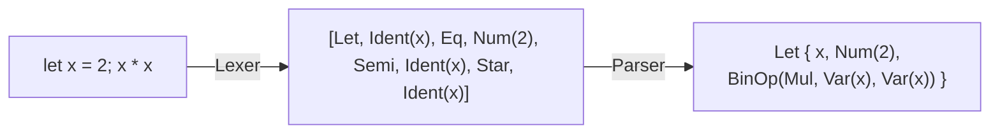

# 2.2 詞法分析與解析器組合子

## 本節目標

用 Rust 從零寫出 MinLang 的完整前端：字元流 → token 流 → AST。採用**手寫遞迴下降**（1961 年的路線），因為它讓你真正理解語法分析的本質，也是 rustc、V8 的實際做法。

## 詞法分析：字元流 → token 流

詞法分析理論上由正規語言（Chomsky 第 3 型）描述，可用有限自動機實作。但手寫版本更簡單：掃描字元、依首字元分派。

```rust
// src/lexer.rs
use crate::ast::BinOp;

#[derive(Debug, Clone, PartialEq)]
pub enum Token {
    Num(i64),
    Ident(String),
    Plus, Minus, Star, Slash,
    Lt, Eq, EqEq,
    LParen, RParen, LBrace, RBrace,
    Semi, Comma,
    Let, Fn, If, Else,
}

pub struct Lexer {
    chars: Vec<char>,
    pos: usize,
}

impl Lexer {
    pub fn new(src: &str) -> Self {
        Lexer { chars: src.chars().collect(), pos: 0 }
    }

    pub fn tokenize(mut self) -> Result<Vec<Token>, String> {
        let mut toks = Vec::new();
        loop {
            self.skip_ws();
            if self.pos >= self.chars.len() {
                toks.push(Token::EOF_PLACEHOLDER); // 見下：實際用 Option
                break;
            }
            toks.push(self.next_token()?);
        }
        Ok(toks)
    }
}
```

實務上更好的做法是 `next_token` 回傳 `Option<Token>`，讓「結束」以型別表達，而不是假 token。接下來是關鍵的分派邏輯：

```rust
impl Lexer {
    fn next_token(&mut self) -> Result<Option<Token>, String> {
        match self.peek() {
            None => Ok(None),
            Some(c) if c.is_ascii_digit() => self.number().map(Some),
            Some(c) if c.is_alphabetic() || c == '_' => self.ident_or_kw().map(Some),
            Some('+') => { self.bump(); Ok(Some(Token::Plus)) }
            Some('-') => { self.bump(); Ok(Some(Token::Minus)) }
            Some('*') => { self.bump(); Ok(Some(Token::Star)) }
            Some('/') => { self.bump(); Ok(Some(Token::Slash)) }
            Some('=') => {
                self.bump();
                if self.peek() == Some('=') { self.bump(); Ok(Some(Token::EqEq)) }
                else { Ok(Some(Token::Eq)) }
            }
            Some('(') => { self.bump(); Ok(Some(Token::LParen)) }
            Some(')') => { self.bump(); Ok(Some(Token::RParen)) }
            Some('{') => { self.bump(); Ok(Some(Token::LBrace)) }
            Some('}') => { self.bump(); Ok(Some(Token::RBrace)) }
            Some(';') => { self.bump(); Ok(Some(Token::Semi)) }
            Some(',') => { self.bump(); Ok(Some(Token::Comma)) }
            Some(c) => Err(format!("unexpected character: '{c}'")),
        }
    }

    fn peek(&self) -> Option<char> {
        self.chars.get(self.pos).copied()
    }

    fn bump(&mut self) -> Option<char> {
        let c = self.peek();
        if c.is_some() { self.pos += 1; }
        c
    }

    fn skip_ws(&mut self) {
        while matches!(self.peek(), Some(c) if c.is_whitespace()) { self.pos += 1; }
    }

    fn number(&mut self) -> Result<Token, String> {
        let mut n: i64 = 0;
        while let Some(c) = self.peek() {
            if !c.is_ascii_digit() { break; }
            n = n.checked_mul(10).and_then(|x| x.checked_add((c as u8 - b'0') as i64))
                .ok_or("number too large")?;
            self.pos += 1;
        }
        Ok(Token::Num(n))
    }

    fn ident_or_kw(&mut self) -> Result<Token, String> {
        let start = self.pos;
        while let Some(c) = self.peek() {
            if c.is_alphanumeric() || c == '_' { self.pos += 1; } else { break; }
        }
        let s: String = self.chars[start..self.pos].iter().collect();
        Ok(match s.as_str() {
            "let" => Token::Let,
            "fn" => Token::Fn,
            "if" => Token::If,
            "else" => Token::Else,
            _ => Token::Ident(s),
        })
    }
}
```

值得注意的 Rust 細節：`number` 用 `checked_mul`/`checked_add` 處理溢位——詞法分析器是最早接觸不可信輸入的程式碼，惡意的超長數字不能讓它 panic 或繞回。C 寫法 `n = n*10 + digit` 會默默溢位，這正是語言層面安全差異的縮影。

## 語法分析：遞迴下降

MinLang 的文法（BNF 形式）：

```text
expr    ::= let | if | or
let     ::= "let" IDENT "=" expr ";" expr
if      ::= "if" expr "{" expr "}" "else" "{" expr "}"
or      ::= and ("||" and)*
and     ::= cmp ("&&" cmp)*
cmp     ::= add (("==" | "<") add)?
add     ::= mul (("+" | "-") mul)*
mul     ::= unary (("*" | "/") unary)*
unary   ::= "-" unary | call
call    ::= primary ("(" args ")")?
primary ::= NUM | IDENT | "(" expr ")"
args    ::= ε | expr ("," expr)*
```

優先級（`*` 高於 `+`）直接編碼在文法的層級裡——這是遞迴下降的精髓：**每個優先級一層函式**。`let` 作為運算式而非敘述（像 Rust 自己），讓作用域可以用運算式樹表達，後面章節處理起來簡單得多。

```rust
// src/parser.rs
use crate::ast::{BinOp, Expr};
use crate::lexer::{Lexer, Token};

pub struct Parser {
    toks: Vec<Token>,
    pos: usize,
}

pub type PResult<T> = Result<T, String>;

impl Parser {
    pub fn new(src: &str) -> PResult<Self> {
        let toks = Lexer::new(src).tokenize()?;
        Ok(Parser { toks, pos: 0 })
    }

    pub fn parse(&mut self) -> PResult<Expr> {
        let e = self.expr()?;
        if self.pos < self.toks.len() {
            return Err(format!("unexpected token: {:?}", self.toks[self.pos]));
        }
        Ok(e)
    }

    fn peek(&self) -> Option<&Token> { self.toks.get(self.pos) }
    fn bump(&mut self) -> Option<Token> {
        let t = self.toks.get(self.pos).cloned();
        if t.is_some() { self.pos += 1; }
        t
    }
    fn expect(&mut self, t: &Token) -> PResult<()> {
        match self.bump() {
            Some(x) if &x == t => Ok(()),
            Some(x) => Err(format!("expected {t:?}, got {x:?}")),
            None => Err(format!("expected {t:?}, got EOF")),
        }
    }

    fn expr(&mut self) -> PResult<Expr> {
        match self.peek() {
            Some(Token::Let) => self.let_expr(),
            Some(Token::If) => self.if_expr(),
            _ => self.or(),
        }
    }

    fn let_expr(&mut self) -> PResult<Expr> {
        self.bump(); // let
        let name = match self.bump() {
            Some(Token::Ident(s)) => s,
            t => return Err(format!("expected identifier, got {t:?}")),
        };
        self.expect(&Token::Eq)?;
        let value = self.expr()?;
        self.expect(&Token::Semi)?;
        let body = self.expr()?;
        Ok(Expr::Let { name, value: Box::new(value), body: Box::new(body) })
    }

    fn if_expr(&mut self) -> PResult<Expr> {
        self.bump(); // if
        let cond = self.expr()?;
        self.expect(&Token::LBrace)?;
        let then_e = self.expr()?;
        self.expect(&Token::RBrace)?;
        self.expect(&Token::Else)?;
        self.expect(&Token::LBrace)?;
        let else_e = self.expr()?;
        self.expect(&Token::RBrace)?;
        Ok(Expr::If { cond: Box::new(cond), then_e: Box::new(then_e), else_e: Box::new(else_e) })
    }

    fn binop_layer<F>(&mut self, sub: F, ops: &[(Token, BinOp)]) -> PResult<Expr>
    where F: Fn(&mut Self) -> PResult<Expr> {
        let mut lhs = sub(self)?;
        loop {
            let matched = match self.peek() {
                Some(t) => ops.iter().find(|(tok, _)| std::mem::discriminant(tok) == std::mem::discriminant(t)).map(|(_, op)| *op),
                None => None,
            };
            match matched {
                Some(op) => {
                    self.bump();
                    let rhs = sub(self)?;
                    lhs = Expr::BinOp { op, lhs: Box::new(lhs), rhs: Box::new(rhs) };
                }
                None => return Ok(lhs),
            }
        }
    }

    fn or(&mut self) -> PResult<Expr> { self.binop_layer(Parser::and, &[]) } // 簡化：MinLang 略去 || &&
    fn and(&mut self) -> PResult<Expr> { self.cmp() }
    fn cmp(&mut self) -> PResult<Expr> {
        self.binop_layer(Parser::add, &[(Token::Lt, BinOp::Lt), (Token::EqEq, BinOp::Eq)])
    }
    fn add(&mut self) -> PResult<Expr> {
        self.binop_layer(Parser::mul, &[(Token::Plus, BinOp::Add), (Token::Minus, BinOp::Sub)])
    }
    fn mul(&mut self) -> PResult<Expr> {
        self.binop_layer(Parser::unary, &[(Token::Star, BinOp::Mul), (Token::Slash, BinOp::Div)])
    }

    fn unary(&mut self) -> PResult<Expr> {
        if let Some(Token::Minus) = self.peek() {
            self.bump();
            let e = self.unary()?;
            return Ok(Expr::BinOp { op: BinOp::Sub, lhs: Box::new(Expr::Num(0)), rhs: Box::new(e) });
        }
        self.call()
    }

    fn call(&mut self) -> PResult<Expr> {
        let mut e = self.primary()?;
        if let Some(Token::LParen) = self.peek() {
            self.bump();
            let mut args = Vec::new();
            if !matches!(self.peek(), Some(Token::RParen)) {
                loop {
                    args.push(self.expr()?);
                    if let Some(Token::Comma) = self.peek() { self.bump(); } else { break; }
                }
            }
            self.expect(&Token::RParen)?;
            let func = match e {
                Expr::Var(name) => name,
                other => return Err(format!("cannot call {other:?}")),
            };
            e = Expr::Call { func, args };
        }
        Ok(e)
    }

    fn primary(&mut self) -> PResult<Expr> {
        match self.bump() {
            Some(Token::Num(n)) => Ok(Expr::Num(n)),
            Some(Token::Ident(s)) => Ok(Expr::Var(s)),
            Some(Token::LParen) => {
                let e = self.expr()?;
                self.expect(&Token::RParen)?;
                Ok(e)
            }
            t => Err(format!("unexpected token {t:?}")),
        }
    }
}
```

## 用 Rust 的型別表達「文法層級」

`binop_layer` 是解析器組合子（parser combinator）思想的最小化身：把「一層優先級」抽象成一個帶閉包參數的函式。完整的組合子風格（如 nom、chumsky crate）會把 `peek`/`bump`/`expect` 也組合起來：

```rust
// chumsky 風格（示意）：組合子宣告式地描述文法
let mul = just('*').to(BinOp::Mul).or(just('/').to(BinOp::Div));
```

組合子的好處是文法即程式；手寫的好處是錯誤訊息可控、行為可預測。兩者本質相同：**都是把 CFG 的產生式變成互相遞迴呼叫的函式**。

## 測試：文法是否正確

```rust
#[cfg(test)]
mod tests {
    use super::*;
    use crate::interp::eval;
    use std::collections::HashMap;

    fn run(src: &str) -> i64 {
        let ast = Parser::new(src).unwrap().parse().unwrap();
        eval(&ast, &mut HashMap::new()).unwrap()
    }

    #[test]
    fn precedence() {
        assert_eq!(run("1 + 2 * 3"), 7);          // * 先算
        assert_eq!(run("(1 + 2) * 3"), 9);        // 括號覆蓋
    }

    #[test]
    fn let_scope() {
        assert_eq!(run("let x = 2; let y = x * x; x + y"), 6);
    }

    #[test]
    fn errors() {
        assert!(Parser::new("1 +").is_err());     // 缺右運算元
        assert!(Parser::new("let 1 = 2; 3").is_err());
    }
}
```

`cargo test` 通過，前端就完成了。此時的管線：



## 習題

1. 在詞法器加入 `//` 單行註解支援。
2. 加入 `&&` 與 `||`（先擴充文法，再加 token 與層級函式），並思考：短路求值在樹直譯器中如何實作？（提示：`&&` 不能先 eval 兩邊。）
3. 遞迴下降對左遞迴文法（`expr ::= expr "+" term`）會無限遞迴，說明 `add ::= mul (("+"|"-") mul)*` 為什麼避免了這個問題。
