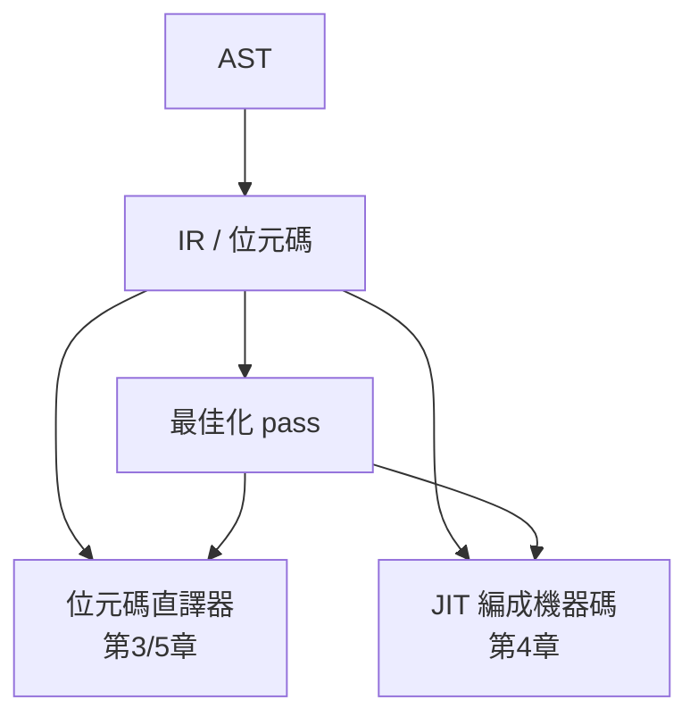

# 2.3 中間表示與代碼生成

## 為什麼需要中間表示

第 2.1 節說過：n 種語言 × m 種機器只需要 n+m 個組件，靠的是中間表示（IR）。但 IR 的價值不只是省工——它同時是：

1. **最佳化的操作對象**：常數摺疊、死碼刪除、指令選擇都在 IR 上做，與語言和機器無關
2. **直譯與 JIT 的共同橋樑**：AST → IR 之後，可以走位元碼直譯（第 3、5 章），也可以走 JIT（第 4 章）。本節做完 IR，後面四章的岔路就從這裡分出



## 為 MinLang 設計堆疊式 IR

最簡單而有用的 IR 是**堆疊式位元碼**（BCPL 的 O-code、Pascal 的 P-code、JVM、CPython 都是）：每條指令從虛擬堆疊取運算元、推回結果。好處是指令很短、代碼生成平凡；壞處是機器碼階段還要再做一次暫存器分配（JIT 章節會處理）。

```rust
// src/ir.rs
#[derive(Debug, Clone, Copy, PartialEq)]
pub enum Instr {
    Push(i64),          // 推常數
    Load(u16),          // 從第 slot 個區域變數載入
    Store(u16),         // 存入第 slot 個區域變數
    Add, Sub, Mul, Div, Lt, Eq,
    Jump(usize),        // 無條件跳到第 idx 條指令
    JumpIfFalse(usize), // 堆疊頂為 0 就跳
    Call { func: u16, nargs: u8 },
    Return,
    Drop,               // 丟掉堆疊頂（表達式敘述的值）
}

pub type Program = Vec<Instr>;
```

這裡已經出現了**虛擬機的架構決策**（第 5 章會展開）：變數用 slot 索引而不是名字——名字解析（符號表查詢）是前端的工作，VM 只做整數索引。這是所有 VM 共同的前後端分工。

## 代碼生成：AST → 位元碼

```rust
// src/compiler.rs
use crate::ast::{BinOp, Expr};
use crate::ir::{Instr, Program};
use std::collections::HashMap;

pub struct Compiler {
    code: Program,
    vars: HashMap<String, u16>,   // 符號表：名字 → slot
    next_slot: u16,
}

impl Compiler {
    pub fn new() -> Self {
        Compiler { code: Vec::new(), vars: HashMap::new(), next_slot: 0 }
    }

    pub fn compile(mut self, expr: &Expr) -> Result<Program, String> {
        self.gen(expr)?;
        Ok(self.code)
    }

    fn emit(&mut self, i: Instr) -> usize {
        self.code.push(i);
        self.code.len() - 1
    }

    fn gen(&mut self, expr: &Expr) -> Result<(), String> {
        match expr {
            Expr::Num(n) => { self.emit(Instr::Push(*n)); }
            Expr::Var(name) => {
                let slot = *self.vars.get(name)
                    .ok_or_else(|| format!("undefined variable: {name}"))?;
                self.emit(Instr::Load(slot));
            }
            Expr::BinOp { op, lhs, rhs } => {
                self.gen(lhs)?;
                self.gen(rhs)?;
                self.emit(match op {
                    BinOp::Add => Instr::Add,
                    BinOp::Sub => Instr::Sub,
                    BinOp::Mul => Instr::Mul,
                    BinOp::Div => Instr::Div,
                    BinOp::Lt => Instr::Lt,
                    BinOp::Eq => Instr::Eq,
                });
            }
            Expr::Let { name, value, body } => {
                let slot = self.next_slot;
                self.next_slot += 1;
                self.gen(value)?;
                self.emit(Instr::Store(slot));
                self.vars.insert(name.clone(), slot);
                self.gen(body)?;
                // body 的值留在堆疊上，就是整個 let 的值
            }
            Expr::If { cond, then_e, else_e } => {
                self.gen(cond)?;
                let jf = self.emit(Instr::JumpIfFalse(0));   // 回填位址
                self.gen(then_e)?;
                let j = self.emit(Instr::Jump(0));           // 回填位址
                let else_pc = self.code.len();
                self.code[jf] = Instr::JumpIfFalse(else_pc);
                self.gen(else_e)?;
                let end_pc = self.code.len();
                self.code[j] = Instr::Jump(end_pc);
            }
            Expr::Call { func, args } => {
                for a in args { self.gen(a)?; }
                let f = self.funcs.get(func)
                    .ok_or_else(|| format!("undefined function: {func}"))?;
                self.emit(Instr::Call { func: *f, nargs: args.len() as u8 });
            }
        }
        Ok(())
    }
}
```

`If` 的生成展示了位元碼編譯的經典技巧——**回填（backpatching）**：生成 `JumpIfFalse` 時還不知道目標位址（else 部分還沒生成），先放 0，記下位置，生成完 else 再回頭修正。這個技巧 1950 年代就有，直到今天 JIT 寫分支時一樣在用。

## 最佳化：在 IR 上做常數摺疊

IR 的第一個回報是最佳化。最簡單的是常數摺疊（constant folding）——1954 年 FORTRAN 就有的 pass：

```rust
// src/opt.rs
use crate::ast::{BinOp, Expr};

pub fn fold(expr: Expr) -> Expr {
    match expr {
        Expr::BinOp { op, lhs, rhs } => {
            let lhs = fold(*lhs);
            let rhs = fold(*rhs);
            // 兩邊都是常數就現在算掉
            if let (Expr::Num(l), Expr::Num(r)) = (&lhs, &rhs) {
                let ok = match op {
                    BinOp::Add => l.checked_add(*r),
                    BinOp::Sub => l.checked_sub(*r),
                    BinOp::Mul => l.checked_mul(*r),
                    BinOp::Div if *r != 0 => l.checked_div(*r),
                    _ => None,
                };
                if let Some(v) = ok { return Expr::Num(v); }
            }
            // 代數恆等式：0+e=e, 1*e=e, e*0=0
            match (op, &lhs, &rhs) {
                (BinOp::Add, Expr::Num(0), _) => rhs,
                (BinOp::Add, _, Expr::Num(0)) => lhs,
                (BinOp::Mul, Expr::Num(1), _) => rhs,
                (BinOp::Mul, _, Expr::Num(1)) => lhs,
                (BinOp::Mul, Expr::Num(0), _) | (BinOp::Mul, _, Expr::Num(0)) => Expr::Num(0),
                _ => Expr::BinOp { op, lhs: Box::new(lhs), rhs: Box::new(rhs) },
            }
        }
        other => other,
    }
}
```

注意 `checked_add`——編譯器在編譯期做常數運算時**不能自己溢位**（否則編譯器成了 bug 製造者），也不能讓使用者程式的溢位被摺疊隱藏。這個細節正是 C 編譯器歷史上真實踩過的坑（未定義行為讓最佳化刪掉溢位檢查）。

## 生成真正機器碼的直覺：堆疊 IR → x86-64

第 4 章的 JIT 需要把位元碼變成 x86-64 機器碼。這裡先看對應直覺——堆疊機的 `Push/Load/Add` 其實就是 x86-64 的記憶體與暫存器操作：

| 位元碼 | x86-64（組語示意） | 機器碼位元組 |
|--------|--------------------|--------------|
| `Push 5` | `push 5` | `48 C7 C3 05 00 00 00`（`mov rbx, 5`） |
| `Add` | `pop rax; add rbx, rax` | `58` + `48 01 C3` |
| `Ret` | `ret` | `C3` |

x86-64 是**暫存器機器**，堆疊機是**虛擬堆疊機器**；兩者之間的翻譯要決定「虛擬堆疊放到哪」——最幼稚的做法是真用 CPU 堆疊（`push`/`pop` 指令），更好的做法是虛擬堆疊的深度在編譯期可算出時，直接分配暫存器。這個決定就是**暫存器分配**，編譯器後端最難的部分（Chaitin 1982 把它化約成圖著色問題），本書在第 4 章用「每個 slot 對應一個固定暫存器」的簡化策略跳過理論、直達實作。

## 連結：從位元碼到「程式」

完整前端跑一遍：

```
let x = 2; x * x
```

產生的位元碼：

```text
0:  Push(2)
1:  Store(0)      ; x → slot 0
2:  Load(0)
3:  Load(0)
4:  Mul
```

用 `dbg!` 驗證：

```rust
fn main() {
    let src = "let x = 2; x * x";
    let ast = parser::Parser::new(src).unwrap().parse().unwrap();
    let ast = opt::fold(ast);
    let code = compiler::Compiler::new().compile(&ast).unwrap();
    for (i, instr) in code.iter().enumerate() {
        println!("{i:3}: {instr:?}");
    }
}
```

## 習題

1. 寫一個「死碼刪除」pass：刪除 `let x = ...; body` 中 x 在 body 出現零次的情況（先簡化：只看變數名，不考慮副作用）。
2. 為什麼堆疊 IR 的 `If` 需要 `Jump` 與 `JumpIfFalse` 兩種指令？只留一種行不行？
3. 運算式敘述 `x + 1;` 的值沒人用，產生 `Drop` 指令。若不刪除它，直譯器執行時會發生什麼？
