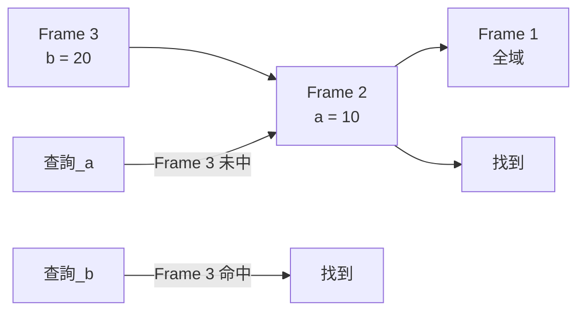
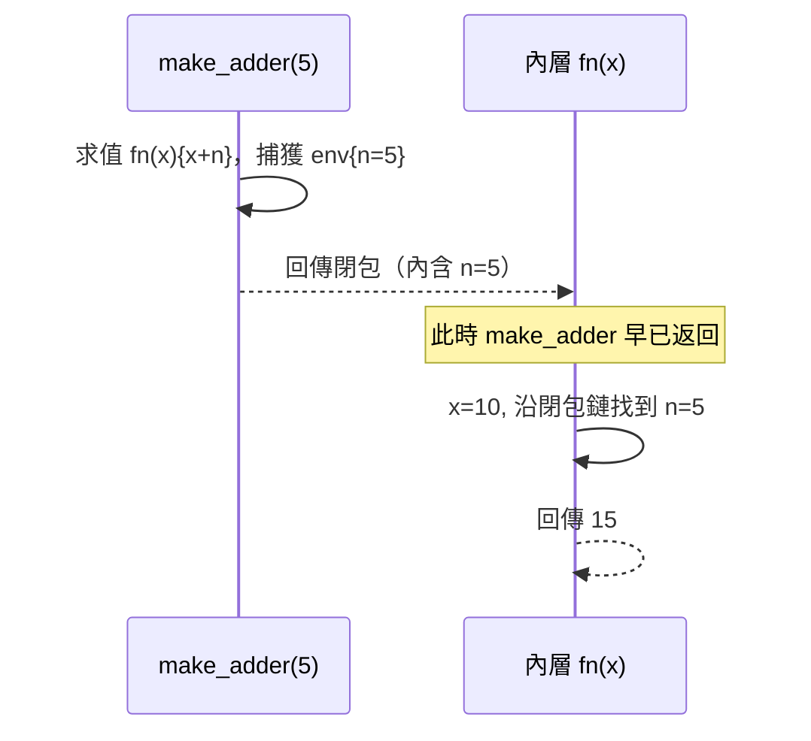

# 3.2 環境與閉包：以 Rust 實作詞法作用域

## 問題：第 3.1 節的環境有三個缺陷

上節的 `eval` 用 `Rc<HashMap>` 表達環境，`Let` 每進一層就整個 `clone`。這在語意上有一個正確性問題與兩個效能問題：

1. **正確性**：函式值 `Value::Fn` 捕獲環境的方式，必須實現**詞法作用域**（lexical scoping）——函式看到的是「它被定義時」的環境，不是「它被呼叫時」的環境。ALGOL 60 報告首次精確定義作用域，SICP 與 Scheme 的 "funarg problem"（1970s）則證明：直譯器若不小心，很容易實現成動態作用域（dynamic scoping）——那是 bug，不是特性。
2. **效能**：每層 `clone` 整個 map 是 O(環境大小)，深巢狀時平方級。
3. **效能**：變數查詢用字串 hash，每次存取都付 hash 成本。

## 環境鏈：作用域的鏈結串列表示

標準解法（LISP 1.5 到所有現代直譯器都在用）：環境是**一層層 frame 組成的鏈**，查詢沿鏈向上找：



```rust
// src/env.rs
use crate::value::Value;
use std::rc::Rc;

#[derive(Debug)]
pub struct Env {
    pub vars: Vec<(String, Value)>,  // 這一層的綁定
    pub parent: Option<Rc<Env>>,     // 外層環境
}

impl Env {
    pub fn new_root() -> Rc<Env> {
        Rc::new(Env { vars: Vec::new(), parent: None })
    }

    pub fn child(parent: &Rc<Env>) -> Rc<Env> {
        Rc::new(Env { vars: Vec::new(), parent: Some(parent.clone()) })
    }

    pub fn define(&mut self, name: String, val: Value) {
        self.vars.push((name, val));
    }

    pub fn get(&self, name: &str) -> Option<&Value> {
        for (n, v) in &self.vars {
            if n == name { return Some(v); }
        }
        self.parent.as_ref().and_then(|p| p.get(name))
    }

    pub fn set(&mut self, name: &str, val: Value) -> bool {
        for (n, v) in self.vars.iter_mut() {
            if n == name { *v = val; return true; }
        }
        false  // 外層修改需要 Rc<RefCell<>>，見下文
    }
}
```

**進入作用域 = `Env::child`（建立新 frame，O(1)），離開作用域 = drop `Rc<Env>`（O(1)）**。上節的整表 clone 消失了。

## 閉包：函式捕獲「定義時」的環境

閉包（closure）一詞來自理論電腦科學的 λ 演算：一個函式值 = λ 項 + 其自由變數的繫結環境。實作上，`Value::Fn` 裡放一個 `Rc<Env>` 即可：

```rust
// src/value.rs（更新）
pub struct Lambda {
    pub params: Vec<String>,
    pub body: Expr,
    pub env: Rc<Env>,       // 定義時的環境
}
```

`Let` 與 `Fn` 的求值：

```rust
// src/interp.rs（更新 Let 分支）
Expr::Let { name, value, body } => {
    let v = eval(value, env)?;
    let new_env = Env::child(env);
    // 注意：new_env 要先可變借用插入，再讓 v 可能含對 env 的引用
    match v {
        Value::Fn(mut lam) => { /* 函式定義走 Fn 分支 */ }
        other => { Env::define(&mut /* ... */, name.clone(), other); }
    }
    eval(body, &new_env)
}
```

函式值的關鍵行為——閉包在定義處捕獲環境：

```rust
Expr::FnLit { params, body } => {
    Ok(Value::Fn(Rc::new(Lambda {
        params: params.clone(),
        body: (**body).clone(),
        env: env.clone(),      // 捕獲「現在」的環境
    })))
}
```

用一個例子驗證詞法作用域：

```
let make_adder = fn(n) { fn(x) { x + n } };
let add5 = make_adder(5);
add5(10)              // 15
```

執行時序：



如果實現成動態作用域（呼叫時環境），`add5(10)` 會在**呼叫者**的環境找 `n`，找不到就報錯——這就是 funarg 問題的實體。閉包的 `Rc<Env>` 讓被引用的環境在函式返回後仍然存活。

## Rust 的借用檢查如何逼出正確設計

寫這段程式碼時，Rust 會強迫你面對三個直譯器的本質問題：

### 1. 為什麼環境要用 `Rc` 而不是所有權

閉包捕獲環境後，環境同時被：呼叫者的棧（執行中的函式）、其他閉包、外層作用域引用。這是**多所有者共享**——Rust 單一所有權模型下必須用 `Rc` 表達。C 直譯器同樣需要引用計數或 GC，只是 C 要手動寫，忘寫就洩漏或 double-free。

### 2. 為什麼 `Lambda.env` 是 `Rc<Env>` 而 `Env.parent` 也是 `Rc<Env>`

因為環境圖不是樹而是 DAG——多個閉包可以共享同一個外層 frame。`Rc` 的引用計數保證最後一個使用者 drop 時 frame 才被釋放。**直譯器的記憶體管理在這裡第一次「長出 GC 的影子」**：`Rc` 就是引用計數 GC 的最簡形式。真正的 tracing GC（如 CPython、JVM）在第 5 章 VM 的記憶體設計中再回來。

### 3. 為什麼 `set`（賦值給外層變數）需要 `RefCell`

```
let counter = fn() { let n = 0; fn() { n = n + 1 } };  // 內層要改外層的 n
```

`Rc<Env>` 是共享唯讀的；要跨層修改，環境的儲存必須是內部可變的：

```rust
use std::cell::RefCell;

pub struct Env {
    pub vars: Vec<(String, RefCell<Value>)>,
    pub parent: Option<Rc<Env>>,
}

pub fn set(env: &Rc<Env>, name: &str, val: Value) -> Result<(), String> {
    let mut cur = Some(env.clone());
    while let Some(e) = cur {
        for (n, v) in &e.vars {
            if n == name {
                *v.borrow_mut() = val;
                return Ok(());
            }
        }
        cur = e.parent.clone();
    }
    Err(format!("undefined variable: {name}"))
}
```

`Rc<RefCell<Value>>` 的組合有一個真實危險：**循環引用導致記憶體洩漏**——閉包捕獲環境，環境裡存了閉包，兩個 `Rc` 互指，計數永遠不歸零。這正是 1960 年 LISP GC 必須被發明的原因：引用計數不夠，需要 tracing GC（標記-清除）打破循環。Python 的實作則是「引用計數 + 循環偵測」的混合——歷史在 Rust 裡重演了一遍。

## 名字解析：把字串查詢提前到編譯期

環境鏈解決了正確性，但**每次存取變數仍要沿鏈比對字串**。編譯式語言的解法是把它整個搬到前端：解析階段就確定每個變數綁定到哪一層 frame 的第幾個 slot，執行期只做 `frame[slot]` 數組存取。

```rust
// 符號表：解析階段記錄「深度 + slot」
pub struct Scope {
    pub slots: HashMap<String, u16>,
    pub parent: Option<Box<Scope>>,
    pub depth: u8,           // 環境鏈要走幾層
}
```

AST 的 `Expr::Var` 就要從 `Var(String)` 升級成帶解析結果的形態：

```rust
pub enum Expr {
    // ...
    Var { name: String, depth: u8, slot: u16 },  // 解析後填入
}
```

執行期查詢從 O(鏈長 × 每層綁定數) 的字串比對，變成固定的兩次索引：

```rust
fn lookup(env: &Rc<Env>, depth: u8, slot: u16) -> &Value {
    let mut e = env;
    for _ in 0..depth { e = e.parent.as_ref().unwrap(); }
    &e.vars[slot as usize]
}
```

這正是 3.3 節位元碼 `Load(u16)/Store(u16)` 指令的來源——**直譯器慢的病根，往往要在「解析與執行分離」中根治**。這條思路的終點（完全靜態的 slot 分配 + 機器碼直接索引）就是編譯器本身。

## 習題

1. 寫出 `let f = fn() { f };`（自引用閉包）在 Rust 實作中會遇到的問題，並解釋為什麼這是循環引用。
2. 動態作用域在什麼樣的語言裡反而是想要的？（提示：shell 的環境變數、Emacs Lisp 的 buffer-local 變數。）
3. 把 `Env::get` 改成帶 `depth`/`slot` 的版本，用 `#[bench]` 或簡單計時比較深巢狀下兩種查詢的差距。
