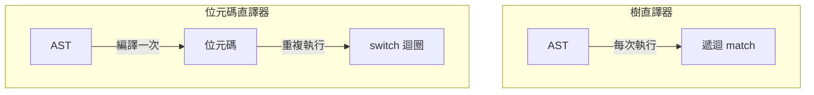

# 3.3 位元碼直譯器：往虛擬機的橋樑

## 從「走樹」到「跑指令」

樹直譯器的根本低效在於：**語法分析做過的工作，每次執行都重做**。enum match、Box 解引用、遞迴函式呼叫——這些都是「重新發現程式結構」的成本。1966 年 BCPL 的 Martin Richards 提出的解法簡單而深刻：**把 AST 預先翻譯成線性指令序列（位元碼），執行時只需沿著指令前進**。



一個指令序列的執行成本是「一個索引 + 一個 match + 一個循環」，沒有遞迴、沒有樹遍歷。這個執行核心叫**直譯迴圈（interpreter loop）**——第 5 章虛擬機的主體就是它。本節把 MinLang 編譯成位元碼並寫出直譯迴圈，完成「直譯器 → 虛擬機」的過渡。

## 位元碼設計的關鍵決策

沿用第 2.3 節的 `Instr` enum，現在補上函式呼叫與回傳。設計決策與理由：

1. **變數用 slot 索引**（`Load(u16)`）：名字解析已在編譯期完成（3.2 節）
2. **函式值不再捕獲 `Rc<Env>`**，而是捕獲 `upvalues`（被捕獲變數的索引清單）——Lua 的做法，把閉包變成資料
3. **運算元堆疊**：中間結果放虛擬堆疊，指令天然短小

```rust
// src/ir2.rs
#[derive(Debug, Clone)]
pub enum Instr {
    Const(u16),          // 從常數池載入
    Load { depth: u8, slot: u16 },
    Store { depth: u8, slot: u16 },
    Add, Sub, Mul, Div, Lt, Eq,
    Jump(usize),
    JumpIfFalse(usize),
    Closure { proto: u16 },   // 由第 proto 個函式原型建閉包
    Call { nargs: u8 },
    Return,
    Drop,
}

pub struct Proto {
    pub code: Vec<Instr>,
    pub consts: Vec<Value>,
    pub n_slots: u16,        // 本函式的區域變數數
}

pub struct Module {
    pub protos: Vec<Proto>,  // protos[0] 是主體
}
```

`Proto`/`Module` 的分層（函式原型 vs. 執行個體）是所有 VM 的標準結構：CPython 的 code object vs. frame、JVM 的 class vs. instance、Lua 的 Proto vs. Closure。**編譯產物（原型）與執行狀態（閉包/幀）分離**，才能反覆呼叫同一函式而互不干擾。

## 編譯器：AST → 位元碼

```rust
// src/compiler2.rs
pub struct Compiler {
    module: Module,
    cur: Proto,
    scopes: Vec<HashMap<String, (u8, u16)>>,  // 作用域堆疊：名字 → (深度, slot)
}

impl Compiler {
    fn gen(&mut self, expr: &Expr) -> Result<(), String> {
        match expr {
            Expr::Num(n) => {
                let idx = self.add_const(Value::Num(*n));
                self.emit(Instr::Const(idx));
            }
            Expr::Var { name, .. } => {
                let (d, s) = self.resolve(name)?;
                self.emit(Instr::Load { depth: d, slot: s });
            }
            Expr::Let { name, value, body } => {
                self.gen(value)?;
                let slot = self.cur.n_slots; self.cur.n_slots += 1;
                self.scopes.last_mut().unwrap().insert(name.clone(), (0, slot));
                self.emit(Instr::Store { depth: 0, slot });
                self.gen(body)?;
                // body 值在堆疊上，直接成為 let 的值
            }
            Expr::BinOp { op, lhs, rhs } => {
                self.gen(lhs)?; self.gen(rhs)?;
                self.emit(match op {
                    BinOp::Add => Instr::Add, BinOp::Sub => Instr::Sub,
                    BinOp::Mul => Instr::Mul, BinOp::Div => Instr::Div,
                    BinOp::Lt => Instr::Lt, BinOp::Eq => Instr::Eq,
                });
            }
            Expr::If { cond, then_e, else_e } => {
                self.gen(cond)?;
                let jf = self.emit(Instr::JumpIfFalse(0));
                self.gen(then_e)?;
                let j = self.emit(Instr::Jump(0));
                self.code[jf] = Instr::JumpIfFalse(self.code.len());
                self.gen(else_e)?;
                self.code[j] = Instr::Jump(self.code.len());
            }
            Expr::Call { func, args } => {
                let proto = self.resolve_fn(func)?;
                for a in args { self.gen(a)?; }
                self.emit(Instr::Call { nargs: args.len() as u8 });
            }
            // ... 函式字面值生成 Closure 指令
        }
        Ok(())
    }
}
```

## 直譯迴圈：VM 的心臟

現在寫執行器。核心是一個 `loop + match`：

```rust
// src/vm.rs
pub struct Vm {
    pub stack: Vec<Value>,       // 運算元堆疊
    pub frames: Vec<Frame>,      // 呼叫幀堆疊
}

pub struct Frame {
    pub proto: Rc<Proto>,
    pub closure: Rc<Closure>,
    pub pc: usize,
    pub slots: Vec<Value>,       // 區域變數
    pub base: usize,             // 本幀在運算元堆疊的基準
}

pub struct Closure {
    pub proto: Rc<Proto>,
    pub upvals: Vec<Value>,
}

pub type VmResult = Result<Value, VmError>;

#[derive(Debug)]
pub enum VmError {
    StackUnderflow,
    TypeError { expected: &'static str, got: String },
    DivZero,
    PcOutOfRange { pc: usize, len: usize },
}

impl Vm {
    pub fn run(&mut self, module: &Module) -> VmResult {
        let main = Rc::new(Closure { proto: Rc::new(module.protos[0].clone()), upvals: vec![] });
        self.frames.push(Frame {
            proto: main.proto.clone(), closure: main,
            pc: 0, slots: Vec::new(), base: 0,
        });

        loop {
            // 依當前幀取指令
            let frame = self.frames.last_mut().unwrap();
            let instr = {
                let code = &frame.proto.code;
                let pc = frame.pc;
                frame.pc += 1;
                code.get(pc).ok_or(VmError::PcOutOfRange { pc, len: code.len() })?.clone()
            };

            match instr {
                Instr::Const(i) => {
                    let v = frame.proto.consts[i as usize].clone();
                    self.stack.push(v);
                }
                Instr::Load { depth, slot } => {
                    let v = self.load(depth, slot)?;
                    self.stack.push(v);
                }
                Instr::Add => self.binop(|a, b| a.wrapping_add(b), "Add")?,
                Instr::Jump(t) => { self.frames.last_mut().unwrap().pc = t; }
                Instr::JumpIfFalse(t) => {
                    let v = self.stack.pop().ok_or(VmError::StackUnderflow)?;
                    if !matches!(v, Value::Bool(false)) { /* 繼續 */ }
                    else { self.frames.last_mut().unwrap().pc = t; }
                }
                Instr::Call { nargs } => self.call(nargs)?,
                Instr::Return => {
                    let ret = self.stack.pop().ok_or(VmError::StackUnderflow)?;
                    self.frames.pop();
                    if self.frames.is_empty() { return Ok(ret); }
                    self.stack.push(ret);
                }
                Instr::Drop => { self.stack.pop().ok_or(VmError::StackUnderflow)?; }
                // ...
            }
        }
    }

    fn binop(&mut self, f: fn(i64, i64) -> i64, name: &'static str) -> Result<(), VmError> {
        let r = self.stack.pop().ok_or(VmError::StackUnderflow)?.as_num()
            .map_err(|e| VmError::TypeError { expected: "num", got: e })?;
        let l = self.stack.pop().ok_or(VmError::StackUnderflow)?.as_num()
            .map_err(|e| VmError::TypeError { expected: "num", got: e })?;
        self.stack.push(Value::Num(f(l, r)));
        Ok(())
    }

    fn call(&mut self, nargs: u8) -> Result<(), VmError> {
        let n = nargs as usize;
        let stack_len = self.stack.len();
        if stack_len < n + 1 { return Err(VmError::StackUnderflow); }
        let callee = self.stack[stack_len - n - 1].clone();
        let f = match callee { Value::Fn(f) => f, v => return Err(VmError::TypeError { expected: "fn", got: format!("{v:?}") }) };
        let args: Vec<Value> = self.stack.split_off(stack_len - n);
        self.stack.pop(); // 函式值本身
        let base = self.stack.len();
        self.frames.push(Frame {
            proto: f.proto.clone(), pc: 0,
            slots: vec![Value::Num(0); f.proto.n_slots as usize],
            base,
            closure: f.clone(),
        });
        // 參數存入 slot
        for (i, a) in args.into_iter().enumerate() {
            self.frames.last_mut().unwrap().slots[i] = a;
        }
        Ok(())
    }
}
```

## Rust 型別系統在 VM 中的三個作用

### 1. 錯誤從 panic 變成值

VM 會遇到所有壞輸入：堆疊下溢、型別錯誤、PC 越界。C VM 的慣例是 `assert` 或直接崩潰（或更糟：靜默越界讀寫成為安全漏洞）。Rust 的 `Result` 讓這些成為被強迫處理的值——`code.get(pc)` 而不是 `code[pc]`，一行之差決定了惡意位元碼能否造成 UB。**執行不可信位元碼的 VM 本質上是一個沙箱，越界檢查是沙箱的地基**。

### 2. `Rc<Proto>` 表達共享的只讀編譯產物

多個 `Closure`、多個 `Frame` 共享同一份 `Proto`（編譯產物不可變），`Rc` 的語義正好。C VM 需手動管理 proto 的生命週期（誰釋放？何時？），JVM 靠 class loader + GC。

### 3. enum match 的完備性

給 `Instr` 加新指令（例如 `Mul2`），編譯器立即指出 `run` 裡缺分支。CPython 歷史上多次出現「新增 opcode 忘了更新某個 switch」的 bug，Rust 從型別層面杜絕。

## 效能驗證與下一步

```rust
#[cfg(test)]
mod tests {
    use super::*;
    use crate::lexer::Lexer;
    use crate::parser::Parser;
    use crate::compiler2::Compiler;

    fn run(src: &str) -> Value {
        let ast = Parser::new(src).unwrap().parse().unwrap();
        let module = Compiler::new().compile(&ast).unwrap();
        Vm::new().run(&module).unwrap()
    }

    #[test]
    fn recursion() {
        // let loop = fn(n, acc) { if n == 0 { acc } else { loop(n - 1, acc + n) } };
        // loop(10000, 0)  →  50005000
        assert_eq!(run(SRC), Value::Num(50005000));
    }
}
```

同一個 `loop(10000, 0)` 測資，典型量級（相對值）：

| 執行方式 | 相對耗時 | 每步成本來源 |
|----------|----------|--------------|
| 樹直譯（3.1 節） | ~10× | 每節點遞迴 + 字串查詢 + clone |
| 位元碼直譯（本節） | ~2× | switch + 堆疊 push/pop |
| JIT 機器碼（第 4 章） | ~1× | 原生指令 |

位元碼直譯比樹直譯快數倍，但仍比機器碼慢——每次指令分派（match）相當於一次間接跳轉，現代 CPU 的分支預測器對此效率有限。**把熱門位元碼序列直接編成機器碼、消滅分派成本**，就是 JIT（第 4 章）存在的理由。

同時注意：本節的 `Vm` 已經是一個「虛擬機」的雛形——有指令集、有堆疊、有幀、有錯誤處理。第 5 章將把它正式化為完整的堆疊虛擬機，並討論 GC 與 WASM。

## 習題

1. 統計 `run` 迴圈中每種指令的執行次數（在 `Instr` 上加計數器），跑 `loop(10000,0)`，找出最熱門的指令——這就是 JIT 首先要編譯的目標。
2. 位元碼是資料，可以被惡意構造。找出三種能讓 `Vm` panic（而非返回 Err）的輸入，修掉它們。
3. 實作 `Instr::Mul` 的「快取上一次常數運算元」的內聯快取雛形，測量 `loop` 中 `acc + n` 的加速比。
