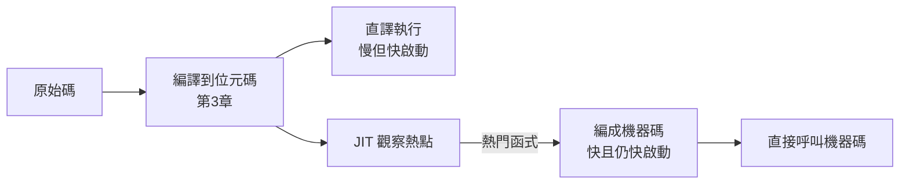
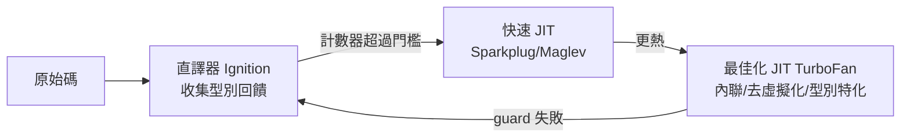
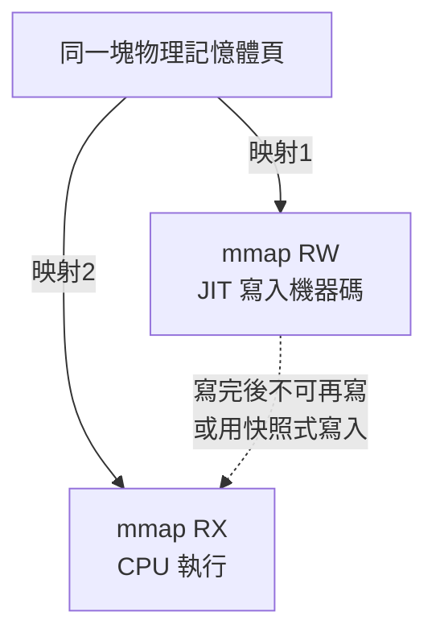

# 4.1 從解譯到執行時編譯：1960-至今的 JIT 史

## 定義與問題

JIT（Just-In-Time compilation，執行時編譯）：在程式**執行期間**，把（位元碼或 AST）翻譯成機器碼並執行。它位於前兩章的交點——



JIT 解決的矛盾：**啟動速度（直譯好）vs. 峰值速度（編譯好）**。AOT 編譯（C/Rust）啟動快、峰值快，但編譯本身要時間且互動性差；純直譯啟動零成本但峰值慢 10-100 倍。JIT 的答案是「先直譯、觀察、對熱點編譯」——花費編譯成本只花在被證明值得的地方。

## 歷史：四個里程碑

### 1960：LISP 1.5 的 compile 奧秘

最早的「執行時編譯」出現在 LISP：`compile` 函式可以把 S-運算式編成機器碼，編好的函式放進函式表就被呼叫。這是「直譯為主、選擇性編譯」的混合模式——JIT 的思想雛形，但由使用者手動觸發，不是自動的。

### 1980-1984：Smalltalk-80 的動態翻譯

Smalltalk-80 一切方法呼叫都經位元碼直譯，效能成為採用障礙。Dave Ungar 為 Smalltalk 的後繼者 **SOAR**（1984）引入動態翻譯，Peter Deutsch 與 Allan Schiffman 在 **PS（Fast Portable Smalltalk, 1984）** 中確立了 JIT 的兩大基礎技術：

- **動態翻譯**：方法第一次被呼叫時從位元碼編成原生碼
- **內聯快取（inline cache）**：在呼叫點快取「上次命中的型別與方法位址」，下次呼叫直接比對快取

這兩項技術至今仍是所有 JIT 的基礎。

### 1989-1995：Self 與去虛擬化

Ungar 的 **Self** 語言（原型繼承、無 class）逼出了更激進的技術：型別回饋（type feedback，記錄呼叫點實際出現的型別）與**去虛擬化（devirtualization）**——JIT 觀察到某呼叫點 99% 是同一型別，就內聯該方法並留下型別檢查的 guard；若 guard 失敗，回退（deopt）到直譯。**「樂觀編譯 + guard + 回退」成為 JIT 的通用模式**。

### 1999-2008：HotSpot 與 V8 把 JIT 帶進主流

- **HotSpot（1999，源自 Self 團隊加盟 Sun）**：名稱就是技術——「熱點偵測」。計數器找出熱方法，C1（快速、少最佳化）與 C2（慢、深度最佳化）兩級編譯。
- **V8（2008）**：Chrome 競賽的產物，JS 直接編機器碼（無直譯起步，後來又加回直譯 Ignition——證明純 JIT 啟動太慢）。V8 的多代編譯器（Crankshaft → TurboFan → Sparkplug/Maglev）演示了「JIT 管線分層」的成熟形態。



V8 管線是本節的最佳教材：它證明了 JIT 不是一個編譯器，而是**一條分層管線**，每層有不同速度/品質權衡，加上「deopt 回退」的迴路。

## JIT 為什麼能快：三個資訊優勢

JIT 比靜態編譯器多知道的是**執行期資訊**：

1. **型別分佈**：`a + b` 在直譯時觀察到 100% 是整數 → JIT 可以生成純整數加法指令，省去動態分派
2. **熱點路徑**：知道哪個函式、哪個分支真的常跑 → 最佳化力氣花在刀口上
3. **實際呼叫圖**：知道誰真的呼叫誰 → 內聯決策有依據

代價是**執行期編譯本身要花時間**，所以 JIT 永遠是權衡：編譯成本 vs. 執行收益。這個權衡公式（大略）：

$$\text{划算} \iff C_{\text{compile}} < N \times (T_{\text{interp}} - T_{\text{native}})$$

其中 $N$ 是未來預計執行次數。計數器就是在估 $N$ 。

## 系統層基礎：可執行記憶體

JIT 的機器碼要放到 CPU 能執行的記憶體，這把我們直接帶到作業系統的頁保護機制（第 6 章詳述）：

```c
mmap(NULL, len, PROT_READ|PROT_WRITE|PROT_EXEC, MAP_PRIVATE|MAP_ANONYMOUS, -1, 0);
```

歷史上的安全事件驅動了演變：

- **W^X（Write XOR Execute）原則**：可寫又可執行的記憶體是攻擊者的樂園（緩衝區溢位直接注入 shellcode）
- **2017 年，Linux 4.14** 預設阻止同時 W+X 的 mmap（除非明確要求）；macOS 自 Apple Silicon 起完全強制 W^X
- 現代 JIT 的應對：**雙映射（dual mapping）**——同一塊實體記憶體映射兩次，一次可寫（RW，給編譯器寫入）、一次可執行（RX，給 CPU 執行），永遠沒有一個映射同時 W+X



Wasmtime/Cranelift（都是 Rust 寫的）實作的正是這個模式。第 4.2 節我們用 Rust 實作單映射版迷你 JIT，4.3 節看 Cranelift 的工程級做法。

## JIT 譜系與 Rust 的位置

| JIT | 語言 | 實作語言 | 特點 |
|-----|------|----------|------|
| HotSpot C2 | Java | C++ | 世界上最成熟的最佳化 JIT |
| TurboFan | JS | C++ | 型別回饋驅動的 Sea-of-Nodes IR |
| Cranelift | WASM | **Rust** | 安全優先、可驗證的 IR |
| LLVM-ORC | 任意 | C++ | 把 AOT 後端做成 JIT |
| rbpf / solana | eBPF | Rust | 核心 eBPF JIT 的使用者態複刻 |

Rust 生態的意義：Cranelift 證明了**JIT 後端本身可以用安全語言寫**，且其 IR（CLIF）設計上支援形式化驗證。第 4.3 節我們用 Cranelift 給 MinLang 做 JIT 後端。

## 習題

1. 用 4.1 的划算公式估算：一個函式直譯每秒慢 20ns、JIT 編譯花 1ms，需要執行多少次才划算？
2. 為什麼 V8 在 2008 年捨棄直譯器、2016 年又加回來？（提示：手機上的啟動時間、記憶體。）
3. W^X 下「寫入與執行不能同時」與 JIT「邊寫邊跑」如何並存？（提示：雙映射、mprotect、寫入屏障。）
