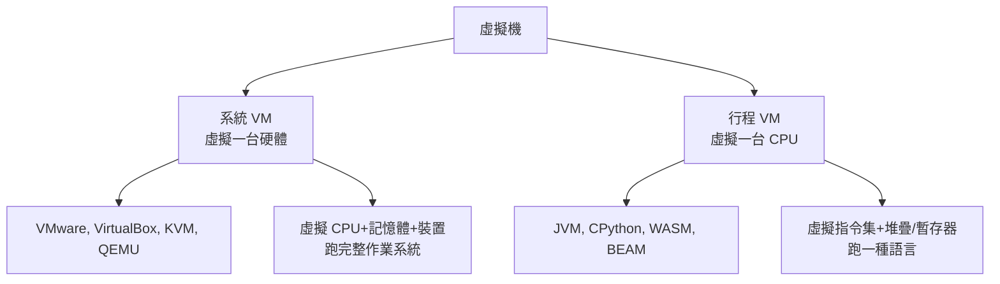
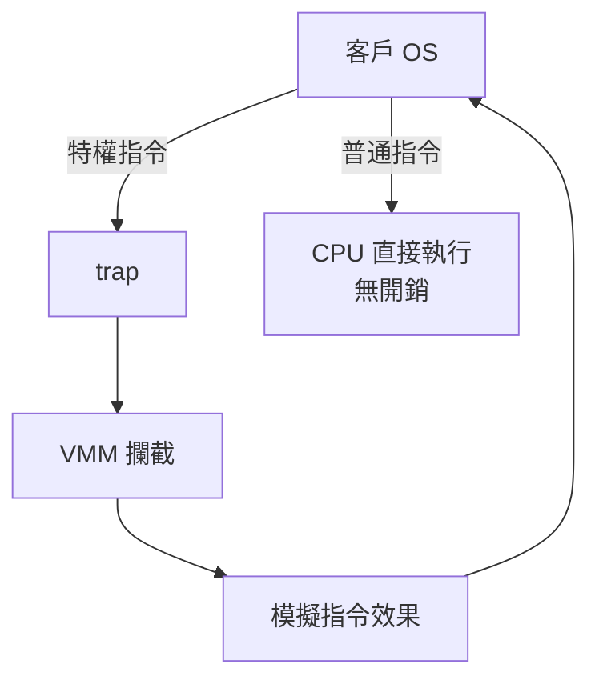
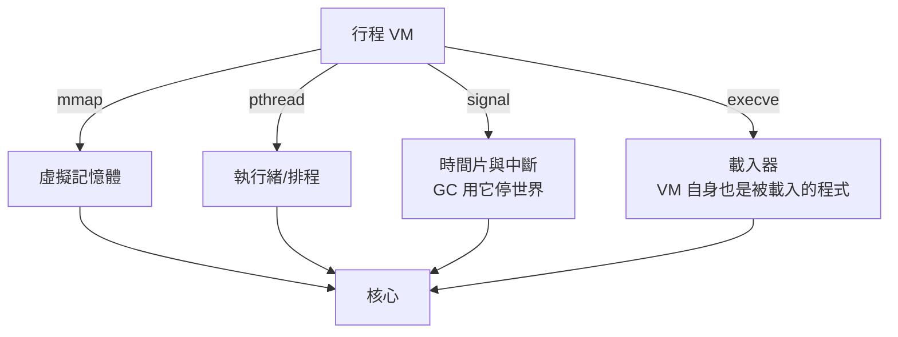

# 5.1 虛擬機的兩大族系：系統 VM 與行程 VM

## 「虛擬機」的兩個意思

「虛擬機」一詞涵蓋兩種技術上完全不同的東西，混淆它們是初學系統軟體最常見的錯誤：

| | 系統 VM | 行程 VM |
|--|---------|---------|
| 虛擬對象 | 整台電腦（含硬體） | 一個 CPU 的指令集 |
| 執行內容 | 完整作業系統 | 一種語言的位元碼 |
| 隔離層級 | 硬體虛擬化（VT-x/AMD-V） | 語意層沙箱（verifier/runtime checks） |
| 與 OS 的關係 | 自己就是 OS 的宿主 | 是 OS 的一個行程 |
| 第幾章 | 第 7 章對比容器 | 本章、第 3.3 節 |

本書主軸是**行程 VM**（第 3.3 節已寫了雛形），但必須先理解系統 VM，因為第 7 章的容器只有對照 VM 才有意義——容器與 VM 的競爭是 2013 年後雲端架構的主軸。

## 系統 VM 的歷史：從 IBM 到雲端

### 1965：IBM System/360 Model 67 與 CP-67

虛擬機的發明是為了解決一個商業問題：**分時系統不穩定時，使用者互相傷害**。IBM 的 CP-40/CP-67 讓每個使用者得到一台「完整虛擬的機器」——跑自己的 OS，互不干擾。1972 年的 VM/370 確立了系統 VM 的三大抽象：

1. **虛擬 CPU**：trap-and-emulate——客戶態執行特權指令時觸發 trap，VMM 攔截並模擬
2. **虛擬記憶體**：影子頁表（shadow page table）——VMM 維護「客戶虛擬位址 → 主機物理位址」的第二層映射
3. **虛擬 I/O 裝置**：虛擬磁碟/終端，VMM 模擬

trap-and-emulate 的美學：**普通指令零開銷（CPU 直接跑），特權指令才進 VMM**。這個「不對稱開銷」設計是所有虛擬化技術的基因。

### 1998-2007：x86 虛擬化的硬關卡與破解

x86 不是為虛擬化設計的——它有 **17 條指令在低特權態執行時不觸發 trap 而是靜默失敗**（Popek-Goldberg 虛擬化條件被違反，1974 年的理論提前命中了 24 年後的問題）。VMware 的解法是**二進位翻譯**（掃描客戶碼，改寫問題指令），KVM（2007 進入 Linux）與 Intel VT-x（2005 硬體）則靠**硬體擴充**：CPU 增加新的 root/non-root 模式，讓 trap-and-emulate 真正可行。

KVM 的架構對本書特別有啟發：**它把 Linux 核心變成 VMM**——每個虛擬機就是一個普通行程，vCPU 就是一個執行緒，虛擬記憶體就是行程位址空間。這個「用 OS 既有的程序抽象實現虛擬機」的思路，與第 7 章「用 OS 既有的 namespace 實現容器」是同一哲學的兩個極端。

### 行程 VM 的歷史脈絡

第 2.1、3.3 節已敘述：BCPL 的 O-code（1966）→ P-code（Pascal, 1970s）→ Smalltalk-80（1980，方法直譯 + 內聯快取）→ Java JVM（1995，bytecode verifier + JIT）→ WASM（2017，安全 + 多語言）。行程 VM 的演化主軸是兩條需求的拉鋸：

1. **可攜**：位元碼與機器無關，一次編譯處處執行（JVM 的口號）
2. **安全**：不可信位元碼不能傷害宿主（Java sandbox、WASM 的線性記憶體）

## 行程 VM 的三個核心機制

以 JVM 為例拆解，每個機制都會在本書對應章節實作：

### 1. 指令集與執行模型

JVM 是堆疊機（第 3.3 節的設計）：`iadd` 從堆疊取兩個數、推回結果。工程界曾長期爭論堆疊機 vs. 暫存器機：

| | 堆疊機 | 暫存器機 |
|--|--------|----------|
| 指令長度 | 短（省位元組） | 長（要編碼暫存器號） |
| 直譯速度 | 慢（push/pop 開銷） | 快（少 47% 分派，Davison 2001 實測 Lua） |
| 代表 | JVM, CPython, WASM | Lua 5, Dalvik, V8 內部 IR |

結論：**下載與儲存要小 → 堆疊機；執行要快 → 暫存器機**。WASM 選堆疊機是為了網路傳輸效率，再由 JIT 展開成暫存器形式（第 4.3 節的 Cranelift）。

### 2. 記憶體管理與 GC

行程 VM 接管記憶體：物件配置在 VM 管理的堆積上，由 GC 回收。歷代 GC 技術（每代都被前代的痛點驅動）：

- **引用計數**（LISP 早期）：簡單，但循環引用洩漏（3.2 節的 `Rc` 問題）
- **標記-清除**（McCarthy, 1960）：打破循環，但要停世界
- **分代**（Lieberman-Hewitt, 1983）：大部分物件朝生暮死，掃新生代就夠——JVM/CPython/V8 的標配
- **併發 GC**（Dijkstra, 1978）：GC 與應用交錯執行，降低停頓

GC 是 VM 中與作業系統交互最深的組件：要 `mmap` 大塊堆積、要停執行緒（訊號）、要處理頁錯誤（usage-based 檢測）。

### 3. 沙箱與驗證

行程 VM 的安全承諾：**惡意/有 bug 的位元碼不能逃出 VM**。實作層次：

- **載入期驗證**：JVM bytecode verifier 檢查型別與堆疊使用的一致性（1995 年的突破——安全檢查從執行期移到載入期）
- **執行期檢查**：陣列邊界、null 檢查、型別檢查（JIT 可優化掉已證明安全的檢查）
- **能力限制**：JVM SecurityManager（已棄用，證明「跑在 VM 裡但共享 OS 權限」的沙箱不夠——**沙箱必須由 OS 層兜底**，這是第 7 章容器存在的理論根據）

## VM 與 OS 的依賴方向

一個容易被忽略的事實：**行程 VM 是 OS 的房客，它的一切假設建立在 OS 之上**：

CPython 的 GIL、JVM 的 safepoint、V8 的後台編譯執行緒——這些 VM 的內部設計全是對 OS 原語的回應。**反過來，作業系統（第 6 章）才是沒有依賴的那一層**：它跑在裸機上，頁表它自己管，中斷它自己處理。這種「依賴方向」就是本書章節順序的邏輯：先寫房客（VM），再看房東（OS）。

## 習題

1. 為什麼 x86 的 17 條指令違反虛擬化條件？「靜默失敗」為什麼比 trap 更麻煩？
2. WASM 選堆疊機但 V8 內部 IR 是暫存器形式，說明兩個層次的需求如何不同。
3. JVM SecurityManager 被棄用的原因，與容器（第 7 章）的出現有何因果關係？
