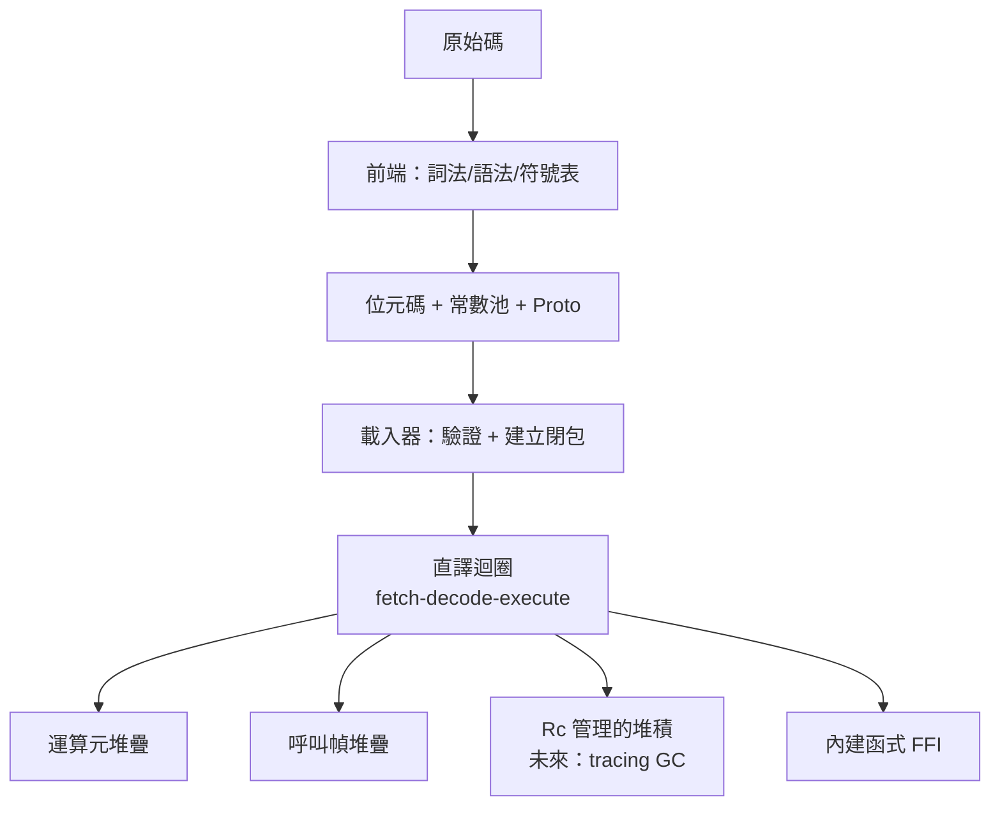

# 5.2 疊代器式的堆疊虛擬機：以 Rust 實作

## 從直譯迴圈到正式的 VM

第 3.3 節的直譯迴圈已經能跑，但它是一個「把所有狀態塞在一個 struct 裡的函式」。本章把它重構成一個正式的堆疊虛擬機，重點放在 Rust 如何表達 VM 的三個核心結構：

1. **指令流**：如何高效地取指（fetch）
2. **運算元堆疊**：堆疊機的靈魂
3. **呼叫幀**：函式呼叫與回傳的機制

並解決「正式 VM」必須面對的工程問題：效能（分派成本）、GC、以及與宿主語言（Rust）的邊界。

## 效能的第一課：分派成本的真相

VM 的每條指令都要經歷：**取指 → 譯碼 → 分派 → 執行**。在 Rust 中 `match` 編譯成什麼，直接決定 VM 快慢：

```rust
loop {
    let instr = code[pc];        // 取指
    match instr {                // 譯碼 + 分派
        Instr::Add => { ... }    // 執行
        Instr::Jump(t) => { pc = t; continue; }
        // ...
    }
    pc += 1;
}
```

`match` 可能被編譯成跳轉表（各 case 位址連續時）或比較鏈。跳轉表的成本是一次記憶體載入 + 一次間接跳轉——**分支預測器無法預測「下一條指令是什麼」**，因為位元碼序列本質是隨機的。這就是直譯器的「分派稅」，通常占總時間 20-40%。

三個經典的應對（依實作難度排序）：

1. **superinstructions**：合併熱門指令序列（`Load + Load + Add` → `AddLocal2`），一次分派做多件事
2. **direct threading**：把位元碼直接存成「分派後的位址」（C 的 `&&label` 技巧），省掉譯碼
3. **JIT**：直接消滅分派（第 4 章）

本節實作 1，並在測試中驗證。

## 運算元堆疊：用 Vec 還是固定陣列

```rust
pub struct Vm {
    pub stack: Vec<Value>,       // 運算元堆疊
    pub frames: Vec<Frame>,      // 呼叫幀
    pc: usize,
}
```

`Vec` 的問題：每次 `push`/`pop` 都要檢查容量。VM 的堆疊操作是最高頻操作，兩種工程化方案：

**方案 A：預分配 + 裸指標（unsafe）**

```rust
pub struct Stack {
    data: Vec<Value>,     // 只用來管理生命週期
    sp: usize,            // 堆疊指標
}

impl Stack {
    pub fn new(cap: usize) -> Self {
        Stack { data: vec![Value::default(); cap], sp: 0 }
    }

    #[inline(always)]
    pub fn push(&mut self, v: Value) -> Result<(), VmError> {
        if self.sp >= self.data.len() { return Err(VmError::StackOverflow); }
        self.data[self.sp] = v;
        self.sp += 1;
        Ok(())
    }

    #[inline(always)]
    pub fn pop(&mut self) -> Result<Value, VmError> {
        if self.sp == 0 { return Err(VmError::StackUnderflow); }
        self.sp -= 1;
        Ok(unsafe { std::ptr::read(&self.data[self.sp]) })  // 移動語意
    }
}
```

**方案 B：安全版（推薦教學用）**——直接 `Vec::push`/`pop`，讓 LLVM 自動優化掉多餘檢查。實測差距通常在 10% 以內，而安全版沒有 UB 風險。這是 Rust 哲學的實踐：**先安全、後測量、只在瓶頸處 unsafe**。

## 呼叫幀：函式呼叫的完整機制

VM 的呼叫幀對應原生程式的 stack frame（第 6 章 OS 層會對照）：

```rust
pub struct Frame {
    pub closure: Rc<Closure>,
    pub pc: usize,             // 返回後從哪繼續
    pub slots: Vec<Value>,     // 區域變數
    pub base: usize,           // 運算元堆疊的幀基準
}

impl Vm {
    fn call(&mut self, nargs: u8) -> Result<(), VmError> {
        let n = nargs as usize;
        let stack_len = self.stack.len();
        if stack_len < n + 1 { return Err(VmError::StackUnderflow); }

        let callee = self.stack[stack_len - n - 1].clone();
        let f = match callee {
            Value::Fn(f) => f,
            v => return Err(VmError::TypeError { expected: "fn", got: format!("{v:?}") }),
        };

        // 參數從運算元堆疊轉移到幀槽
        let args: Vec<Value> = self.stack.split_off(stack_len - n);
        self.stack.pop();  // 函式值

        self.frames.push(Frame {
            closure: f.clone(),
            pc: 0,
            slots: {
                let mut s = vec![Value::default(); f.proto.n_slots as usize];
                for (i, a) in args.into_iter().enumerate() { s[i] = a; }
                s
            },
            base: self.stack.len(),
        });
        Ok(())
    }

    fn ret(&mut self) -> Result<Option<Value>, VmError> {
        let ret = self.stack.pop().ok_or(VmError::StackUnderflow)?;
        self.frames.pop();
        // 幀回收：slots 連同局部變數一起 drop（區域 GC 的最簡形態）
        if self.frames.is_empty() { return Ok(Some(ret)); }
        self.stack.push(ret);
        Ok(None)
    }
}
```

## Superinstruction：測量與實作

先測量：在直譯迴圈加計數器，跑熱門 benchmark（例如 `loop(10000, 0)`），統計各指令頻率。典型結果：

```text
Load     38%
Add      22%
Call     12%
Const    10%
Store     8%
其他     10%
```

`Load` + `Load` + `Add` 占 60% 以上——合併成一條 superinstruction：

```rust
#[derive(Debug, Clone)]
pub enum Instr {
    // ...原有指令...
    /// superinstruction: Load a; Load b; Add
    AddLocal2 { a: u16, b: u16 },
}
```

編譯器在生成時做模式匹配（peephole optimization，窺孔最佳化——1970 年代就有，McKeeman 1965）：

```rust
// compiler: 觀察 Load-Load-Add 的模式
fn try_superinstruction(&self, window: &[&Expr]) -> Option<Instr> {
    match (window.get(0)?, window.get(1)?, window.get(2)?) {
        (Expr::Var{..}, Expr::Var{..}, Expr::BinOp{op: BinOp::Add, ..}) => {
            // 兩個變數相加 → 合併成一條
            Some(Instr::AddLocal2 { a: ..., b: ... })
        }
        _ => None,
    }
}
```

執行時：

```rust
Instr::AddLocal2 { a, b } => {
    let f = self.frames.last().unwrap();
    let va = f.slots[*a as usize].as_num().map_err(|e| VmError::TypeError { expected: "num", got: e })?;
    let vb = f.slots[*b as usize].as_num().map_err(|e| VmError::TypeError { expected: "num", got: e })?;
    self.stack.push(Value::Num(va.wrapping_add(vb)));
}
```

一次分派完成三次工作的效果——**分派次數減少 60%**，整體通常加速 15-25%。CPython 3.11 的「自適應直譯器」（specializing adaptive interpreter）是這個思路的工業級版本：直譯器在執行中把泛型指令**原地改寫**成特化版本（`BINARY_ADD` → `BINARY_ADD_INT`），下次執行直接走特化路徑。

## 與 GC 的第一次遭遇

到目前為止我們用 `Rc<Value>` 管理函式值的生命週期。正式 VM 的 GC 設計選擇：

| 方案 | 優點 | 缺點 | 使用者 |
|------|------|------|--------|
| `Rc`（引用計數） | 簡單、確定性釋放 | 循環洩漏、每次 clone 原子操作 | 較少（Lua 不用 GC 也可選引用計數） |
| 標記-清除 | 處理循環 | 停世界 | CPython（分代版） |
| 分代複製 | 新生代快、局部性好 | 需要寫屏障、記憶體倍增 | JVM、V8 |
| Rust `unsafe` 自管理 | 完全可控 | 極難正確 | 生產 VM 的現實 |

本書採用 `Rc`（正確且夠用），並在第 6 章 OS 記憶體管理時對照：**GC 的「停世界」本質上是需要 OS 的訊號機制**——這是 VM（房客）與 OS（房東）交互的深水區。

## 與宿主的邊界：FFI 與內建函式

VM 需要與宿主（Rust）世界互動——列印、讀檔、時間。設計內建函式表：

```rust
pub type Builtin = fn(&mut Vm, &[Value]) -> Result<Value, String>;

pub fn install_builtins(builtins: &mut HashMap<String, Value>) {
    builtins.insert("print".into(), Value::Builtin(builtin_print));
    builtins.insert("clock".into(), Value::Builtin(builtin_clock));
}

fn builtin_print(vm: &mut Vm, args: &[Value]) -> Result<Value, String> {
    for a in args { print!("{a:?} "); }
    println!();
    Ok(Value::default())
}
```

FFI 邊界的注意事項：

1. **型別轉換**：`Value::Num(i64)` 與 Rust 的各種數字型別之間的映射要明確（第 5.3 節 WASM 的型別系統設計會回來）
2. **不要讓宿主 panic 傳進 VM**：`builtin` 回傳 `Result`，任何錯誤都變成 VM 的可恢復錯誤
3. **重入**：宿主函式再呼叫 VM 時的堆疊狀態管理（`Vm::call_builtin` 要保存當前幀）

## 總結：堆疊 VM 的完整樣貌



這個 VM 已具備 CPython 1.0 的核心結構。接下來的兩章沿兩個方向擴展：第 4 章（已完成）給它 JIT 後端；下一節（5.3）把它升級到工業標準——實作一個 WASM 子集執行器，正式對接生態。

## 習題

1. 實作 `MulLocal2`、`LoadConst`（Load + Const 合併）superinstruction，測量加速比。
2. 為什麼 `Value` 需要 `Default`？如果改成 `Option<Value>` 的堆疊會更安全還是更慢？
3. CPython 3.11 的自適應直譯器需要「回退機制」（特化假設錯了要改回泛型指令）。在我們的 VM 中設計一個最簡回退。
