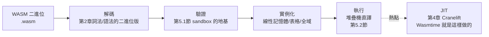

# 5.3 WASM：以 Rust 寫一個 WebAssembly 執行器

## 為什麼是 WASM

WASM（WebAssembly, 2017 W3C 標準）是行程 VM 的當代旗艦，也是 Rust 與 VM 關係最深的项目：

- **WASM 的主力工具鏈就是 Rust**：`rustc` 的 `wasm32-unknown-unknown` target 是最成熟的 WASM 前端
- **最流行的 WASM 執行器是 Rust 寫的**：Wasmtime（Bytecode Alliance）、Wasmer
- **WASM 的設計目標與本書主軸完全重合**：安全沙箱、與機器無關、可被 JIT

寫一個（簡化的）WASM 執行器，就是把前面四章的全部知識縫合：



## WASM 的執行模型

與 MinLang VM 的三個關鍵差異，每一個都是精心設計的安全/可攜決策：

### 1. 線性記憶體（linear memory）

WASM 程式能觸及的記憶體是一段連續位元組陣列，**唯一**：

```rust
pub struct Instance {
    pub memory: Vec<u8>,          // 線性記憶體：唯一的資料空間
    pub globals: Vec<Value>,      // 全域變數
    pub table: Vec<Option<u32>>,  // 間接呼叫表
    pub stack: Vec<ValType>,      // 運算元堆疊
    pub frames: Vec<WasmFrame>,
}
```

安全含義：**WASM 程式沒有裸指標可逃逸**。所有記憶體存取都是「線性記憶體內的偏移」，驗證器只需檢查「偏移 + 大小 ≤ 記憶體長度」就保證不越界。對比 x86：任意位址可讀寫——WASM 把「指標」降級成「帶邊界檢查的索引」，這是沙箱的地基（第 5.1 節的承諾在語言層面的兌現）。

### 2. 結構化控制流

WASM 沒有任意 `jump`——只有 `block`/`loop`/`if`/`br`（跳到標籤）。這使控制流圖在驗證時可分析，也讓 JIT 不需要處理「跳到任意指令中間」的退化情況。對比 JVM 的 `goto`（bytecode 層有）：WASM 更嚴格，是「CFL 可達性可驗證」的設計。

### 3. 型別化值堆疊

WASM 的驗證器對每條指令做**型別堆疊追蹤**：`i32.add` 要求堆疊頂兩個是 `i32`，推回一個 `i32`。整個函式的位元碼在**載入時**被證明型別安全——JVM verifier 的思想（1995），WASM 把它精煉成數學上可證明的形式。

## 最小 WASM 執行器

一個真實的 WASM 模組是二進位格式（LEB128 變長整數、section 結構）。完整解碼器太長，本節聚焦執行核心，用一個已解碼的最小模組：

```rust
// src/wasm.rs — 簡化的 WASM 執行器
#[derive(Debug, Clone, Copy, PartialEq)]
pub enum ValType { I32, I64 }

#[derive(Debug, Clone, Copy)]
pub enum WasmVal { I32(i32), I64(i64) }

/// 簡化後的指令集（真實 WASM 的子集）
#[derive(Debug, Clone, Copy)]
pub enum WasmInstr {
    I32Const(i32),
    I32Add,
    I32Sub,
    I32Mul,
    LocalGet(u32),
    LocalSet(u32),
    Call(u32),          // 函式索引
    End,                 // 函式結尾
}

pub struct WasmFunc {
    pub params: Vec<ValType>,
    pub results: Vec<ValType>,
    pub locals: Vec<ValType>,
    pub code: Vec<WasmInstr>,
}

pub struct WasmModule {
    pub funcs: Vec<WasmFunc>,
    pub memory_pages: u32,       // 1 頁 = 64KiB
}
```

### 驗證器：型別堆疊追蹤

```rust
pub fn validate(module: &WasmModule) -> Result<(), String> {
    for (i, func) in module.funcs.iter().enumerate() {
        let mut stack: Vec<ValType> = func.params.clone();
        for instr in &func.code {
            match instr {
                WasmInstr::I32Const(_) => stack.push(ValType::I32),
                WasmInstr::LocalGet(idx) => {
                    let t = func.locals.get(*idx as usize)
                        .or_else(|| func.params.get(*idx as usize))
                        .ok_or(format!("func {i}: local {idx} out of range"))?;
                    stack.push(*t);
                }
                WasmInstr::I32Add | WasmInstr::I32Sub | WasmInstr::I32Mul => {
                    let b = stack.pop().ok_or(format!("func {i}: stack underflow"))?;
                    let a = stack.pop().ok_or(format!("func {i}: stack underflow"))?;
                    if a != ValType::I32 || b != ValType::I32 {
                        return Err(format!("func {i}: i32 op requires i32 operands"));
                    }
                    stack.push(ValType::I32);
                }
                WasmInstr::Call(f) => {
                    let callee = module.funcs.get(*f as usize)
                        .ok_or(format!("func {i}: call to unknown func {f}"))?;
                    // 檢查參數型別匹配
                    if stack.len() < callee.params.len() {
                        return Err(format!("func {i}: not enough args for call {f}"));
                    }
                    for t in callee.params.iter().rev() {
                        let got = stack.pop().unwrap();
                        if got != *t { return Err(format!("func {i}: arg type mismatch")); }
                    }
                    for t in &callee.results { stack.push(*t); }
                }
                WasmInstr::End => { /* 檢查回傳型別 */ }
            }
        }
    }
    Ok(())
}
```

這個驗證器展示了 WASM 安全模型的核心：**在執行任何一條指令之前，每一條指令的型別行為都已被證明**。執行器因此可以省掉大部分執行期檢查（除了記憶體邊界——那是資料依賴的，靜態無法完全確定）。

### 執行器

```rust
pub struct WasmRuntime {
    pub module: WasmModule,
    pub memory: Vec<u8>,
}

impl WasmRuntime {
    pub fn instantiate(module: WasmModule) -> Result<Self, String> {
        validate(&module)?;
        Ok(WasmRuntime {
            memory: vec![0; module.memory_pages as usize * 65536],
            module,
        })
    }

    pub fn invoke(&mut self, func_idx: u32, args: &[WasmVal]) -> Result<WasmVal, String> {
        let func = self.module.funcs.get(func_idx as usize)
            .ok_or("unknown function")?
            .clone();

        let mut stack: Vec<WasmVal> = args.to_vec();
        let mut locals: Vec<WasmVal> = func.locals.iter()
            .map(|t| match t { ValType::I32 => WasmVal::I32(0), ValType::I64 => WasmVal::I64(0) })
            .collect();
        locals.extend(args.iter().cloned());  // 簡化：參數也算 local

        let mut pc = 0;
        while pc < func.code.len() {
            match &func.code[pc] {
                WasmInstr::I32Const(n) => stack.push(WasmVal::I32(*n)),
                WasmInstr::I32Add => self.binop_i32(&mut stack, |a, b| a.wrapping_add(b))?,
                WasmInstr::I32Mul => self.binop_i32(&mut stack, |a, b| a.wrapping_mul(b))?,
                WasmInstr::LocalGet(i) => {
                    let v = *locals.get(*i as usize).ok_or("local out of range")?;
                    stack.push(v);
                }
                WasmInstr::LocalSet(i) => {
                    let v = stack.pop().ok_or("stack underflow")?;
                    let slot = locals.get_mut(*i as usize).ok_or("local out of range")?;
                    *slot = v;
                }
                WasmInstr::End => break,
                WasmInstr::Call(_) => return Err("call not supported in this subset".into()),
            }
            pc += 1;
        }
        stack.pop().ok_or_else(|| "no return value".into())
    }

    fn binop_i32(&mut self, stack: &mut Vec<WasmVal>, f: fn(i32, i32) -> i32) -> Result<(), String> {
        let b = match stack.pop() { Some(WasmVal::I32(v)) => v, _ => return Err("type error".into()) };
        let a = match stack.pop() { Some(WasmVal::I32(v)) => v, _ => return Err("type error".into()) };
        stack.push(WasmVal::I32(f(a, b)));
        Ok(())
    }
}
```

## 記憶體邊界：安全沙箱的執行期一半

線性記憶體的寫入必須檢查邊界：

```rust
impl WasmRuntime {
    pub fn load_i32(&self, addr: u32) -> Result<i32, String> {
        let a = addr as usize;
        if a + 4 > self.memory.len() {
            return Err(format!("out of bounds: {addr:#x} + 4 > {}", self.memory.len()));
        }
        Ok(i32::from_le_bytes(self.memory[a..a+4].try_into().unwrap()))
    }

    pub fn store_i32(&mut self, addr: u32, val: i32) -> Result<(), String> {
        let a = addr as usize;
        if a + 4 > self.memory.len() {
            return Err(format!("out of bounds: {addr:#x} + 4 > {}", self.memory.len()));
        }
        self.memory[a..a+4].copy_from_slice(&val.to_le_bytes());
        Ok(())
    }
}
```

**這個邊界檢查是 WASM 與原生碼的效能差主因之一**。工業級實現的優化：

1. **記憶體預留 + 保護頁**：一次 `mmap` 4GB 虛擬位址空間，末尾放保護頁——大多數存取不需要檢查（越界自然觸發頁錯誤），由訊號處理器轉成 trap。Wasmtime 用此技術。
2. **JIT 特化**：編譯期已知 `addr + 4` 在常數範圍內時刪除檢查（第 4.3 節 Cranelift 的最佳化會做此判斷）

注意這又回到了 OS 層：**保護頁、頁錯誤、訊號**——VM 的安全性最後還是託付給硬體 MMU 與核心。沙箱不是 VM 自己畫的線，而是 VM、MMU、核心三層合力（第 6、7 章的主題）。

## WASM 的生態意義：第四種「通用執行環境」

| | 原生執行 | JVM | 瀏覽器 JS | WASM |
|--|----------|-----|-----------|------|
| 效能 | 1× | ~1.5× | ~10× | ~1.2-2× |
| 啟動 | 快 | 慢 | 快 | 快 |
| 沙箱 | 無 | VM 層 | 瀏覽器層 | VM + 記憶體層 |
| 語言 | 任意 | Java 系 | JS | **任意**（LLVM/rustc/Cranelift） |
| 場景 | 伺服器/系統 | 企業應用 | 網頁 | 邊緣計算、插件、區塊鏈 |

WASM 正在成為「插件與沙箱執行的通用載體」：Envoy/Proxy-Wasm 的插件、Shopify Functions、Figma 的核心引擎、區塊鏈合約。Rust 在這個趨勢中同時是**最流行的 WASM 生產語言**（`wasm32` target）與**最流行的 WASM 執行器語言**（Wasmtime/Wasmer）。

## 習題

1. 為什麼 WASM 禁止任意 `jump`？寫一段 JVM bytecode 與對應 WASM 的對照，說明驗證難度的差別。
2. 實作 `WasmInstr::Loop` 與 `WasmInstr::BrIf`（受限的迴圈），並思考驗證器如何防止無限迴圈（或解釋為什麼不需要防——「不停是呼叫者的責任」）。
3. 用 `mmap` + 保護頁實作「無檢查的記憶體存取」，並用訊號處理器把 SIGSEGV 轉成 WASM trap（提示：`sigaction` + `siglongjmp`，這是 Wasmtime 的經典技術）。
