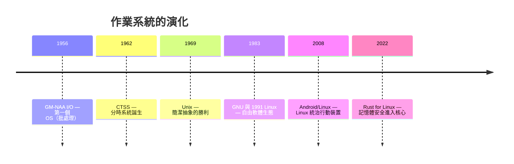
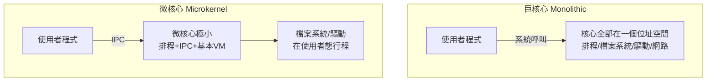
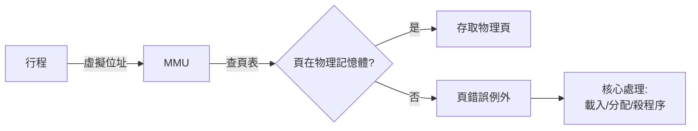

# 6.1 1960-至今：從相容分時系統到 Rust 核心

## 作業系統的本質問題

前五章的一切——編譯器、直譯器、JIT、VM——都是**行程**：作業系統的房客。本章翻轉視角，站在房東的位置。作業系統要解決的根本問題只有兩個：

1. **多工**：有限的 CPU 與記憶體，多個程式同時要用
2. **保護**：一個程式的錯誤不能傷害其他程式與系統本身

所有核心機制（程序、虛擬記憶體、特權級、系統呼叫）都是這兩個問題的答案。而**保護**正是前五章反覆出現的主題：JIT 依賴頁保護（4.2）、VM 依賴 MMU 與訊號（5.3）、沙箱依賴 namespace（第 7 章）——現在到了看清這些依賴的根源的時候。

## 歷史：三次典範轉移



### 1962：CTSS 與分時的革命

批處理時代（IBM 主機），程式是成批提交的卡片，CPU 大部分時間閒置。MIT 的 CTSS（Compatible Time-Sharing System, 1961-62）讓多個終端**同時**互動使用一台機器——代價是必須解決「多個程式的狀態如何輪換與隔離」。程序（process）概念、時鐘中斷驅動的排程、記憶體交換（swapping）都誕生於此。

分時的需求驅動了**硬體保護**的發明：1964 年的 System/360 引入特權級，CPU 開始有「user mode」與「supervisor mode」之分。這個硬體機制是後續一切虛擬化（第 5.1 節 trap-and-emulate）與保護的地基。

### 1969：Unix 的抽象革命

Thompson 與 Ritchie 在 PDP-7 上寫 Unix（名字來自 Multics 的雙關）。Unix 的貢獻不是發明新機制，而是**把機制簡化成三個可組合的抽象**：

1. **一切皆檔案**：裝置、管線、socket 統一成檔案介面
2. **程序 = fork + exec**：建立程序的方法只有一條路徑，簡單到極致
3. **管線**：程式之間用位元組流組合（`ls | grep | wc`）

這三個抽象直至今日仍是 Linux 的日常。fork/exec 的設計（先複製再替換，而不是一步到位的 spawn）在當時看似浪費，卻讓「重定向、管線」這些組合變得自然——**抽象的好壞由它能組合出什麼決定**。

### 1983-1991：自由軟體與 Linux

Stallman 的 GNU（1983）提供使用者態全套工具（gcc、coreutils），缺一個核心。Torvalds 的 Linux（1991，學習自 Tanenbaum 的 MINIX）補上了。兩者合流形成今日的 GNU/Linux 生態。對本書的重要意義：**Linux 的開放使它能被改造**——第 7 章的容器技術（namespace、cgroups）全是 2000 年後各公司（Google、Sun、Parallels）為自己需求往 Linux 裡加的功能。

## 核心的結構：巨核心 vs. 微核心



| | 巨核心（Linux, Windows 核心） | 微核心（MINIX, seL4, QNX） |
|--|------------------------------|----------------------------|
| 效能 | 高（函式呼叫） | 低（IPC 開銷） |
| 可靠性 | 驅動崩潰 = 核心崩潰 | 驅動崩潰 = 重啟那個行程 |
| 驗證 | 太大，無法形式化驗證 | seL4（2009）完成機器檢查的證明 |
| 大小 | Linux 逾 3000 萬行 | seL4 約 1 萬行 |

微核心的理論優雅但實務慘敗（Tanenbaum-Torvalds 辯論, 1992），直到近年兩件事改變局面：

1. **seL4 的形式化驗證**（2009）：1 萬行核心被機器證明「無緩衝區溢位、無空指標、無 use-after-free」——只有小核心才驗證得動
2. **Rust 核心模組**（2022 進入 Linux 6.1）：不改變巨核心結構，而是**用型別系統消除驅動中的記憶體錯誤**

Rust 走的是第三條路：**在巨核心中用語言層保護替代隔離層保護**。動機是殘酷的統計：Linux 核心的 CVE 中，記憶體安全類長期占 60-70%，其中**驅動程式貢獻了絕大多數**（驅動占核心代碼的大半，品質卻最參差）。Rust for Linux 的首批使用案例正是驅動（Android 的 Binder、NVMe 驅動實驗）。

```rust
// Rust 核心模組的 API 風格示意（linux kernel crate）
use kernel::prelude::*;

module! {
    type: HelloModule,
    name: "hello",
    license: "GPL",
}

struct HelloModule;

impl kernel::Module for HelloModule {
    fn init(_module: &'static ThisModule) -> Result<Self> {
        pr_info!("Hello from Rust kernel module!\n");
        Ok(HelloModule)
    }
}
```

注意 API 的設計：核心的 `Result`、`pr_info!`——Rust 的錯誤處理語義被帶進核心，取代了 C 的 `int ret; goto cleanup;` 樣式。**用型別表達錯誤路徑，讓「忘記釋放資源」在編譯期成為不可能**。

## 核心提供給房客的介面：系統呼叫

核心與使用者態的唯一官方通道是系統呼叫（syscall）。x86-64 Linux 的機制：

```text
使用者程式:
  mov rax, 1        ; syscall 號碼（1 = write）
  mov rdi, 1        ; 參數1: fd
  mov rsi, buf      ; 參數2: 緩衝區
  mov rdx, len      ; 參數3: 長度
  syscall           ; 陷入核心
  ; 回來時 rax = 回傳值
```

`syscall` 指令做的事：

1. CPU 從 ring 3（user）切到 ring 0（kernel）
2. 跳到核心預先註冊的入口（`entry_SYSCALL_64`）
3. 核心查表分派到 `sys_write`
4. 核心驗證使用者傳來的指標（`buf` 真的屬於這個行程嗎？）——**這是所有核心安全檢查的第一線**
5. 執行、回傳、切回 ring 3

前五章的程式碼一直在用這條路（`mmap`、`write`、`clone`……），只是被 libc 與 Rust std 包住了。第 6.2 節我們用 Rust 裸機程式——**連 syscall 都沒有的環境**——來真正看清核心是「什麼東西的什麼東西」。

## 記憶體保護：房東的地契制度

OS 保護的核心機制是**虛擬記憶體**，由 MMU（記憶體管理單元，CPU 的一部分）強制執行：



每個行程有自己的頁表 → 位址空間完全隔離。這個機制同時服務：

- **保護**：行程 A 的指標解不引用到行程 B 的記憶體（第 5.3 節 WASM 沙箱的地基）
- **按需載入**：頁錯誤時才真的讀入（可執行檔的 lazy loading）
- **共享**：兩個行程的頁表可以指向同一物理頁（共享庫、共享記憶體）
- **swap**：不熱的頁可換出到磁碟

第 4.2 節的 JIT、第 5.3 節的保護頁，全部是這個機制的租戶。第 6.3 節我們將在裸機上親手建立頁表。

## 本章路線

接下來兩節的操作難度高於前面所有章節——我們要離開「Rust 程式在 Linux 上」的舒適區：

- **6.2**：`#![no_std]`、`no_main`、UEFI/bootloader、裸機輸出與中斷——把一個 Rust 函式變成「沒有作業系統也能跑的東西」
- **6.3**：親手建立分頁結構、配置物理頁框、實作最簡分配器

學完本章再回頭看第 7 章，容器的一切（namespace 是「假的根」、cgroups 是「配額」）將獲得完整的地基理解：**容器就是搶走作業系統的某些抽象、又留下另一些的妥協藝術**。

## 習題

1. fork+exec 與 Windows 的 `CreateProcess`（一步到位）相比，各犧牲了什麼、得到了什麼？
2. 用 `strace -c ls` 統計系統呼叫分佈，解釋為什麼「IO 與記憶體」是核心的大頭。
3. 為什麼驅動程式是核心 CVE 的大宗？（提示：驅動的數量、撰寫者、以及它們觸碰的資料。）
