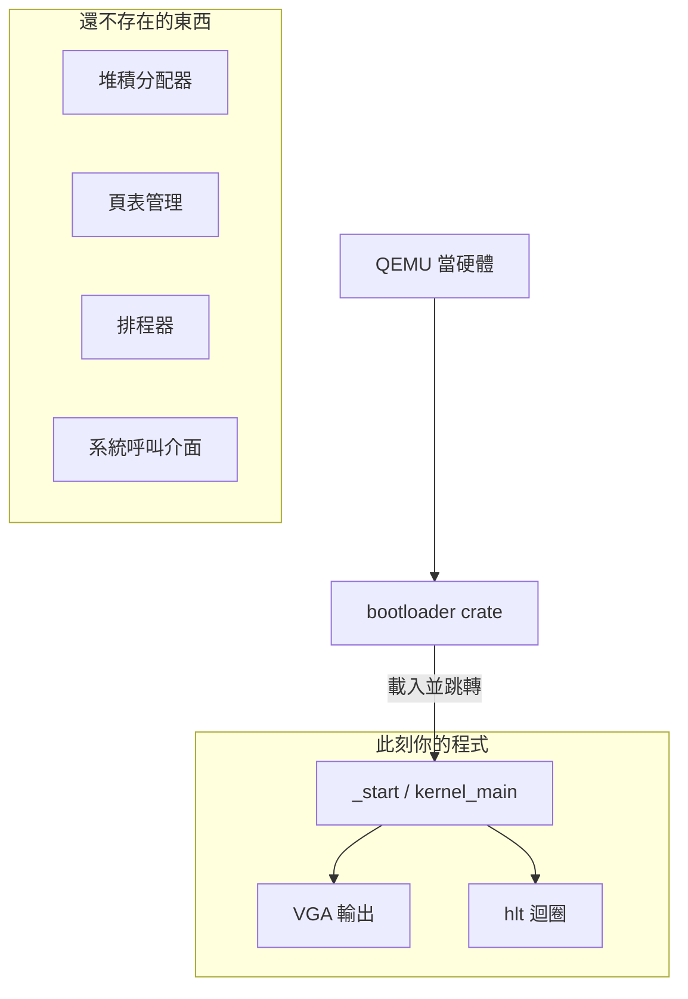

# 6.2 用 Rust 做作業系統啟動與裸機 hello-world

## 從「有 OS 的 Rust」到「Rust 就是 OS」

到目前為止所有程式都有一個隱藏前提：**作業系統在底下**。`println!` 背後是 `write` 系統呼叫，`Box` 背後是 `malloc` 背後是 `brk`/`mmap`，程式啟動是 `execve` 載入 ELF。

本章把這些前提一層層拆掉。目標：**一個 `x86-64` 裸機（bare-metal）Rust 程式**——沒有 libc、沒有 std、沒有 OS，直接被 CPU 執行。這就是「寫作業系統」的第一步，也會讓你徹底理解「OS 提供了什麼」。

## 環境準備

```bash
rustup component add rust-src llvm-tools-preview
cargo install bootimage
# 需要的系統工具
sudo apt install qemu-system-x86_64 xorriso   # Debian/Ubuntu
brew install qemu                              # macOS
```

QEMU 是系統 VM（第 5.1 節）——我們用它當「虛擬硬體」，這正是系統 VM 的本職工作。

## 第一步：no_std

```toml
# Cargo.toml
[package]
name = "mini-os"
version = "0.1.0"
edition = "2021"

[dependencies]
bootloader = "0.9"

[profile.dev]
panic = "abort"   # 裸機無法展開堆疊 unwind
```

```rust
// src/main.rs
#![no_std]       // 不連結標準庫
#![no_main]      // 沒有 C main，入口由我們定義

use core::panic::PanicInfo;

/// 沒有 std 的 println 就沒了——之後自己寫
#[no_mangle]
pub extern "C" fn _start() -> ! {
    // 這裡是整個「作業系統」的起點
    // 此刻：沒有堆積、沒有執行緒、沒有檔案系統
    // 只有：CPU 暫存器、實體記憶體、VGA 文字模式
    loop {}
}

#[panic_handler]
fn panic(info: &PanicInfo) -> ! {
    // panic 不能再 panic——裸機裡錯誤處理就是「停機」
    loop {}
}
```

`#![no_std]` 拆掉的不只是函式庫，而是**整個執行時（runtime）的假設**。逐項檢查 std 給了你什麼：

| std 提供 | 底下是什麼 | 裸機的替代 |
|----------|-----------|-----------|
| `println!` | `write` 系統呼叫 | 直接寫 VGA 記憶體（0xB8000）或序列埠 |
| `Box`/`Vec` | `malloc` → `brk`/`mmap` | 自己寫分配器（6.3 節） |
| `thread` | `clone` 系統呼叫 | 核心排程器（本章不做） |
| panic unwind | 棧展開 + libc | `panic = "abort"` 直接停 |
| 程式入口 | `_start` 由載入器調用 | bootloader 跳到 `_start` |

## 第二步：bootloader 與啟動協議

x86 的啟動流程（BIOS 時代）：


BIOS 的 512 位元組限制意味著真正的核心需要二段式載入。傳統做法是自己寫組語 bootloader；現代做法是用 **bootloader crate**（Rust 寫的，支援 BIOS/UEFI），它把「啟動協議」處理掉，直接把你的 Rust 核心載入到約定位置並跳轉。

```bash
cargo bootimage     # 產生可開機映像
qemu-system-x86_64 -drive format=raw,file=target/x86_64-debug/bootimage-mini-os.bin
```

## 第三步：裸機輸出——VGA 文字模式

沒有 `println!`，我們直接操作硬體。VGA 文字模式是一段映射在 `0xB8000` 的記憶體，每個字元佔 2 位元組（ASCII + 顏色屬性）：

```rust
// src/vga.rs
use core::fmt;

const VGA_BUFFER: *mut u8 = 0xb8000 as *mut u8;
const COLS: usize = 80;

pub struct Writer {
    row: usize,
    col: usize,
}

impl Writer {
    pub fn write_byte(&mut self, byte: u8) {
        unsafe {
            match byte {
                b'\n' => { self.newline(); }
                _ => {
                    let offset = (self.row * COLS + self.col) * 2;
                    // 第一位元組：ASCII；第二位元組：顏色（白底黑字→黑底白字 0x0f）
                    VGA_BUFFER.offset(offset as isize).write_volatile(byte);
                    VGA_BUFFER.offset(offset as isize + 1).write_volatile(0x0f);
                    self.col += 1;
                    if self.col >= COLS { self.newline(); }
                }
            }
        }
    }

    fn newline(&mut self) {
        self.col = 0;
        self.row += 1;
        if self.row >= 25 { self.row = 0; }  // 簡化：不清屏捲動
    }

    pub fn write_str(&mut self, s: &str) {
        for b in s.bytes() { self.write_byte(b); }
    }
}

// 讓 println! 風格可用：實作 fmt::Write
impl fmt::Write for Writer {
    fn write_str(&mut self, s: &str) -> fmt::Result {
        self.write_str(s);
        Ok(())
    }
}

use core::fmt::Write;
use spin::Mutex;

pub static WRITER: Mutex<Writer> = Mutex::new(Writer { row: 0, col: 0 });

#[macro_export]
macro_rules! print {
    ($($arg:tt)*) => ({
        use core::fmt::Write;
        let mut w = $crate::vga::WRITER.lock();
        write!(w, format_args!($($arg)*)).unwrap();
    });
}

#[macro_export]
macro_rules! println {
    () => { $crate::print!("\n") };
    ($($arg:tt)*) => { $crate::print!("{}\n", format_args!($($arg)*)) };
}
```

這段程式碼裡每一個細節都在教「OS 與硬體的直介面」：

1. **`write_volatile`**：告訴編譯器「這個寫入有副作用，不准優化掉」。不寫 volatile，LLVM 可能發現這段記憶體「沒人讀」而整段刪除——**MMIO（記憶體映射 IO）必須 volatile**，這是嵌入式與核心程式的基本規則。
2. **裸指標 `0xb8000 as *mut u8`**：實體位址直接當指標——因為 bootloader 已幫我們設定好「實體位址 = 虛擬位址」的初級映射（6.3 節將親手建立更完整的映射）。
3. **`spin::Mutex`**：`std::sync::Mutex` 用系統呼叫（futex）休眠，裸機沒有——改用自旋鎖（busy-wait）。**每一個 std 型別背後都有一個系統假設**，no_std 的過程就是不斷把假設換成硬體直介面。
4. **巨集自製 `println!`**：`core::fmt` 仍在（它在 core 而非 std），只是輸出目標變成了 VGA。

## 第四步：組裝 `_start`

```rust
// src/main.rs
#![no_std]
#![no_main]

mod vga;
use bootloader::{BootInfo, entry_point};

entry_point!(kernel_main);

fn kernel_main(boot_info: &'static BootInfo) -> ! {
    println!("=== mini-os ===");
    println!("physical memory offset: {:#x}", boot_info.physical_memory_offset);
    println!("it works!");
    loop {
        // TODO: 6.3 節在此加入記憶體管理
        // halt：讓 CPU 進入省電等待，而不是空轉
        x86_64::instructions::hlt();
    }
}

#[panic_handler]
fn panic(info: &PanicInfo) -> ! {
    println!("PANIC: {info}");
    loop { x86_64::instructions::hlt(); }
}
```

`hlt()` 的意義：裸機 `loop {}` 是空轉——CPU 全速執行 nop，浪費電也（在虛擬機上）占 QEMU 的 CPU。`hlt` 指令讓 CPU 停止取指直到下一個中斷。**這是 OS 排程器「idle 狀態」的原語**——6.1 節的分時系統，其能量效率的全部祕密就在中斷 + hlt 的組合。

## 看見整個系統：這一刻你站在哪裡



對照前幾章的認知翻轉：

- 第 4.2 節我們呼叫 `mmap` 要可執行記憶體——**現在你就是決定「哪些頁可執行」的那一方**
- 第 5.2 節 VM 用 `Vec` 當堆疊——**現在你就是「誰給 Vec 一個堆積」的那一方**
- 第 5.3 節 WASM 沙箱靠保護頁——**現在你就是建立保護頁表的那一方**

## 習題

1. 把 `write_volatile` 改成普通 `write`，觀察（用 `objdump`）編譯器是否刪除了迴圈或合併寫入。
2. 實作捲動：`row` 到 25 時把第 1-24 行往上搬一行。用 `core::ptr::copy`（注意它是 unsafe 還是 safe？為什麼？）。
3. 用 QEMU 的 `-d int` 選項觀察中斷。查資料說明：bootloader 跳到 `_start` 時，中斷描述表（IDT）尚未設定——此刻如果發生頁錯誤會怎樣？（這就是 triple fault，機器重啟。）
