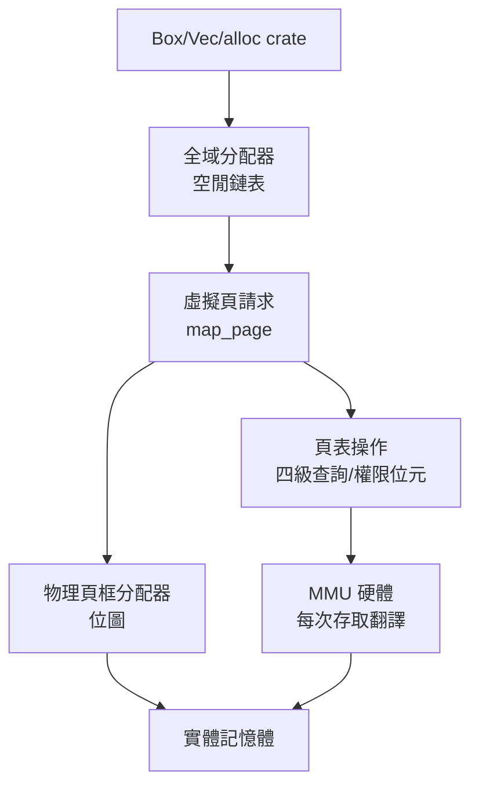

# 6.3 記憶體管理與簡易頁表

## 本章目標

在 6.2 節的裸機環境上實作記憶體管理的三塊基石：

1. **分頁（paging）**：虛擬位址 → 實體位址的翻譯機制——第 5.3 節 WASM 沙箱、第 4.2 節 JIT 都依賴的底層
2. **物理頁框分配器**：管理「哪些 4KB 頁是空閒的」
3. **堆積分配器**：`Box`/`Vec` 的地基——第 1 章以來所有 `alloc` 的源頭

完成後，你的 mini-os 就能 `Box::new` 了。

## 分頁：硬體的翻譯機制

x86-64 用**四級頁表**把 48 位元虛擬位址翻譯成實體位址：


每一級表是一個 4KB 頁，含 512 個 8 位元組條目。條目不只是「位址」，還帶權限位元：

| 位元 | 名稱 | 意義 |
|------|------|------|
| 0 | PRESENT | 此頁在記憶體中嗎？ |
| 1 | WRITABLE | 可寫嗎？ |
| 2 | USER | 使用者態可存取嗎？ |
| 4 | ACCESSED | CPU 存取過（核心用於換頁決策） |
| 5 | DIRTY | 被寫過（swap 決策） |
| 63 | NO_EXECUTE | 不可執行（W^X 的硬體位元！） |

**第 4.2 節的 W^X、第 5.3 節的沙箱、Linux 的頁保護，全部落在這幾個位元上**。核心的工作就是維護這些表，MMU 每次記憶體存取都走一遍這個翻譯（結果快取在 TLB）。

## 在 Rust 中操作頁表

用 `x86_64` crate 的型別化 API（它把頁表條目的每個位元都做成型別安全欄位）：

```rust
// src/mem.rs
use x86_64::structures::paging::page_table::{PageTable, PageTableFlags};
use x86_64::{PhysAddr, VirtAddr};

pub struct PageTableManager {
    pub l4: &'static mut PageTable,   // Level 4 表
    phys_offset: VirtAddr,            // 物理記憶體在虛擬空間的映射起點
}

impl PageTableManager {
    /// 關鍵技巧：核心自己也在虛擬位址上執行，
    /// 要改「實體位址 P 的頁表」，得先知道 P 對應的虛擬位址。
    /// bootloader 已建立「全物理記憶體映射到 phys_offset 起」的區域，
    /// 所以 phys_offset + p 就是答案。
    fn phys_to_virt(&self, phys: PhysAddr) -> *mut PageTable {
        (self.phys_offset + phys.as_u64()).as_mut_ptr()
    }

    /// 建立新映射：虛擬頁 → 物理頁框
    pub unsafe fn map_page(&mut self, virt: VirtAddr, phys: PhysAddr) {
        let p4 = self.l4;
        let idx4 = p4_index(virt);
        let idx3 = p3_index(virt);
        let idx2 = p2_index(virt);
        let idx1 = p1_index(virt);

        // 沿途建立中間級表（不存在就分配）
        let p3 = self.next_table_or_create(p4, idx4);
        let p2 = self.next_table_or_create(p3, idx3);
        let p1 = self.next_table_or_create(p2, idx2);

        // 最後一級寫入映射 + 權限位元
        p1[idx1].set_addr(phys, PageTableFlags::PRESENT | PageTableFlags::WRITABLE);
    }

    unsafe fn next_table_or_create<'a>(
        &mut self,
        table: &'a mut PageTable,
        idx: usize,
    ) -> &'a mut PageTable {
        if table[idx].is_unused() {
            let frame = alloc_frame().expect("out of physical frames");
            table[idx].set_frame(frame, PageTableFlags::PRESENT | PageTableFlags::WRITABLE);
            // 新表要清零——髒的頁表條目 = 隨機映射 = 安全漏洞
            let pt = self.phys_to_virt(frame.start_address());
            core::ptr::write_bytes(pt as *mut u8, 0, 4096);
        }
        &mut *self.phys_to_virt(table[idx].addr())
    }
}
```

三個深度教學點：

1. **「核心怎麼改頁表」是雞生蛋問題**：頁表本身在實體記憶體，核心跑在虛擬位址上。解法（bootloader 預建的 phys_offset 大映射）是 Linux 的 `__va`/`__pa` 巨集的同一思想。**看懂這裡就看懂了「核心也是被虛擬記憶體管理的程式」**——只是它管理著那套機制。
2. **新表必須清零**：分配到的物理頁框內容是未定義的（可能是上一個行程的資料！），不清零的頁表 = 隨機映射 = **資訊洩漏**。這是真實核心 CVE 的種類（kernel heap 未初始化洩漏）。
3. **`unsafe` 的責任邊界**：整個函式 unsafe——因為它做「任意虛擬位址 → 任意物理位址」的映射，這正是 Rust 型別系統**不可能**驗證的操作。核心 = `unsafe` 的集中地，而 Rust 的貢獻是把 unsafe 的總量壓到最小並顯式標註。

## 物理頁框分配器

分頁的原料是 4KB 物理頁框。最簡單可行的分配器——**位圖（bitmap）**：

```rust
// src/frame.rs
pub struct FrameAllocator {
    bitmap: &'static mut [u8],   // 每位元對應一個 4KB 框
    next_free: usize,
}

impl FrameAllocator {
    pub fn alloc(&mut self) -> Option<PhysFrame> {
        // 找到第一個 0 位元
        for i in self.next_free..self.bitmap.len() * 8 {
            if !self.is_used(i) {
                self.set_used(i);
                self.next_free = i + 1;
                return Some(PhysFrame::containing_address(PhysAddr::new(i as u64 * 4096)));
            }
        }
        None
    }

    pub fn dealloc(&mut self, frame: PhysFrame) {
        let idx = frame.start_address().as_u64() as usize / 4096;
        self.set_free(idx);
        self.next_free = self.next_free.min(idx);
    }
}
```

真實核心用**夥伴系統（buddy allocator）**（Linux 的核心做法）：以 2 的冪次管理空閒塊，分配與合併都是 O(log n)，並解決外部碎片。位圖版夠教學，但請讀者查 Knuth 對 buddy 系統的原始討論（TAOCP）。

## 堆積分配器：Box 的地基

有了頁框，再往上做位元組級分配。經典選項：

| 演算法 | 原理 | 適用 |
|--------|------|------|
| 線性（bump） | 一個指標往前推 | 快，但無法釋放 |
| 空閒鏈表 | 空閒塊串鏈表，first/best fit | 通用，碎片化 |
| slab | 每種大小一個池 | Linux 的 kmalloc、Rust 的 typed arena |

裸機第一步用 bump（能動就好），然後接上 `alloc` crate 讓 Rust 的 `Box`/`Vec` 可用：

```rust
// src/heap.rs
use linked_list_allocator::LockedHeap;

#[global_allocator]
static ALLOCATOR: LockedHeap = LockedHeap::empty();

pub fn init_heap(phys_offset: VirtAddr, ptm: &mut PageTableManager) {
    const HEAP_START: u64 = 0o_000_000_000_000;   // 選個不衝突的虛擬位址
    const HEAP_SIZE: u64 = 100 * 1024;             // 100 KiB

    // 1. 向頁框分配器要物理頁
    // 2. map_page 把 [HEAP_START, HEAP_START+HEAP_SIZE] 映射上去
    for page in Page::range_inclusive(
        Page::containing_address(VirtAddr::new(HEAP_START)),
        Page::containing_address(VirtAddr::new(HEAP_START + HEAP_SIZE - 1)),
    ) {
        let frame = alloc_frame().unwrap();
        unsafe { ptm.map_page(page.start_address(), frame.start_address()); }
    }

    // 3. 告訴全域分配器這段範圍可用
    unsafe { ALLOCATOR.lock().init(HEAP_START as *mut u8, HEAP_SIZE as usize); }
}
```

```rust
// 現在裸機上可以：
let v = vec![1, 2, 3];      // Vec → malloc → 空閒鏈表 → 頁框 → 頁表 → 實體記憶體
let b = Box::new(42);       // 整條鏈第一次全部點亮
```

## 完整的層次圖



對照前幾章的依賴鏈：

- 第 1 章 `Box<T>` 的 drop → 空閒鏈表歸還 → （未做）頁回收
- 第 4.2 節 JIT 的 `mmap` → 在真核心中就是 map_page + NO_EXECUTE 位元的管理
- 第 5.3 節 WASM 保護頁 → 頁表權限 + 頁錯誤訊號 → 本章的頁表就是那個訊號的源頭

**至此，本書的信任鏈完全閉合**：從 `Box` 的 drop（第 1 章）到頁表位元（本章），從 JIT 的機器碼（第 4 章）到 W^X 硬體位元（本章），從 WASM 沙箱（第 5 章）到 USER 位元與頁錯誤（本章）。

## 習題

1. 在 `map_page` 中移除清零步驟，然後（在 QEMU 中）驗證新分配的頁表初始內容是否為隨機資料。
2. 把 bump 分配器加上「重置」功能，實作第 5.2 節 arena 分配的想法，比較 Box 與 arena 在連續分配 1000 個小物件時的效能。
3. Linux 的伙伴系統如何處理「分配 3 個頁」這種非 2 冪請求？（提示：拆分與合併，讀 `include/linux/mmzone.h` 的 MAX_ORDER 註解。）
4. 思考題：為什麼核心需要「實體位址 → 虛擬位址」的直接映射區？如果沒有它，改頁表要怎麼做？（提示：先想辦法臨時映射頁表本身——Linux 的 fixmap。）
