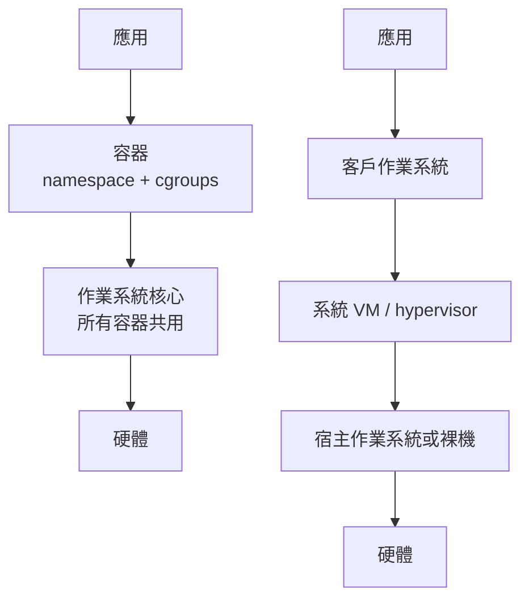
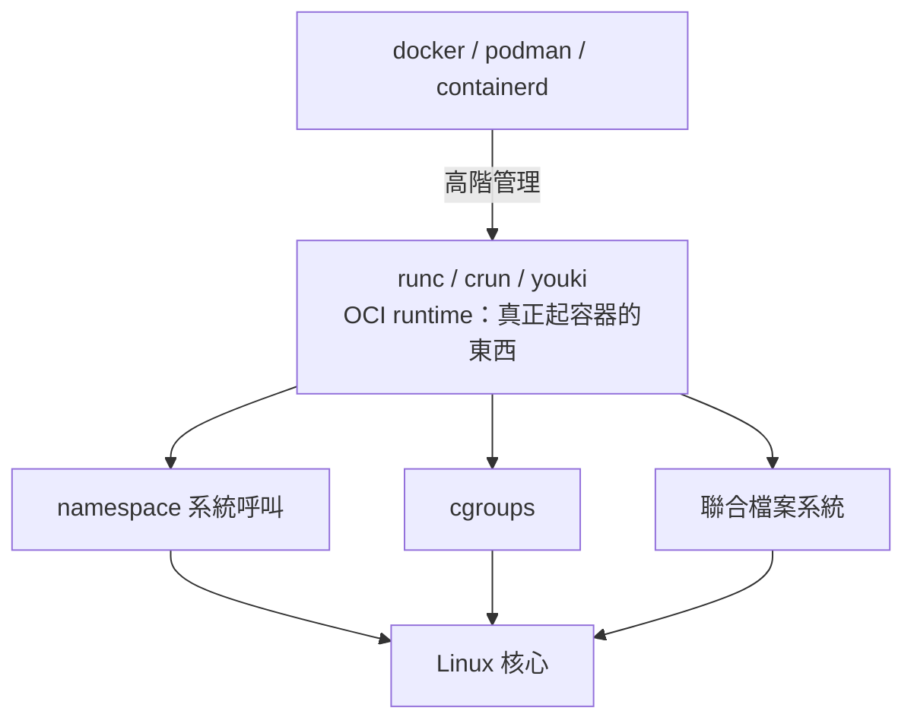
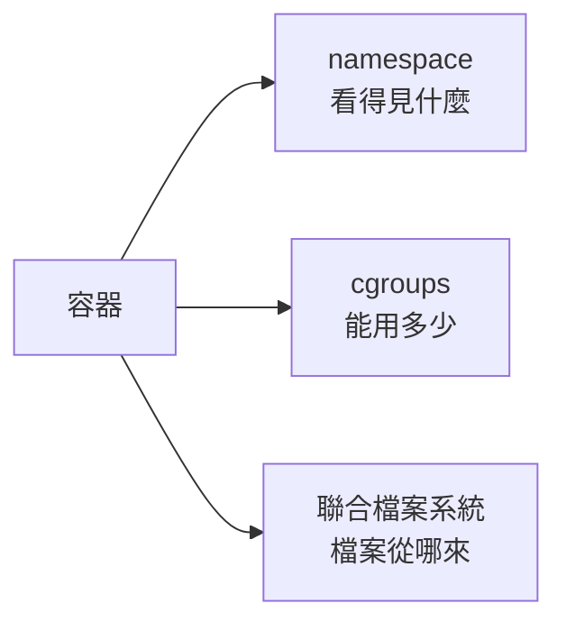

# 7.1 1979-chroot 到 2013-Docker：容器技術史

## 定位：容器是 OS 的「借用者」

第 5 章結尾留了一個理論根據：**沙箱必須由 OS 層兜底**（JVM SecurityManager 的教訓）。第 6 章建立了 OS 的地基（程序、頁表、系統呼叫）。本章的主角——容器——正是「在 OS 之上、VM 之下」的隔離層：

| | 虛擬機 | 容器 |
|--|--------|------|
| 每單位開銷 | GB 級（整個客戶 OS） | MB 級（只有根檔案系統） |
| 啟動 | 數十秒 | 毫秒 |
| 隔離強度 | 硬體級（VT-x） | 核心級（軟體邊界） |
| 核心共用 | 否（各自核心） | **是（共用宿主核心）** |

「共用核心」既是容器的效率來源（第 5 章說 VM 用 OS 的程序抽象實現虛擬機，容器則更徹底：**容器就是一個普通的 Linux 行程**），也是它的風險來源（核心漏洞可能穿透所有容器——2016 年 Dirty COW 之後，多租戶環境對「容器不是 VM」有明確認知）。

## 歷史：七步演化，每步都由需求驅動

### 1979：chroot——囚籠的發明

Version 7 Unix 加入 `chroot`（change root）：把行程的根目錄改到某個子目錄。**原始動機不是安全**，而是開發環境——在隔離的目錄樹中測試軟體，不弄髒主系統。後來它被當安全工具用（FTP 服務 chroot 到 `/srv/ftp`），但 2000 年代初人們發現它的漏洞：root 行程可以 `chroot` 逃逸（`chroot` 之後再 `chdir("..")` + `chroot` 一次）。**教訓：單一機制的隔離不夠，這推動了 namespace 的出現**。

### 2000：FreeBSD Jail——多維囚籠

FreeBSD 的 jail 在 chroot 之上加：程序隔離（jail 內看不到外部程序）、網路隔離（獨立 IP）、資源限制。**「隔離需要多個維度同時做」**的認識成形。

### 2005：Solaris Zones

Sun 的 Zones 把容器做成商業產品級：每個 zone 有獨立程序空間、網路、資源配額。**需求驅動：一台 Sun 伺服器太貴，客戶要在單機上安全地分租**。此時容器概念成熟，但 Linux 沒有對應物。

### 2006-2008：Google cgroups 與 LXC

Google 在自己的內部基礎設施（Borg，Kubernetes 前身）中大量使用容器，2006 年把**資源帳務與限制**（cgroups，control groups）推進 Linux 主線（2007 進入 2.6.24）。同時 OpenVZ/Parallels 把 **namespace** 推進主線（2008 年的 2.6.24 前後逐步完成六種 namespace）。LXC 把兩者組合成使用者可用的容器工具。

這裡有一個歷史因果鏈值得注意：**Google 的搜尋/廣告基礎設施規模，逼出了資源隔離的通用機制；機制進入主線 Linux，才使後來的 Docker 成為可能**。沒有 cgroups，Docker 只是 chroot 的花俏包裝。

### 2013：Docker——把容器變成產品

dotCloud（PaaS 公司）的 Solomon Hykes 發布 Docker。它的技術成分沒有一項是新的：

- namespace（Linux 主線已有）
- cgroups（Google 已推進主線）
- AUFS/聯合檔案系統（已有）
- LXC（已有的執行器）

Docker 的革命是**體驗與分發**：

1. **映像（image）**：分層檔案系統 + 可下載、可複製——「在我機器上能跑」的問題第一次有了工程解
2. **一條命令**：`docker run ubuntu echo hello`——LXC 時代需要幾十行設定檔
3. **註冊中心（Docker Hub）**：映像的 npm/PyPI

**技術不是瓶頸，封裝才是**。這是系統軟體史反覆出現的主題（也呼應第 1.1 節的驅動關係：底層機制成熟後，上層的抽象與工具鏈才是價值所在）。

### 2015：OCI 標準與 runc

Docker 太成功，生態需要標準化。OCI（Open Container Initiative）定義了兩個規格：

- **runtime spec**：容器執行時的介面（JSON 描述 namespace/cgroups/mounts → 起一個隔離行程）——參考實現是 **runc**（從 Docker 剝離出來，Go 寫的）
- **image spec**：映像格式

**runc 之後，容器的技術棧變成分層的**：

**youki**（2021，日本大和總研）用 **Rust** 重寫了 runc，是 OCI runtime 的現代實作——本章 7.3 節將實作一個縮小版的 youki。

### 2014-至今：Kubernetes 與容器的「編排時代」

容器太多之後，管理容器成為新問題——Kubernetes（Google 開源，靈感來自內部 Borg）接管調度、擴縮、故障恢復。此時「容器」一詞的意義已從「一個隔離行程」升級為「可編排的計算單位」。本書範圍止於單機 runtime（7.2-7.3），編排是另一本書的題材。

## 關鍵認知：容器 = 三個機制的組合

把 Docker 拆開，剩下的就是 Linux 的三個既有特性：

- **namespace**：回答「這個行程看到的世界是什麼樣」——隔離的**視圖**
- **cgroups**：回答「這個行程群組能消耗多少資源」——隔離的**配額**
- **overlayfs**：回答「程式的檔案從哪來」——**分發與分層**

第 5 章的 WASM 沙箱是「VM 內畫的線」，容器的隔離是「核心畫的線」；兩者的信任假設不同（WASM 假設驗證器正確，容器假設核心正確），但**設計思想同源：把「看得見、用得起、放得下」三件事都框在邊界內**。

## 習題

1. chroot 為什麼不夠？列出至少三種它隔離不到的資源（提示：程序列表、網路、使用者 ID）。
2. Docker 沒有發明任何核心機制，為什麼成功了？用 1.1 節的「驅動關係」框架分析。
3. 為什麼容器的安全模型在多租戶環境被認為弱於 VM？（提示：核心攻擊面、2016 年 Dirty COW、2022 年 seccomp/namespace 逃逸 CVE。）
