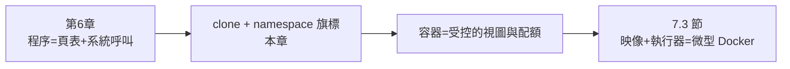

# 7.2 namespace 與 cgroups：以 Rust 實作容器隔離

## 本節目標

不經 Docker，直接用 Rust 呼叫 Linux 系統呼叫，親手建立一個隔離行程——這就是容器的本體。需要 root 權限與 Linux（macOS 的讀者請在虛擬機或 Linux 容器內進行）。

## namespace：看得見什麼

namespace 讓一組行程擁有「全局資源」的私有視圖。Linux 提供七種（時間先後反映核心演化的需求）：

| namespace | 隔離什麼 | 進主線 | 容器中對應的「幻覺」 |
|-----------|----------|--------|----------------------|
| mount | 掛載點 | 2.4.19 (2002) | 獨立的檔案系統 |
| UTS | 主機名 | 2.6.19 (2006) | 獨立的 hostname |
| IPC | System V IPC | 2.6.19 (2006) | 獨立的訊號量/共享記憶體 |
| PID | 程序編號 | 2.6.24 (2008) | 自己是 1 號程序 |
| Network | 網路棧 | 2.6.29 (2009) | 獨立的網卡與 IP |
| User | UID/GID 映射 | 3.8 (2013) | 容器內是 root，容器外不是 |
| Cgroup | cgroup 根視圖 | 4.6 (2016) | 看不到外層 cgroup |

**每種 namespace 對應一種「全域資源的私有視圖」**——這個列表本身就是「作業系統裡有哪些全局狀態」的清單。

## 用 clone 建立 namespace

建立帶 namespace 的行程的系統呼叫是 `clone`（就是建立執行緒的那個——**容器與執行緒用同一個原語，只是旗標不同**，這是第 6 章程序/執行緒統一模型的自然延伸）：

```rust
// src/mini_container.rs — 需要 Linux + root
use libc::{clone, CLONE_NEWNS, CLONE_NEWPID, CLONE_NEWUTS, SIGCHLD};
use std::ffi::CString;

const STACK_SIZE: usize = 1024 * 1024;

pub fn run_in_namespaces<F>(child: F) -> std::io::Result<i32>
where
    F: FnOnce(),
{
    let stack: &mut [u8; STACK_SIZE] = Box::leak(Box::new([0; STACK_SIZE]));
    // clone 旗標 = 在新行程中同時建立多種 namespace
    let flags = SIGCHLD | CLONE_NEWNS | CLONE_NEWPID | CLONE_NEWUTS;

    extern "C" fn trampoline(_arg: *mut libc::c_void) -> i32 {
        // 在新 namespace 內執行的第一行程
        unsafe {
            // PID namespace 內我們是 1 號
            println!("in new namespaces: pid = {}", libc::getpid());
        }
        container_child();
        0
    }

    let ret = unsafe {
        clone(trampoline, stack.as_mut_ptr().add(STACK_SIZE), flags, std::ptr::null_mut())
    };
    if ret < 0 { return Err(std::io::Error::last_os_error()); }
    Ok(ret)
}

fn container_child() {
    // 1. 改 hostname（UTS namespace 隔離）
    let host = CString::new("mini-container").unwrap();
    unsafe { libc::sethostname(host.as_ptr(), 14); }

    // 2. 掛新的 procfs（mount namespace 隔離）——
    //    讓 /proc 反映「只有容器內的程序」
    unsafe {
        let proc_dir = CString::new("proc").unwrap();
        let proc_fs = CString::new("proc").unwrap();
        libc::mkdir(proc_dir.as_ptr(), 0o755);
        libc::mount(proc_fs.as_ptr(), proc_dir.as_ptr(), proc_fs.as_ptr(), 0, std::ptr::null());
    }

    // 3. chroot 到容器根檔案系統（7.3 節用 overlayfs 準備）
    // chroot(".");
}
```

## PID 1 的責任：容器內的 init

PID namespace 的一個深水區：**容器內的第一個程序是 PID 1**，而 PID 1 在 Unix 中有特殊語意——孤兒程序歸它收養，預設訊號處理不同。runc 起的容器中 PID 1 就是使用者指定的程式；如果它不處理 SIGTERM（例如 shell 腳本），`docker stop` 會等 10 秒後改送 SIGKILL。**這是容器工程最常見的坑之一，根源是 Unix 的 init 語意**——7.3 節的 youki 風格實作會處理這個。

## cgroups：能用多少

namespace 管「視圖」，cgroups 管「配額」。cgroup v2 的統一層級是一個檔案系統樹，每個目錄是一組，控制是把限制寫進檔案：

```bash
# 建立 cgroup，限制 CPU 50%、記憶體 100MB
mkdir /sys/fs/cgroup/mini
echo "50000 100000" > /sys/fs/cgroup/mini/cpu.max    # 50ms / 100ms
echo "104857600" > /sys/fs/cgroup/mini/memory.max    # 100MB
echo $PID > /sys/fs/cgroup/mini/cgroup.procs         # 把行程放進去
```

Rust 版本：

```rust
// src/cgroup.rs
use std::fs;
use std::path::Path;

pub struct Cgroup {
    pub path: String,   // 例 "/sys/fs/cgroup/mini"
}

pub struct CgroupSpec {
    pub cpu_quota_us: u64,      // 每 period 的配額
    pub cpu_period_us: u64,
    pub memory_max: u64,
    pub pid_max: u32,
}

impl Cgroup {
    pub fn create(name: &str, spec: CgroupSpec) -> std::io::Result<Self> {
        let path = format!("/sys/fs/cgroup/{name}");
        fs::create_dir_all(&path)?;

        // 寫配額——每個檔案就是一個核心介面
        fs::write(format!("{path}/cpu.max"),
            format!("{} {}", spec.cpu_quota_us, spec.cpu_period_us))?;
        fs::write(format!("{path}/memory.max"), spec.memory_max.to_string())?;
        fs::write(format!("{path}/pids.max"), spec.pid_max.to_string())?;
        Ok(Cgroup { path })
    }

    pub fn attach(&self, pid: i32) -> std::io::Result<()> {
        fs::write(format!("{}/cgroup.procs", self.path), pid.to_string())
    }

    pub fn current_usage(&self) -> std::io::Result<u64> {
        let s = fs::read_to_string(format!("{}/memory.current", self.path))?;
        Ok(s.trim().parse().unwrap_or(0))
    }
}
```

cgroup 的設計哲學值得停下來體會：**核心的介面不是系統呼叫，而是檔案系統**。`echo 100M > memory.max` 這種「把設定寫進檔案」的模式來自 Plan 9 的一切皆檔案哲學（第 6 章 Unix 抽象的極端化）。對比傳統 syscall 介面（參數繁多、版本難擴充），檔案介面的可組合性與可發現性更好——這也是 `/proc`、`/sys` 的同一設計。

## 遺留的隔離細節

生產級容器還要處理（youki/runc 的日常工作）：

| 機制 | 作用 | 相關 syscall |
|------|------|--------------|
| pivot_root | 比 chroot 更徹底的根切換 | `pivot_root` |
| seccomp | 白名單系統呼叫——容器內能調哪些 syscall | `seccomp(SECCOMP_SET_MODE_FILTER)` |
| capabilities | 把 root 的權限拆成 40 項，容器只保留幾項 | `capset` |
| 聯合檔案系統 | 映像分層 + 唯讀基礎層 + 可寫層 | `mount` |

seccomp 與 capabilities 值得多說一句：它們是**把「root 的單一強權限」拆成可組合的小權限**——最小權限原則的作業系統實現。容器預設丟棄大部分 capabilities（例如 `CAP_SYS_ADMIN`，即 mount 權限），所以容器內預設不能掛載檔案系統。第 6 章的視角：**這些都是「房東（核心）給房客（容器）的權限契約」**。

## 組裝：一個最小的隔離行程

```rust
fn main() -> std::io::Result<()> {
    let spec = CgroupSpec {
        cpu_quota_us: 50_000, cpu_period_us: 100_000,
        memory_max: 100 * 1024 * 1024,
        pid_max: 64,
    };
    let cg = Cgroup::create("mini", spec)?;

    let pid = run_in_namespaces(|| {
        // 進入容器後：
        // - 我們是 PID 1
        // - hostname 是 mini-container
        // - /proc 只顯示容器內程序
        // - CPU 最多 50%、記憶體最多 100MB
        println!("hello from container");
    })?;

    cg.attach(pid)?;
    Ok(())
}
```

驗證幻覺：

```bash
$ sudo cargo run
in new namespaces: pid = 1        # ← 容器內第一行程，PID 1
hello from container
```

## 與前幾章的接合



- **clone 的旗標就是容器的全部祕密**：同一個系統呼叫，加 `CLONE_NEWPID|CLONE_NEWNS|CLONE_NEWNET` 就是容器，加 `CLONE_VM|CLONE_THREAD` 就是執行緒
- cgroups 的檔案介面是第 6 章「一切皆檔案」的應用
- pivot_root/chroot 的安全性依賴 mount namespace——單獨的 chroot 可逃逸（7.1 節）

## 習題

1. 只用 `CLONE_NEWPID` 不用 `CLONE_NEWNS`，容器內的 `/proc` 會顯示什麼？為什麼？
2. 實作 `CLONE_NEWNET`，容器內執行 `ip link` 觀察網卡。然後用 veth pair 讓容器有網路（這是 Docker 網路的原理）。
3. 用 `unshare --pid --fork --mount-proc bash`（coreutils 的 namespace 工具）手動實驗，對照本節程式碼的每一步。
4. 思考：為什麼 cgroup v2 要求「一個行程只能在一個 cgroup」？v1 的多層級設計出了什麼問題？
