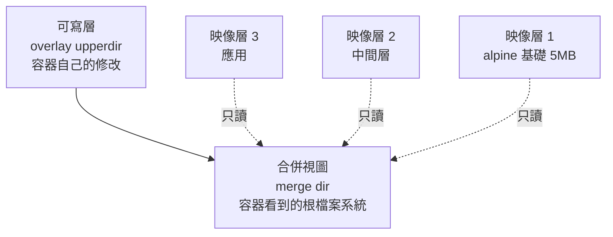
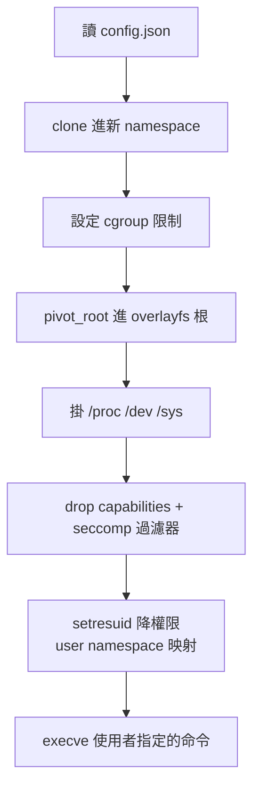
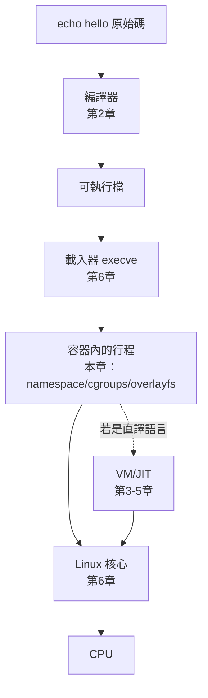

# 7.3 以 Rust 打造微型 Docker 執行器

## 目標：mini-docker

把 7.2 節的隔離機制，包裝成 Docker 式的體驗：

```bash
$ sudo mini-docker run alpine:latest echo hello
hello
```

要實作三個部分：

1. **映像層**：下載與解壓 OCI 映像 → 聯合檔案系統掛載
2. **執行器**：namespace + cgroups + pivot_root 起容器（youki/runc 的核心邏輯）
3. **CLI**：`run` 子命令

參考對象是 **youki**——Rust 寫的 OCI runtime。本節做的是它的百行縮影。

## OCI 映像：分層的 tar

OCI image spec 的結構：

```text
alpine:latest
├── manifest.json           # 描述有哪些層
├── sha256:xxx/layer.tar    # 每層：該層對根檔案系統的「差異」
│                           #   （新增/修改/刪除的檔案）
└── sha256:yyy/config.json  # 進入點、環境變數、工作目錄
```

**分層是 Docker 體驗的核心**：`alpine` 基礎層 5MB，你的應用層可能只有 1KB，兩者組合成容器的根檔案系統。多個容器共享同一個基礎層（唯讀），磁碟與記憶體（頁快取）都省。

## 聯合檔案系統：把層疊起來



用 Linux 的 overlayfs 實作（一行 mount，但意義深遠）：

```rust
// src/image.rs
use std::fs;
use std::process::Command;

pub struct LayeredRootfs {
    pub root: String,        // 合併後的容器根
    pub upper: String,       // 可寫層
    pub work: String,        // overlayfs 工作目錄
}

/// 下載映像並解出各層（簡化：假設已有 layers/ 目錄含解壓好的層）
pub fn prepare_rootfs(name: &str, layers: &[String]) -> std::io::Result<LayeredRootfs> {
    let base = format!("/var/lib/mini-docker/{name}");
    fs::create_dir_all(format!("{base}/upper"))?;
    fs::create_dir_all(format!("{base}/work"))?;
    fs::create_dir_all(format!("{base}/merge"))?;

    let lower = layers.iter().cloned().collect::<Vec<_>>().join(":");
    // overlayfs 的底層序列 = 映像的分層
    let out = Command::new("mount")
        .args([
            "-t", "overlay", "overlay",
            "-o", &format!("lowerdir={lower},upperdir={base}/upper,workdir={base}/work"),
            &format!("{base}/merge"),
        ])
        .output()?;
    if !out.status.success() {
        return Err(std::io::Error::new(std::io::ErrorKind::Other,
            format!("overlayfs mount failed: {}", String::from_utf8_lossy(&out.stderr))));
    }
    Ok(LayeredRootfs {
        root: format!("{base}/merge"),
        upper: format!("{base}/upper"),
        work: format!("{base}/work"),
    })
}
```

overlayfs 的行為規則（容器的檔案系統語意由此而來）：

- 讀：從最上層找起，找到即回——**讀舊層檔案走頁快取，多容器共享同一物理頁**
- 寫：**copy-up**——首次修改下層檔案時，先複製到可寫層再改。容器「看起來」在改系統檔案，實際上複製了一份
- 刪：在下層檔案的位置放一個「whiteout」特殊檔案

copy-up 解釋了容器效能的一個常識：**容器內寫入大檔案比宿主慢（首次），頻繁寫入應掛 volume（繞過 overlayfs）**——Docker 的 `-v` 掛載就是為此。

## 執行器：runc 的核心邏輯

OCI runtime spec 把「起一個容器」定義為：讀入 `config.json`，執行一連串隔離步驟，最後 exec 使用者程式。runc/youki 的執行序列：



順序是關鍵：**權限逐步遞減，每一步都在縮小後續步驟的能力範圍**。最後一步 `execve` 之後，容器內跑的就是使用者的程式，而它已經被四層鎖（namespace、cgroup、capability、seccomp）包住。

```rust
// src/executor.rs — youki 風格的容器執行序列
use crate::{cgroup, image::LayeredRootfs};
use std::path::Path;

pub struct ContainerSpec {
    pub image_layers: Vec<String>,
    pub cmd: Vec<String>,          // 例 ["echo", "hello"]
    pub cgroup: cgroup::CgroupSpec,
}

pub fn run(spec: ContainerSpec) -> std::io::Result<()> {
    // 1. 準備聯合檔案系統
    let rootfs = crate::image::prepare_rootfs("run", &spec.image_layers)?;

    // 2. clone 進 namespace（7.2 節的函式）
    let pid = crate::mini_container::run_in_namespaces(move || {
        // 以下在新 namespace 內執行，此時我們是 PID 1、還是 root

        // 3. pivot_root：把 overlayfs 根變成真正的 /
        //    （比 chroot 強：舊根被完全卸載，無法逃回）
        do_pivot_root(&rootfs.root);

        // 4. 掛上容器內的 /proc /dev
        mount_pseudo_filesystems();

        // 5. drop capabilities：保留 BASIC 之外全丟
        //    （真實 youki 在此安裝 seccomp BPF 過濾器）
        // drop_capabilities();

        // 6. exec 使用者命令——execve 不 fork，直接替換本行程
        let c: Vec<std::ffi::CString> = spec.cmd.iter()
            .map(|s| std::ffi::CString::new(s.as_str()).unwrap())
            .collect();
        unsafe {
            libc::execvp(c[0].as_ptr(), c.as_ptr() as *const *const libc::c_char);
        }
        // exec 失敗才會到這裡
        std::process::exit(127);
    })?;

    // 7. 把容器行程放進 cgroup（在父行程側設定）
    let cg = cgroup::Cgroup::create("mini-docker", spec.cgroup)?;
    cg.attach(pid)?;

    // 8. 等待結束，回收（PID 1 之外的正常程序由 wait 收屍）
    let status = unsafe { wait_and_reap(pid)? };
    Ok(())
}
```

`execve` 的語意（第 6 章提過）在此有新意義：**exec 不建立新行程，而是「靈魂替換」**——PID、namespace、cgroup、capability 全部保留，只有程式碼與位址空間被替換。這正是容器執行器把「隔離設定」與「使用者程式」接起來的方式：所有隔離在 exec 之前完成，exec 之後使用者程式生於隔離之中。

## CLI 與完整流程

```rust
// src/main.rs
use std::process::exit;

fn main() {
    let args: Vec<String> = std::env::args().collect();
    match args.get(1).map(|s| s.as_str()) {
        Some("run") => {
            let cmd = args[3..].to_vec();
            let spec = executor::ContainerSpec {
                image_layers: pull_image(&args[2]),   // 拉映像（解 tar、分層）
                cmd,
                cgroup: cgroup::CgroupSpec {
                    cpu_quota_us: 100_000, cpu_period_us: 100_000,   // 1 CPU
                    memory_max: 512 * 1024 * 1024,
                    pid_max: 256,
                },
            };
            if let Err(e) = executor::run(spec) {
                eprintln!("mini-docker: {e}");
                exit(1);
            }
        }
        _ => {
            eprintln!("usage: mini-docker run <image> <cmd>...");
            exit(2);
        }
    }
}
```

## 測試與對照

```bash
# 編譯
cargo build --release

# 對照組：真 Docker
docker run alpine echo hello

# 我們的
sudo ./target/release/mini-docker run alpine echo hello

# 觀察：容器內外互相看不見
sudo ./target/release/mini-docker run alpine sh -c "ps aux; hostname"
# → 只有一個 PID 1 的 sh，hostname 是我們設定的
```

## mini-docker 與生產執行器的差距

本書實作涵蓋了 runc/youki 的**骨幹**，生產級還需：

| 缺項 | 內容 | 對應真實組件 |
|------|------|--------------|
| 映像拉取 | registry API、TLS、內容定址 | containerd 的 puller |
| seccomp 過濾器 | BPF 程式白名單系統呼叫 | youki 的 seccomp 模組 |
| user namespace | 容器 root ↔ 宿主非 root 的 UID 映射 | `CLONE_NEWUSER` |
| 熱遷移/檢查點 | CRIU 凍結容器到磁碟、跨機恢復 | `criu` 集成 |
| 網路 | veth pair + bridge + iptables NAT | CNI 插件 |
| 儲存驅動 | overlayfs 之外的備選（btrfs/zfs/快照） | storage driver |

**最後一個維度的對照**——把本書所有章節放回一張圖：



從一行文字到一個被隔離的、受配額約束的、跑在自建頁表與機器碼上的行程——**這條鏈的每一環你都親手做過了**。系統軟體不是一門「知識」，而是一套可以逐層建造、逐層驗證的工程實踐。Rust 是這個時代最合適的建造工具：它把每一層的 unsafe 邊界顯式化，讓「系統的信任鏈」第一次可以用型別系統的語言來陳述。

## 習題

1. 在容器內執行 `ls /proc`，然後實作 seccomp 白名單（只允許 `read/write/exit`），觀察其他系統呼叫被拒絕的現象。
2. 實作 user namespace：容器內 uid 0 映射到宿主 uid 1000，驗證容器內 `id` 顯示 root 但宿主上檔案屬於普通使用者。
3. 兩個容器同時 `dd if=/dev/zero of=/tmp/big`，用 cgroups 的 `memory.max` 觀察哪個先被 OOM kill，並解釋 `memory.oom.group` 的作用。
4. 把 mini-docker 改成支援 `-v /host:/mnt` 掛載（bind mount），思考為什麼 volume 能繞過 overlayfs 的 copy-up。
