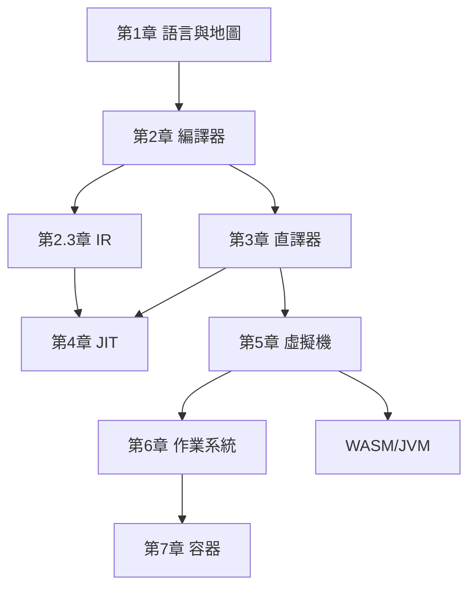

# 用 Rust 學習系統軟體設計

一本以 Rust 為工具，從編譯器、直譯器、JIT、虛擬機，一路做到作業系統與 Docker 容器的實作型教科書。

全書的核心命題是：**系統軟體是一條由上而下的信任鏈**——直譯器信任作業系統的記憶體，JIT 信任 CPU 的指令集，容器信任核心的 namespace。理解任何一層，最好的方式就是親手寫出那一層，而 Rust 是五十年來第一門能同時勝任「核心層」與「語言層」兩端工作的語言。

## 目錄

* 第1章-導論：系統軟體的地圖
    * [1.1-系統軟體的階層地圖與驅動關係](01.1-系統軟體的階層地圖與驅動關係.md)
    * [1.2-1958-LISP到2010-Rust：為何系統軟體需要新的語言](01.2-1958-LISP到2010-Rust.md)
    * [1.3-用Rust實作一個最小語言來貫穿全書](01.3-用Rust實作一個最小語言來貫穿全書.md)
* 第2章-編譯器
    * [2.1-1940-1970-從機器碼到最佳化編譯器](02.1-1940-1970-從機器碼到最佳化編譯器.md)
    * [2.2-詞法分析與解析器組合子](02.2-詞法分析與解析器組合子.md)
    * [2.3-中間表示與代碼生成](02.3-中間表示與代碼生成.md)
* 第3章-直譯器
    * [3.1-1958-LISP與樹行走的直譯器](03.1-1958-LISP與樹行走的直譯器.md)
    * [3.2-環境與閉包：以Rust實作詞法作用域](03.2-環境與閉包：以Rust實作詞法作用域.md)
    * [3.3-位元碼直譯器：往虛擬機的橋樑](03.3-位元碼直譯器：往虛擬機的橋樑.md)
* 第4章-JIT
    * [4.1-從解譯到執行時編譯：1960-至今的JIT史](04.1-從解譯到執行時編譯：1960-至今的JIT史.md)
    * [4.2-自修改可執行記憶體：以Rust寫一個迷你JIT](04.2-自修改可執行記憶體：以Rust寫一個迷你JIT.md)
    * [4.3-Cranelift與自訂位元碼的JIT後端](04.3-Cranelift與自訂位元碼的JIT後端.md)
* 第5章-虛擬機
    * [5.1-虛擬機的兩大族系：系統VM與行程VM](05.1-虛擬機的兩大族系：系統VM與行程VM.md)
    * [5.2-疊代器式的堆疊虛擬機：以Rust實作](05.2-疊代器式的堆疊虛擬機：以Rust實作.md)
    * [5.3-WASM：以Rust寫一個WebAssembly執行器](05.3-WASM：以Rust寫一個WebAssembly執行器.md)
* 第6章-作業系統
    * [6.1-1960-至今：從相容分時系統到Rust核心](06.1-1960-至今：從相容分時系統到Rust核心.md)
    * [6.2-用Rust做作業系統啟動與裸機hello-world](06.2-用Rust做作業系統啟動與裸機hello-world.md)
    * [6.3-記憶體管理與簡易頁表](06.3-記憶體管理與簡易頁表.md)
* 第7章-Docker容器
    * [7.1-1979-chroot到2013-Docker：容器技術史](07.1-1979-chroot到2013-Docker：容器技術史.md)
    * [7.2-namespace與cgroups：以Rust實作容器隔離](07.2-namespace與cgroups：以Rust實作容器隔離.md)
    * [7.3-以Rust打造微型Docker執行器](07.3-以Rust打造微型Docker執行器.md)

## 環境需求

- Linux x86-64（第 2、4、6、7 章的實驗需要 Linux；macOS 讀者建議使用虛擬機或容器）
- Rust 1.75 以上（`rustup update stable`）
- 第 6 章需要 `qemu-system-x86_64`；第 7 章需要 root 權限

## 全書地圖

## 學習路線建議

第 1–3 章是語言層（怎麼「跑起來」一段程式），第 4–5 章是執行層（怎麼「跑得快、跑得穩」），第 6–7 章是系統層（誰在底下撐住一切）。三層剛好對應 Rust 的三種用法：普通 `cargo` 專案、`unsafe` 與記憶體操作、以及 `no_std` 與裸機。

每一節的程式碼都可以直接放進一個 `cargo new` 出來的專案編譯執行。建議讀者邊讀邊打，遇到編譯錯誤時，把 Rustc 的錯誤訊息當作老師——它是本書最重要的助教。
