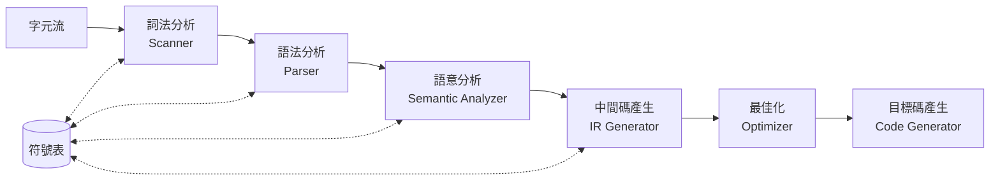

# 1.2 編譯器的整體架構與前端後端

## 為什麼要「分階段」

1950 年代的第一代編譯器（如 FORTRAN I）多為單體式：程式從頭讀到尾，邊讀邊產生碼。這種做法對單一機器可行，但每支援一種新語言、新機器，幾乎要重寫整個系統。1960 年代 UNCOL 計畫與 ALGOL 60 的經驗使人體認到：**把「語言的知識」與「機器的知識」分離**，才能以 $m \times n$ 降為 $m + n$ 的成本支援 $m$ 種語言與 $n$ 種機器。這正是前後端分離思想的起源。

## 六個經典階段

教科書上常見的架構（可追溯到 Aho–Sethi–Ullman《Compilers: Principles, Techniques, and Tools》，即「龍書」，1977 初版、1986 二版）將編譯過程分為六階段：



1. **詞法分析（Lexical Analysis / Scanning）**：把字元流切分為記號（token），如識別字、關鍵字、運算子。對應第 2 章。
2. **語法分析（Parsing）**：依文法規則把 token 流組織成樹，判定結構合法性。對應第 3 章。
3. **語意分析（Semantic Analysis）**：檢查型別、範圍、宣告，建立符號表。對應第 4.1 節。
4. **中間碼產生（IR Generation）**：產生與機器無關的中間表示，如三址碼、SSA。對應第 4.2 節。
5. **最佳化（Optimization）**：在中間碼上做常數摺疊、死碼刪除等變換。對應第 5 章。
6. **目標碼產生（Code Generation）**：指令選擇、暫存器配置、指令排程。對應第 5 章。

## 前端、中端與後端

實務上通常分為三段：

- **前端（Frontend）**：詞法、語法、語意分析＋中間碼產生。只懂語言，不懂機器。
- **中端（Middle-end）**：與語言及機器皆大致無關的最佳化，在 IR 上進行。這是 LLVM 成功的關鍵設計——Chris Lattner 於 2000 年代初提出 LLVM IR 作為統一中介層，讓 C、Rust、Swift 等語言共享同一套最佳化。
- **後端（Backend）**：指令選擇、暫存器配置、目標碼輸出。只懂機器，不懂語言。

## 範例：一行程式碼走完全程

以 C 語句 `position = initial + rate * 60;` 為例：

**詞法分析**產生 token 流：

```
<id,position> <=> <id,initial> <+> <id,rate> <*> <num,60> <;>
```

**語法分析**建構抽象語法樹：

```
      =
     / \
 position  +
          / \
   initial   *
            / \
       rate    60
```

**語意分析**發現 `rate` 為浮點數，將整數 `60` 轉為 `60.0`（插入型別轉換節點 `inttofloat`）。

**中間碼**（三址碼）：

```
t1 = inttofloat(60)
t2 = rate * t1
t3 = initial + t2
position = t3
```

**最佳化**可將 `60` 折疊為 `60.0`，並於迴圈中將不變量外提；若 `position` 未再使用，可整段刪除。

**目標碼**（x86 風格）：

```asm
movss  xmm0, [rate]
mulss  xmm0, [sixty_f]
addss  xmm0, [initial]
movss  [position], xmm0
```

## 階段之間的「趟」（Pass）與一體化設計

- **多趟（multi-pass）編譯器**：每個階段讀寫一次中間結果，記憶體需求低，但 I/O 成本高。1970 年代 Pascal 的 P-code 編譯器即採此法。
- **單趟（one-pass）編譯器**：邊掃邊產碼，C 語言的宣告先行（declare before use）正是為了支援單趟編譯。
- **即時編譯（JIT）**：Java HotSpot（1990 年代末）與 JavaScript V8 把編譯器嵌入執行期，動態蒐集分支資訊做導向式最佳化，代表架構上的第三條路。

## 小結

- 分階段源於「語言知識與機器知識分離」的經濟動機。
- 六階段＋符號表是標準心智模型；前、中、後端是實務分工。
- 每個階段都有獨立的理論基礎（正規語言、文法、資料流），後續章節將逐一展開。
