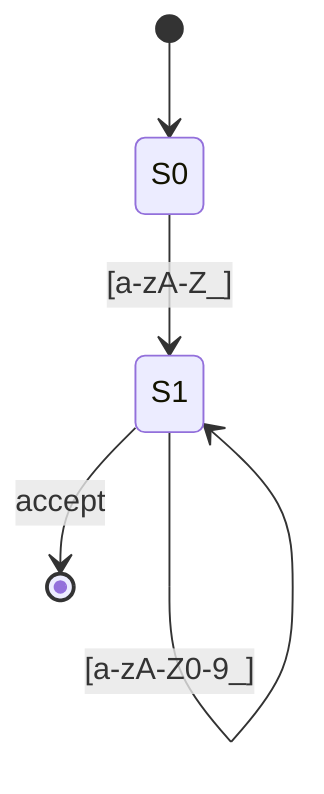

# 2.1 正規語言與有限狀態機

## 從 Kleene 到自動機理論

1951 年，Stephen Kleene 在 RAND 公司的報告《Representation of Events in Nerve Nets and Finite Automata》中，為 McCulloch–Pitts 神經元模型（1943）能辨識的事件建立了代數描述，即「正規事件」。1956 年他證明：正規事件、正規表示式、有限自動機三者等價，這就是 **Kleene 定理**。1959 年 Rabin 與 Scott 證明 DFA（確定性）與 NFA（非確定性）等價且可互相轉換，並因此獲得 1976 年圖靈獎。

這一連串理論成果在 1960 年代被編譯器領域吸收：詞法單元（識別字、數字、運算子）的結構恰好落在正規語言的表達能力內，而有限狀態機的線性時間特性使掃描快得足以吞下整個原始檔。

## 有限狀態機的形式定義

**確定性有限自動機（DFA）** 是五元組 $M = (Q, \Sigma, \delta, q_0, F)$ ：

- $Q$ ：有限狀態集合
- $\Sigma$ ：輸入字母集
- $\delta: Q \times \Sigma \to Q$ ：轉移函數（每狀態每字元恰好一個出口）
- $q_0 \in Q$ ：起始狀態
- $F \subseteq Q$ ：接受狀態集合

語言 $L(M) = \{ w \mid \delta^*(q_0, w) \in F \}$ 。

**非確定性有限自動機（NFA）** 放寬 $\delta$ 為 $\delta: Q \times (\Sigma \cup \{\epsilon\}) \to 2^Q$ ，允許零個、一個或多個出口，並允許不消耗字元的 $\epsilon$ 轉移。

**範例**：辨識 C 風格識別字（字母或底線開頭，其後為字母、底線或數字）：



## NFA 轉 DFA：子集構造法

NFA 表達力強、書寫自然，但直接模擬需要回溯或平行追蹤多個狀態。Rabin–Scott 指出可將其確定化：**子集構造法（Subset Construction）**。

演算法概念：

```text
輸入：NFA N
輸出：DFA D
D 的狀態 = N 狀態集合的子集（可達者）
ε-closure(T) = 從 T 出發只走 ε 邊可達的所有狀態
move(T, a)   = { t | s∈T, s --a--> t }

初始：Dstart = ε-closure({q0})
工作佇列未處理：
  取出 T，對每個輸入符號 a：
    U = ε-closure(move(T, a))
    若 U 尚未命名，加入佇列
    加轉移 T --a--> U
含 NFA 接受狀態的子集即為 D 的接受狀態
```

最壞情況狀態數從 $n$ 增至 $2^n$ ，但實務上詞法的 NFA 很小，膨脹可控。

## DFA 最小化

同一正規語言有多個 DFA，**Myhill–Nerode 定理**（1957）指出每個正規語言存在唯一（同構意義下）的最小 DFA。最小化用**等價類分裂法**：

```text
1. 初始劃分：接受狀態 / 非接受狀態
2. 反覆細分：
   若 s, t 同組但存在字元 a 使
   δ(s,a) 與 δ(t,a) 落在不同組，則分裂 s、t
3. 直到不再分裂
```

此演算法為 $O(n^2)$ 級，Hopcroft（1971）提出 $O(n \log n)$ 版本。掃描器產生器（如 Lex）皆使用最小 DFA，因為狀態越少，轉移表越小，快取越友善。

## 為什麼詞法分析要靠正規語言

- **速度**：DFA 每個輸入字元只做一次表查詢， $O(n)$ 且無回溯。
- **表達力恰當**：識別字、常數、運算子皆無巢狀或計數需求。想用正規表示式配對巢狀括號是不可能的——這是 **Pumping Lemma**（泵引理，1960 年代由 Rabin、Bar-Hillel 等人形式化）保證的：對任意正規語言存在長度 $p$ ，任何長度 $\ge p$ 的字串都可「泵」出無限多個也在語言中的變形。 $a^n b^n$ 違反此性質，故不是正規語言。
- **工具化**：正規表示式 → NFA（Thompson 構造，1968）→ DFA（子集構造）→ 最小 DFA，全程可自動化，這正是 Lex/Flex 的原理（見 2.2）。

## 邊界問題：最長符合與多模式

掃描時常有多條規則同時符合（如 `>` 與 `>=`、`=` 與 `==`），約定取**最長符合**；若長度相同取**優先序最高**的規則。實作上在 DFA 執行中記錄「最後一次抵達接受狀態的位置與規則」，失配時回退該位置繼續。這就是** maximal munch** 原則。

## 小結

- Kleene 定理連結正規表示式、NFA、DFA 三種等價表示。
- 子集構造與 DFA 最小化是掃描器產生器的兩大核心演算法。
- Pumping Lemma 解釋了為何語法分析需要更強的機器——下一節將把正規表示式變成實際工具。
