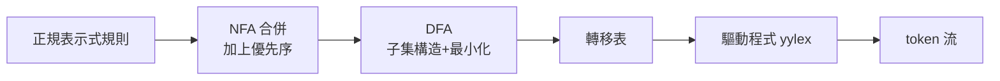

# 2.2 正規表示式與 Lex/Flex 工具

## 正規表示式的定義

在字母集 $\Sigma$ 上，正規表示式（regular expression, regex）遞迴定義如下：

1. $\epsilon$ 是正規表示式，表語言 $\{\epsilon\}$
2. $a \in \Sigma$ 是正規表示式，表語言 $\{a\}$
3. 若 $r, s$ 為正規表示式，則：
   - $r \mid s$（選擇，union）：$L(r) \cup L(s)$
   - $rs$（連接，concatenation）：$L(r)L(s)$
   - $r^*$（Kleene star）：零次或多次重複

優先序：`*` > 連接 > `|`。現代工具再加 `+`（一次以上）、`?`（零或一次）、字元類 `[a-z]`、計數 `{m,n}` 等語法糖。

## Thompson 構造：從 regex 到 NFA

1968 年，Ken Thompson 在貝爾實驗室發表論文《Regular Expression Search Algorithm》，提出將正規表示式轉為 NFA 的構造法，並把它寫進 QED 編輯器——這是 grep（1974）與後來所有 regex 引擎的直系祖先。構造規則：

- $a$：兩狀態一邊
- $rs$：串接（前者接受狀態 ε 連到後者起始）
- $r \mid s$：新增分支與匯合狀態
- $r^*$：新增環回 ε 邊

由 $n$ 個符號的 regex 構造出的 NFA 至多 $2n$ 個狀態、$3n$ 條轉移，構造是線性的。

## Lex 與 Flex 的誕生

1975 年，Mike Lesk 與 Eric Schmidt 在貝爾實驗室寫出 **Lex**——lexical analyzer generator，搭配 Johnson 的 Yacc 構成 UNIX 編譯工具鏈的黃金組合。Lex 讀入規則檔（`.l`），產生 C 語言掃描器 `lex.yy.c`。開源世界的 **Flex**（fast lex, 1987, Vern Paxson 等）是其現代替代品，採用 DFA 表驅動，速度大幅提升。

規則檔三段式：

```lex
%{
#include "token.h"
int line = 1;
%}

%option noyywrap

DIGIT    [0-9]
ID       [a-zA-Z_][a-zA-Z0-9_]*

%%

[ \t]+            ;
\n                { line++; }
"if"              { return IF; }
"while"           { return WHILE; }
{ID}              { yylval.id = strdup(yytext); return ID; }
{DIGIT}+          { yylval.num = atoi(yytext); return NUM; }
"+"               { return PLUS; }
"<="              { return LE; }
.                 { printf("非法字元 %s\n", yytext); }

%%

int main() { while (yylex() != 0) ; return 0; }
```

運作流程：



## 規則的優先序與二義性消解

Lex 的兩條鐵律：

1. **最長符合優先（maximal munch）**：`<=` 會勝過 `<`。
2. **先列出的規則優先**：把 `"if"` 放在 `{ID}` 之前，否則 `if` 會被當成識別字。

這兩條規則讓使用者不需要處理多數歧義，代價是規則順序具有語意意義——排列錯誤是詞法層最常見的 bug。

## 正規表示式在編譯器之外的影響

- **grep / awk / sed**（1970 年代 UNIX 工具）把 regex 帶入日常腳本。
- **Perl**（Larry Wall, 1987）大幅擴充 regex 語法，引入回溯引擎與反向參照，使其不再是正規語言（可表達 $a^n b^n$），但也帶來 ReDoS（catastrophic backtracking）風險。
- **Rust 的 regex crate、Go 的 RE2**（Cox, 2010）回歸 DFA/NFA 模擬，保證線性時間、無指數爆炸——理論上的正規語言模型在工程上重新獲勝。

## 小結

- 正規表示式是描述語言的最小代數，Thompson 構造讓它可自動編譯為 NFA/DFA。
- Lex/Flex 將「regex → NFA → DFA → 表驅動 C 碼」整條流水線自動化，是編譯器工具化的濫觴。
- 理解 maximal munch 與優先序，是寫出正確掃描器規則的關鍵。
