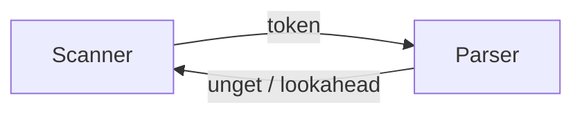

# 2.3 詞法分析器的實作

## 手寫 vs. 產生器

實作掃描器有兩條路：**表驅動自動機**（由 Lex/Flex 產生或手工編碼）與**手寫遞迴/分支掃描器**（GCC、V8、Rustc 皆為手寫）。取捨如下：

| 方面 | 產生器（Flex） | 手寫掃描器 |
|------|----------------|------------|
| 開發速度 | 極快 | 慢 |
| 錯誤訊息品質 | 一般 | 可精細（行、欄、上下文） |
| 速度 | 快（表驅動） | 極快（直接分支、可向量化） |
| Unicode/複雜詞法 | 較麻煩 | 容易 |
| 與 Parser 的緊耦合 | 困難 | 容易 |

現代編譯器偏手寫，主要原因包括：需要處理 UTF-8、原始字串、插值字串、條件編譯（C 的預處理器）、以及為 Parser 提供「預看」與「rewind」能力。

## Token 的表示

```c
typedef enum {
    TK_INT, TK_IF, TK_WHILE, TK_ID, TK_NUM,
    TK_PLUS, TK_MINUS, TK_LE, TK_ASSIGN, TK_EOF
} TokenType;

typedef struct {
    TokenType type;
    char     *lexeme;   // 原文（或 interned id）
    int       line, col;
    union {
        long  num;
        double fnum;
        int   sym_index;   // 指向符號表
    };
} Token;
```

大型編譯器使用 **字串駐留（string interning）**：每個識別字只存一份，比較指標即比較字串，快且省記憶。

## 核心掃描迴圈（手寫 DFA 風格）

以迷你語言為例，主迴圈依首字元分派：

```c
Token next_token() {
    skip_ws_and_comments();
    int c = peek();

    if (isalpha(c) || c == '_')  return scan_ident();
    if (isdigit(c))              return scan_number();
    if (c == '"')                return scan_string();

    switch (c) {
    case '+': advance(); return make(TK_PLUS);
    case '<':
        advance();
        if (peek() == '=') { advance(); return make(TK_LE); }
        return make(TK_LT);
    case '=':
        advance();
        if (peek() == '=') { advance(); return make(TK_EQ); }
        return make(TK_ASSIGN);
    case EOF: return make(TK_EOF);
    default:  error("unexpected char '%c'", c);
    }
}
```

其中 `peek()`/`advance()` 對應 DFA 的「看轉移邊」與「吃字元」；`scan_ident()` 內部迴圈就是識別字 DFA。這段程式碼本質上是最小 DFA 的人工展開。

## 數字與字串的陷阱

- **浮點數**：`1.2e-3`、十六進位 `0x1p-2`、C23 的二進位字面值，狀態數不少，且 `1..2`（Swift 區間運算）與 `1.2` 需要特殊規則。
- **數值解析**：`strtod` 慢，V8、LLVM 都手寫快速路徑，並以 Eisel–Lemire 演算法（2020）在 64 位元內完成正確捨入。
- **字串**：跳脫序列（`\n`、`\u{1F600}`）、多行字串、插值 `"x = {x}"`，插值會把掃描結果交回 Parser 組合，是詞法/語法交界模糊化的例子。

## 錯誤處理

詞法錯誤通常是「局部性」的：一個非法字元不應中止編譯。常見策略：

1. **跳過並續掃**：略過非法字元，記錄錯誤，繼續下一 token。
2. **修復猜測**：`1.2.3` 可能是使用者想寫 `1.2` 或 `1.23`，可猜測並提示。
3. **批次回報**：將所有錯誤收集後依位置排序一次輸出，避免使用者反覆重編。

## 與 Parser 的介面



- Parser 通常需要 **1 個預看（lookahead）**，LR 甚至需要 k 個，因此掃描器應支援「不消耗的讀取」。
- 有些實作採**拉（pull）模型**（Parser 呼叫 `next_token()`），有些採**推（push）模型**（Lexer 為協程，如 Go/Pony 的設計、Rust 的 logos 產生 NFA 模擬器）。
- 快取整個 token 流（token vector）是常見工程選擇，因為 Parser 可能回溯，且 IDE 需要重複遍歷。

## 效能考量

- 掃描常佔編譯時間的相當比例（字元級操作、快取不友善）。手法：一次讀入整檔、雙緩衝避免邊界檢查、將關鍵字以**完美雜湊**（gperf, 1989）或**字首樹**判別、識別字以長度+前四字元快速分派。
- 平行化困難：掃描本質是序列的，但可切檔（每個 `#include`/模組獨立掃描）。

## 小結

- 手寫掃描器是「展開的 DFA」，產生器則自動化同一件事；現代主流編譯器選手寫以換取速度與錯誤訊息品質。
- Token 設計、字串駐留、預看機制是掃描器與 Parser 的三個關鍵介面。
- 數值/字串的邊角案例與錯誤回復策略，決定了編譯器的使用者體驗。
