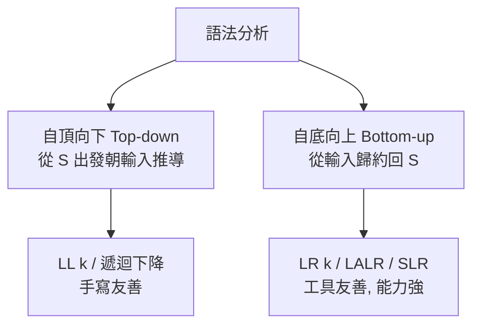

# 3.1 上下文無關文法與推導樹

## 從 BNF 到語法分析

1960 年，ALGOL 60 報告以 BNF（Backus–Naur Form）描述語法，這是程式語言史上第一次語法被完整形式化。從此「語法分析」不再是每個編譯者憑感覺手寫的經驗活，而成為有數學基礎的工程學科。Knuth 在 1965 年發表《On the Translation of Languages from Left to Right》，定義了 **LR(k)** 文法，為自底向上分析奠定理論基礎；Lewis 與 Stearns 則在 1968 年提出 **LL(k)**。

## 上下文無關文法回顧

文法 $G = (N, \Sigma, P, S)$，產生式形如 $A \to \alpha$（$A \in N$，$\alpha \in (N \cup \Sigma)^*$）。本書常用的算術運算式文法：

$$
\begin{aligned}
E &\to E + T \mid E - T \mid T \\
T &\to T * F \mid T / F \mid F \\
F &\to (E) \mid id \mid num
\end{aligned}
$$

**消歧設計**：把優先序「編碼進文法層次」——`E` 管 `+`/`-`（低優先），`T` 管 `*`/`/`（高優先），層次越深綁得越緊。結合性則由遞迴方向決定：左遞迴 `E -> E + T` 是左結合，右遞迴 `E -> T + E` 是右結合。

## 推導、最左與最右

**推導**（derivation）是從 $S$ 開始反覆以產生式右邊取代左邊非終端的過程：

- **最左推導**：每步取代最左非終端。
- **最右推導**：每步取代最右非終端。

$E \Rightarrow E + T \Rightarrow T + T \Rightarrow F + T \Rightarrow id + T \Rightarrow id + T * F \Rightarrow id + id * id$

**剖析樹**（parse tree）：每次取代畫成父子邊，樹的葉序即輸入字串。最左推導與最右推導對應**同一棵**剖析樹時，樹才是這個推導的「形狀」。

**歧義**：若某字串有兩棵不同的剖析樹，文法即為歧義。上面把優先序寫進層次的文法無歧義；而偷懶的 $E \to E + E \mid E * E \mid id$ 有歧義。一般而言**判定任意 CFG 是否歧義是不可判定的**（無演算法能對所有文法回答），只能限制在無歧義子集（LL、LR）內工作。

## 推導樹、AST 與語意動作

剖析樹常含大量「語法膠水」節點（單一子節點的傳遞鏈）。實務上編譯器把它壓縮成 **抽象語法樹（AST）**，只保留有語意意義的節點，並附加位置資訊：

```text
剖析樹:              AST:
     E                    +
    /|\                  / \
   E + T                id  *
   |     |\                 / \
   T     F F               id  num
  /|\    |  \
 F * F  id  num
 |   |
id  num
```

**屬性文法**（Donald Knuth, 1968）提供理論框架：節點可攜帶綜合屬性（由子節點計算）與繼承屬性（由父/兄節點傳入），語意動作（semantic actions）即屬性計算的實作，常直接嵌在文法規則中（Yacc 的 `{ ... }` 區塊）。

## 文法的工程性質

設計文法時須檢查：

1. **FIRST 集合**：$\text{FIRST}(\alpha)$ = 可從 $\alpha$ 推導出的字串的首終端集合。
2. **FOLLOW 集合**：$\text{FOLLOW}(A)$ = 可出現在 $A$ 之後的終端集合。
3. **左遞迴**：$A \to A\alpha$ 會使自頂向下分析無限遞迴，必須改寫為右遞迴：
   $$A \to A\alpha \mid \beta \quad\Longrightarrow\quad A \to \beta A',\; A' \to \alpha A' \mid \epsilon$$
   注意：改寫會改變結合性，若原意是左結合需在語意動作中修正。
4. **公共前綴**：$A \to \alpha\beta_1 \mid \alpha\beta_2$ 需提取左因子（left factoring）為 $A \to \alpha A'$。

## 語法分析策略的兩大陣營



- **自頂向下**：預測要套用哪條產生式；不能處理左遞迴；適合手寫。
- **自底向上**：先看見句柄（handle）再歸約；能處理左遞迴；以 LR 家族為代表，由工具（Yacc/Bison）自動產生。

兩者的理論基礎分別在 3.2 與 3.3 展開。

## 小結

- ALGOL 60 的 BNF 讓語法分析成為科學；Knuth 的 LR(k)（1965）是理論高峰。
- 推導樹記錄結構，AST 是其精簡化；歧義性不可判定，故需受控的文法子集。
- FIRST/FOLLOW、左遞迴消除、左因子提取是文法工程的基本功。
