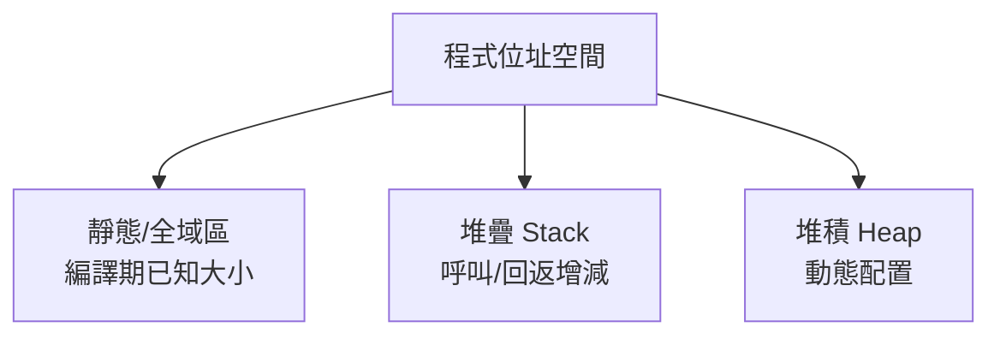

# 4.3 執行期記憶體組織：堆疊框與堆積

## 編譯器與執行期的契約

編譯器產生的碼必須在「執行期系統」（runtime system）上運行：記憶體如何配置、參數如何傳遞、回返位址存哪裡——這些是**呼叫慣例（calling convention）**與**執行期記憶體組織**的問題。編譯器在編譯期就要決定每個變數放在哪裡，因此必須先設計好執行期模型。

歷史上：FORTRAN（1957）因**不支援遞迴**，可直接用靜態配置——每個變數一個固定位址。ALGOL 60 要求遞迴與巢狀範圍，逼出**堆疊框（stack frame）**模型；LISP（1960）的函數式生存期（函數可回傳閉包）需要**堆積（heap）**與垃圾回收。三種配置方式正好對應三個時代的語言需求。

## 三種記憶體配置



- **靜態配置**：編譯期定址，零成本；缺點是不支援遞迴、不支援動態大小。
- **堆疊配置**：符合「後進先出」的呼叫結構，快（移動一個指標）；變數生存期限於其範圍。
- **堆積配置**：生存期由程式決定，需要配置器（malloc/free 或 GC）管理。

## 活動記錄（Activation Record / Stack Frame）

每次函式呼叫在堆疊上壓入一個**活動記錄**：

```text
高位址
  ┌─────────────────────┐
  │  呼叫者的堆疊框       │
  ├─────────────────────┤ ← frame pointer (rbp)
  │  saved rbp          │
  │  回返位址 (ret addr) │ ← stack pointer 推入處
  │  參數（超出暫存器者）  │
  │  局部變數            │
  │  臨時值 / 運算式暫存  │
  │  saved registers    │
  ├─────────────────────┤ ← stack pointer (rsp)
  │  被呼叫者的堆疊框     │
  └─────────────────────┘
低位址
```

典型序言／尾聲（x86-64）：

```asm
# 序言 prologue
push rbp
mov  rbp, rsp
sub  rsp, 48          # 為局部變數保留空間
# 尾聲 epilogue
leave                 # mov rsp, rbp ; pop rbp
ret
```

兩個指標的角色：**SP** 指向堆疊頂（動態），**FP/BP** 指向本框基準（呼叫期間固定），使局部變數可用 `FP - offset` 定址。

## 呼叫慣例

System V AMD64（Linux/macOS）範例：整數/指標參數依序用 `rdi, rsi, rdx, rcx, r8, r9`；浮點用 `xmm0–xmm7`；回傳值在 `rax`（浮點 `xmm0`）；`rbx, rbp, r12–r15` 為 callee-saved，其餘為 caller-saved。微軟 x64、ARM AAPCS 各有不同。**編譯器的後端必須嚴格遵守目標慣例**，否則無法與系統庫連結。

## 巢狀範圍與靜態鏈

Pascal 這類允許巢狀函式的語言，內層函式需存取外層函式的變數。解法是**靜態鏈（static link）**：堆疊框中存一個指標指向「語法上外層」函式最近的活動記錄，存取第 $k$ 層外的變數需沿靜態鏈跳 $k$ 次（**display 表**可加速為 $O(1)$ ）。C 語言沒有巢狀函式（GNU 擴充除外），故只需處理全域與局部。

## 閉包與「堆疊框逃逸」

若語言允許函數回傳內部函式（閉包），被捕捉的變數**生存期超出其堆疊框**，必須搬上堆積：

- Python：閉包變數裝箱為 cell 物件。
- Lua：open/upvalue 機制，起初指向堆疊，逃逸時搬移。
- Rust：所有被閉包捕捉的變數直接建立於堆積上的結構（或由編譯器決定）。

## 堆積與垃圾回收

- **手動管理**：malloc/free（C）。碎片化、懸垂指標、洩漏。
- **引用計數**：Python/CPython、Swift ARC（Apple, 2011）。即時回收，但有循環引用問題。
- **追蹤式 GC**：
  - 標記—清除（mark-sweep, McCarthy 1960 為 LISP 發明）
  - 標記—整理（mark-compact）
  - 複製式（copying, Cheney 1970）
  - 分代（generational, Lieberman & Hewitt 1983）：假設「多數物件朝生暮死」，新生代頻繁回收。
  - 併發/增量（CMS、G1、ZGC、Shenandoah）降低停頓。

GC 需要編譯器配合：**精確堆疊映射（stack maps）**記錄每個安全點上哪些暫存器/堆疊槽持有指標，這使編譯器與執行期深度耦合——JVM、.NET、Go 皆是。

## 小結

- 配置方式的演進由語言需求驅動：靜態（FORTRAN）→ 堆疊（ALGOL 遞迴）→ 堆積（LISP 閉包）。
- 活動記錄、SP/FP、呼叫慣例是後端產碼的底層契約。
- 靜態鏈解巢狀範圍，閉包逃逸驅動堆積化，GC 與編譯器的 stack map 合作是現代執行期的關鍵設計。
