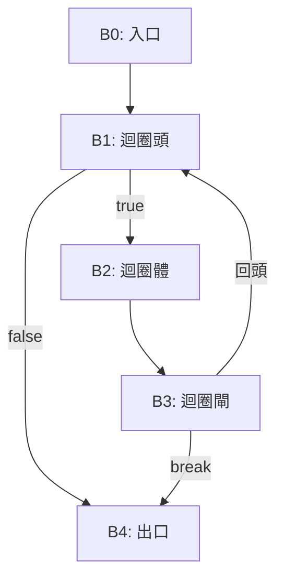

# 5.1 資料流分析與優化

## 從「能跑」到「跑得快」

1957 年 FORTRAN I 已內建公共子表示式刪除與迴圈最佳化；1970 年代是最佳化理論的黃金期：Gary Kildall（1973，他的博士論文《A Unified Approach to Global Program Optimization》）提出以「格（lattice）」統一資料流分析的框架；Frances Allen（IBM）發展了區間分析與控制流分析，1970 年代其工作為她贏得 2006 年圖靈獎——首位女性得主；John Cocke（IBM, 1970）建立強度削減與暫存器最佳化的系統方法（圖靈獎 1987）。本章聚焦中端最佳化的兩大支柱：控制流圖與資料流分析。

## 控制流圖（CFG）

最佳化在 **CFG** 上進行：節點是基本塊（basic block，單進單出的線性指令序列），邊是可能的跳轉。



**支配關係**：A 支配 B（所有路徑必經 A）。**自然迴圈**：回邊 $B_3 \to B_1$ 中 $B_1$ 支配 $B_3$，迴圈體為 $B_1, B_2, B_3$。迴圈是最佳化的主戰場——程式 90% 的時間常在 10% 的碼裡。

## 資料流分析的格理論框架

對每個程式點，求一組「事實」（如「變數 x 此刻是常數 3」）。抽象為：

- **格** $(L, \sqsubseteq, \sqcap, \sqcup, \top, \bot)$：事實的偏序集合。
- **轉移函數** $f: L \to L$：沿指令邊傳遞事實。
- **匯合運算**：控制流匯合處取 meet（$\sqcap$ 或 $\sqcup$，依分析方向而定）。
- **不動點**：解聯立方程組 $x = F(x)$。

Kildall 的**迭代不動點演算法**：

```text
worklist 演算法:
  初始化每個節點的 in/out 為 ⊤ 或 ⊥
  將所有節點放入 worklist
  while worklist 非空:
    取出 n
    new_in = meet(over preds of n)
    new_out = f_n(new_in)
    if new_out ≠ out[n]:
      out[n] = new_out
      將 n 的後繼加入 worklist
```

**格的高度**決定迭代次數上限（單調函數保證收斂）；有限高度 ⇒ 終止。

## 四大經典資料流分析

| 分析 | 方向 | 匯合 | 事實域 | 用途 |
|------|------|------|--------|------|
| 到達定義 | 前向 | 併集 | 定義集合 | use-def 鏈、常數傳播 |
| 可用運算式 | 前向 | 交集 | 運算式集合 | 公共子表示式、迴圈不變量外提 |
| 活躍變數 | 後向 | 併集 | 變數集合 | 死碼刪除、暫存器配置 |
| 非常繁忙運算式 | 後向 | 交集 | 運算式集合 | 運算式提前求值 |

**到達定義（reaching definitions）**：定義 $d: x = \ldots$ 可到達點 p，若存在路徑無其他 $x$ 定義覆蓋。用位元向量（每定義一位元）＋併集匯合，迭代至不動點。

**活躍變數（live variables）**：變數 v 在點 p 活躍，若從 p 出發存在路徑在重新定義前使用 v。後向分析：

$$
\text{in}[n] = \text{use}[n] \cup (\text{out}[n] - \text{def}[n])
$$

## 依賴活躍/到達資訊的經典變換

1. **死碼刪除（DCE）**：定義的結果不活躍 ⇒ 刪除（迭代直到不動點）。
2. **常數傳播**：稀疏條件常數傳播（SCCP, Wegman & Zadeck, 1991）在 SSA 上追蹤每個值的 ⊥(未知)/常數/⊤(非常數) 三態格。
3. **公共子表示式刪除（CSE）**：在匯合點若某運算式「處處可用」，可用同一臨時值。
4. **迴圈不變量外提（LICM）**：運算式在迴圈內各定義點皆不變 ⇒ 移到迴圈前。需迴圈閉合 SSA（LCSSA）確保正確。
5. **強度削減**：`i*4` → `t += 4`（Cocke 與 Kennedy 的歸納變數分析，1970s）。

**安全性與效益性**：變換必須「不改變可觀察行為」（安全），且「平均而言更快」（效益）。LICM 外提可能造成除以零提前觸發——涉及例外/浮點語意時要格外小心。

## 更進階的框架

- **SSA 稀疏分析**：def-use 鏈使資料流沿「值」而非「全域位元向量」傳播，複雜度近線性。
- **條件常數傳播＋稀疏條件**：可利用分支條件沿特定邊傳遞事實（如 `if (x==5) { ... }` 內 x 是 5）。
- **別名分析（alias analysis）**：判斷兩指標是否指向同一位址；Steensgaard（1996）近乎線性、Andersen（1994）更精確但 $O(n^3)$。C 的 union、type punning 使其近似不可解。
- **過程間分析（IPA）**：跨函式內聯、全程序分析；LLVM 的 ThinLTO（2016）以平行＋摘要實現規模化。

## 小結

- Kildall（1973）以格與不動點統一資料流分析；Allen 與 Cocke 建立迴圈與強度削減理論。
- 到達定義、活躍變數、可用運算式是三大工作馬；SSA 讓分析稀疏化。
- 安全性先於效益性：一切最佳化以不破壞語意為前提。
