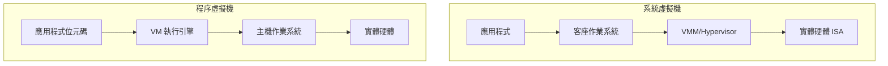

# 1.2 虛擬機的分類（系統虛擬機 vs 程序虛擬機）

## 分類的軸線：虛擬化的對象是什麼

「虛擬機」一詞在文獻中涵蓋了性質迥異的許多系統，若不加區分容易產生混淆。最經典的分類方式由 James Smith 與 Ravi Nair 在《Virtual Machines: Versatile Platforms for Systems and Processes》（2005）中系統化：依據虛擬機**模擬的介面層級**來分類。任何一台電腦都可以被視為一疊由下而上的介面：實體硬體介面（ISA：指令集架構）、作業系統的系統呼叫介面（ABI/Syscall API）、以及語言執行環境的函式庫或位元碼介面。虛擬機就是「在某個介面上做複製」的軟體（或軟硬體組合）：

## 系統虛擬機（System Virtual Machine）

系統虛擬機複製的是**完整硬體 ISA**：它提供一個虛構的機器，上面可以安裝並執行未經修改的完整作業系統。CP/CMS（1967）、VM/370（1972）、VMware Workstation（1999）、Xen（2003）、KVM（2006）、Hyper-V（2008）都屬於此類。其核心特徵是：

1. **等價性（equivalence）**：客座軟體在虛擬機上的行為與在真實機器上相同（允許資源量的差異）。
2. **資源控制（resource control）**：VMM 完全掌控實體資源，客座 OS 不直接接觸硬體。
3. **效率（efficiency）**：絕大多數指令應由硬體直接執行，不需 VMM 介入——這正是 Popek-Goldberg 定理（1974）刻劃的條件。

系統虛擬機又可依實作技術細分為：**完全虛擬化**（full virtualization，如 VMware，客座 OS 不需修改）、**半虛擬化**（paravirtualization，如 Xen 的客座核心需修改以主動呼叫 hypervisor）、**硬體輔助虛擬化**（如 Intel VT-x，2005，由 CPU 提供額外的 root mode）。此外還有**同構型**與**異構型**之分：VMware 在 x86 上跑 x86 是同構；而 1960 年代 IBM 為舊機器模擬新 ISA、或 Mac 在 PowerPC 上以動態二進位轉譯跑 x86 程式，則是異構虛擬化。

## 程序虛擬機（Process Virtual Machine）

程序虛擬機複製的是**更高層的抽象介面**：它提供一個虛構的「語言機器」，執行的單位不是機器碼而是**位元碼（bytecode）**，且生命週期與單一程序綁定——程序結束，虛擬機即消失。代表性的家族包括：

- **P-code 家族**：Niklaus Wirth 的 Pascal P-code（1970 年代中期），為了讓 Pascal 編譯器可攜到各式各樣當時互不相容的小型機上。
- **物件導向 VM**：Smalltalk-80 VM（1980）、Self VM（1987-1995），這些系統發明了 JIT、inline cache、分代 GC 等日後成為 VM 標配的技術。
- **Java 與 .NET**：JVM（1995）與 CLR（2002），將「位元碼 + 驗證器 + JIT + GC」打包成工業標準平台。
- **腳本語言 VM**：CPython 的 eval 迴圈（1990）、Lua VM（1993）、PHP Zend Engine、V8 雖以 JIT 為主但也屬此譜系。
- **行動平台**：Dalvik（2008，暫存器式）、ART。

程序虛擬機不追求「跑得跟真機一樣」，反而刻意設計一個**與任何實際硬體都不相同的理想化 ISA**：它有無限的暫存器或深不見底的運算堆疊、有物件與型別資訊、有豐富的方法呼叫指令。因為介面更高、資訊更豐富，程序虛擬機可以做系統 VM 做不到的事：型別安全的位元碼驗證、以語言層語義為單位的高階優化、與平台無關的可攜發行格式。

## 兩者的比較與交會

| 面向 | 系統虛擬機 | 程序虛擬機 |
|---|---|---|
| 虛擬化介面 | 硬體 ISA | 語言位元碼 / 系統呼叫 |
| 執行單位 | 完整作業系統 | 單一程序 |
| 客座程式 | 未修改的二進位檔 | 編譯器產生的位元碼 |
| 代表系統 | VM/370、VMware、Xen | JVM、CLR、CPython |
| 核心難題 | 敏感指令陷阱、記憶體虛擬化 | 直譯效能、GC、型別安全 |
| 主要動機 | 資源共享、隔離 | 可攜性、安全性、語言實現自由 |

兩個世界並非涇渭分明，而是不斷交會。例如 JVM 早期曾被實作為「Java OS」直接跑在硬體上（JavaOS，1996）；反向地，現代雲端把程序 VM 當作交付單位，容器（2013 年的 Docker）則介於兩者之間——它虛擬的既不是硬體也不是語言，而是作業系統的命名空間介面，常被稱為「作業系統層虛擬化」，形成三分法中的第三類。

## 小結

分類的意義在於看清每類虛擬機解決的問題與依賴的機制不同：系統 VM 的難題在 ISA 的可虛擬性與陷阱模擬，牽動的是作業系統與硬體；程序 VM 的難題在執行引擎的效率與記憶體安全，牽動的是編譯器與執行時期系統。本書第 2、3、4 章聚焦程序虛擬機，第 5 章回到系統虛擬化，讀者可對照兩條技術路線彼此借鑑的痕跡——例如 JIT 同時服務了 JavaScript 引擎與二進位轉譯，GC 與分頁管理共享相似的分代思想。
