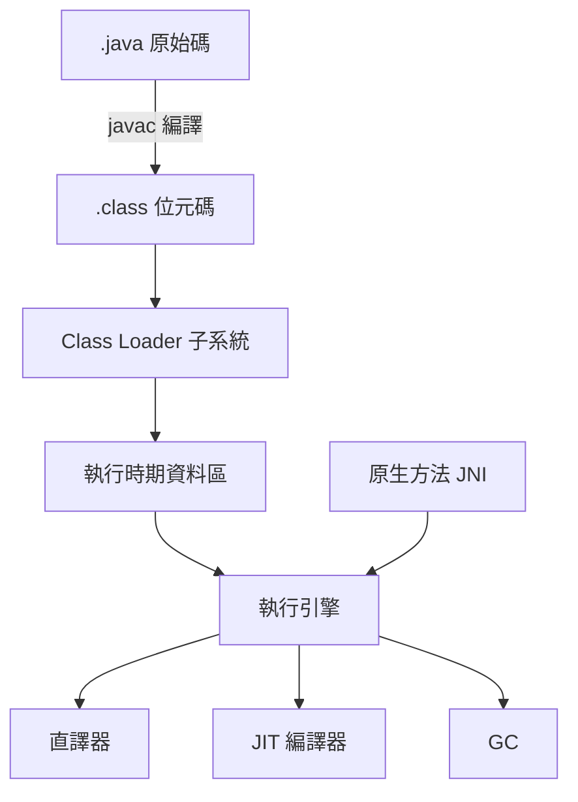

# 2.2 Java Virtual Machine（1995年與 Write Once Run Anywhere）

## 誕生：從消費性電子到網際網路

Java 的前身是 1991 年 Sun Microsystems 內部的 Green 專案。James Gosling、Mike Sheridan 與 Patrick Naughton 原本的目標是為機上盒、電視等消費性電子設備設計語言與執行環境，專案語言先後叫 Oak、最後在 1995 年更名為 Java。消費電子背景解釋了 JVM 的許多設計決策：目標平台碎片化（各廠商的晶片互不相同）催生了位元碼；裝置資源有限使位元碼必須緊湊；不可信的第三方程式碼（未來要下載到用戶設備執行的內容）催生了安全性設計。

1995 年真正的轉捩點是網際網路：Netscape 宣布在 Navigator 中支援 Java applet， suddenly 「從伺服器下載一段不可信程式碼、在使用者機器上安全執行」有了具體場景。Sun 提出的口號「Write Once, Run Anywhere」（一次撰寫、到處執行）精準命中了當時開發者的最大痛點——C/C++ 軟體在不同 Unix 與 Windows 之間的移植地獄。JVM 1.0 於 1996 年正式發布，Java 位元碼（.class 檔）成為第一個真正全球普及的位元碼格式。

## JVM 架構總覽



JVM 規格（1996 年由 Tim Lindholm 與 Frank Yellin 定稿的《The Java Virtual Machine Specification》）定義了五個部分：位元碼指令集、class 檔格式、類別載入子系統、執行時期資料區（方法區、堆、Java 堆疊、PC 暫存器、native method stack）、與執行引擎。值得強調的是「規格與實作分離」：JVM 是一份規格書，HotSpot、OpenJ9、GraalVM、Android 的 ART（語法不同但精神相通）都是實作。這種「以規格書定義虛擬機」的做法承襲自 1970 年代 P-code 的文件傳統，但工業化程度更高——位元碼格式有精確的版本號與驗證規則，使跨廠商相容成為可能。

## 位元碼與堆疊機設計

JVM 位元碼是堆疊式的（見 2.1 節的理由：緊湊、易驗證）。常用指令包括：

- 載入/儲存：`iload_0`、`astore_1`（在區域變數陣列與運算堆疊之間搬移）
- 運算：`iadd`、`imul`（型別前綴 i/l/f/d/a 分別代表 int/long/float/double/reference）
- 控制流：`if_icmpge`、`goto`
- 呼叫：`invokevirtual`（虛擬呼叫）、`invokestatic`、`invokespecial`（建構子/私有）、`invokeinterface`；Java 7 加入 `invokedynamic` 以支援動態語言
- 物件：`new`、`getfield`、`putfield`

以方法 `int add(int a, int b) { return a + b; }` 為例，位元碼只有三條：

```text
iload_1      ; push 區域變數 1（a）
iload_2      ; push 區域變數 2（b）
iadd         ; 相加
ireturn      ; 回傳堆疊頂
```

值得注意的是 JVM 的區域變數存放在**框架的區域變數陣列**中而非堆疊上，`iload` 顧名思義是「載入到堆疊」——這個混合設計已經偏離純堆疊機，目的在降低最熱門的「載入-運算-存回」序列的指令數。

## 執行引擎的演化：從純直譯到 HotSpot

JVM 1.0 的執行引擎是純直譯器，效能常被戲稱為「解釋五倍慢」。歷史上有三個重要里程碑：

1. **JIT 編譯的引入（1998 前後）**：Sun 的 HotSpot（源自 1994 年收購的 Longview Technologies，其技術根源是 Self 語言的 VM 研究）在 2001 年的 JDK 1.3 成為預設 VM，以方法式 JIT、熱點偵測與精確 GC 大幅提升效能（詳見第 4 章）。
2. **`invokedynamic`（Java 7，2011）**：由 John Rose 主導，讓 JRuby、Kotlin、Groovy 等動態語言能直接表達動態方法分派，並由 VM 內建的 method handle 機制優化，避免每種語言自造分派邏輯。
3. **GraalVM 與多語言執行（2019 前後）**：以 Java 寫成的 JIT 編譯器，進一步實現 Truffle 框架——任何語言以直譯器形式撰寫，即可獲得接近原生碼的 JIT 效能。

## Write Once, Run Anywhere 的真實意義與限制

WORA 在實務上並非無摩擦：浮點運算語義（strictfp 的歷史）、AWT/Swing 在不同平台的視覺差異、JNI 原生碼的不可攜、以及「至少要有一個廠商為該平台實作 JVM」的前提，都是缺口。但比對照組仍具壓倒性優勢：同一份 .jar 在 Windows、Linux、Solaris、AIX、z/OS 上行為一致，這在 1990 年代末是革命性的。更深遠的影響是**生態位元碼化**：JVM 位元碼成為一個「語言的相容層」——Scala（2003）、Kotlin（2011）、Clojure（2007）都選擇編譯到 JVM 位元碼而非自建 VM，因為 GC、JIT、驗證器都是免費的現成基礎建設。這證明了一個架構洞見：**虛擬機一旦成為穩定規格，就會演化成整個語言生態的底座**，正如作業系統成為應用生態的底座。

## 小結

JVM 把 P-code 時代的可攜性理想、Smalltalk 時代的動態執行技術（JIT、GC）與 1990 年代的網路安全需求熔於一爐，定義了現代程序虛擬機的標準形態：位元碼格式 + 類別載入 + 驗證 + 混合執行引擎（直譯 + JIT）+ 精確 GC。之後兩節將深入其位元碼驗證與類別載入機制——那是 JVM 安全性與動態性的兩根支柱。
