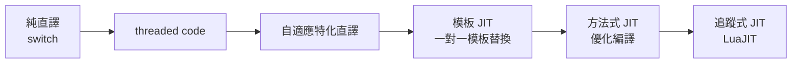

# 3.2 直譯迴圈與分派技術（switch、threaded code、JIT 雛形）

## 直譯器效能問題的本質

虛擬機直譯器的心臟是一個簡單到近乎乏味的迴圈：取指令、解碼、執行、跳回。然而這個迴圈每秒執行數億到數十億次，其細節決定了整個 VM 的基線效能。直譯的開銷由三部分構成：**分派開銷**（決定下一條指令是什麼並跳到對應的處理程式碼）、**取址與解碼開銷**（讀取運算元、遮罩 opcode）、以及**宿主機流水線效率**（分支預測失敗、指令快取失效率）。本節討論的三種分派技術，正是三個世代的研究者對同一個問題的回答。

## 第一代：switch 分派

最直觀的寫法是 switch（或 C 語言的 computed goto 之前的 case 表）：

```c
for (;;) {
    opcode = *pc++;
    switch (opcode) {
    case ADD:  sp[-2] += sp[-1]; sp--; break;
    case LOAD: *++sp = frame[rB]; break;
    case JMP:  pc = code + rA;    break;
    /* ... 數百個 case ... */
    }
}
```

優點是簡單、可攜。缺點有三：(1) 編譯器通常把 switch 編成跳躍表，但整個 case 區塊落在同一個函式內，**區域變數必須溢出到堆疊框**（各 case 共用一個框架，編譯器難以把熱門狀態留在暫存器）；(2) switch 跳躍位址密集，**分支預測器難以學習**指令序列的模式；(3) 各 case 的程式碼彼此靠近，指令快取空間區域性被不相干的指令碼稀釋。CPython 的 ceval 迴圈是 switch 分派的最著名代表——這也是 CPython 長年被詬病「慢」的結構性原因之一。

## 第二代：Threaded Code（線結碼）

Threaded code 的思想源自 1960-70 年代的 Forth 系統（James Bell 1973 年的經典論文《Threaded Code》將其命名與分類）。其核心是：**每個指令處理器以「直接跳到下一個指令處理器」結尾，而不是跳回分派迴圈**。在現代 C 中以「labels as values」擴充（GCC 的 `&&label` 語法，1990 年代由 GNU 團隊加入）實作 direct threaded code：

```c
static void *dispatch[] = { &&L_ADD, &&L_LOAD, &&L_JMP, ... };
#define DISPATCH() goto *dispatch[*pc++]

L_ADD: sp[-2] += sp[-1]; sp--; DISPATCH();
L_LOAD: *++sp = frame[rB]; DISPATCH();
```

與 switch 相比 threaded code 省掉了「跳回迴圈頂再跳出」的中間跳躍（一次間接跳躍取代兩次），且每個處理器是獨立的基本區塊，編譯器可為每個 handler 單獨配置暫存器。效能提升典型在 20-30%。Lua 5.x 與後來的 CPython 3.11（其 "adaptive interpreter" 也採用 computed goto）都採用了這項技術。更深層的洞察是：threaded code 讓「分派」這件事變成了**指令流的資料**——連續的間接跳躍位址正好形成指令序列的指紋，硬體分支目標緩衝區（BTB）開始能夠預測常見的指令對模式（如 LOAD-ADD 出現的機率遠高於隨機）。

## 第三代：指令特化與自適應直譯

即使分派效率已高，直譯每條指令仍要付「通用性稅」：`BINARY_OP` 必須在執行時檢查運算元型別（是 int? float? 還是有 `__add__` 的物件?）。第四代技術讓直譯器**根據觀察到的實際型別，把通用指令原地改寫成特化指令**：

```text
初次執行: BINARY_OP  →  執行通用邏輯，記錄「兩個運算元都是 int」
改寫後:   BINARY_OP_INT  →  直接整數加法，型別檢查省略
若遇到非 int 的運算元 → 回退到通用路徑並重新記錄
```

CPython 3.11（2022，"Faster CPython" 專案，Guido 團隊主導）的 adaptive interpreter、LuaJIT 直譯部分的型別特化、以及 Dalvik 的 quickened instructions（Android 早期以 quick 指令快取解析結果）都屬此類。這實質上是 **inline cache 思想（見 4.3 節）在直譯器內的重現**：以自我修改的位元碼快取「型別形態」的推測。

## 從直譯到 JIT 的連續光譜

值得建立的正確心智模型是：**直譯與 JIT 不是二元對立，而是優化程度連續光譜上的點**：



- **模板式 JIT**：每個位元碼指令對應一小段機器碼模板，拼接即得原生碼——實作極簡、零優化，但已能獲得 2-5 倍加速（如早期的動態翻譯器、PyPy 初期與部分 JavaScript 引擎的基線編譯器）。
- **追蹤式 JIT**（見 4 章）：只編譯熱迴圈的線性軌跡。
- **方法式 JIT**（見 4 章）：以方法為單位做完整優化編譯。

歷史上這條光譜是漸進鋪設的：1980 年代 Smalltalk-80 的 Berkeley 實作（David Ungar 的 SOAR 研究與 Peter Deutsch 的「Deutsch-Schiffman implementation」，1980）已經示範了動態翻譯，1990 年代 HotSpot 把它工程化，2010 年代 JavaScript 引擎（V8 的 Ignition+TurboFan 架構，2016 起）回歸「直譯器打底 + 多層 JIT」的分層策略。連 V8 也承認：完全不用直譯器的 JIT 啟動太慢，現代最佳實務是**直譯器快速啟動、JIT 接手熱點**。

## 與作業系統與體系結構的關聯

直譯技術的演進深受硬體演化的牽動：1960 年代記憶體昂貴，代碼密度優先（threaded code 的原始動機）；1990 年代之後分支預測與快取成為瓶頸，直譯器的佈局與跳躍模式開始講究微架構友善；2010 年代之後，直譯器設計甚至要考慮 ASLR 與自我修改程式碼的 W^X 保護（OS 要求同時可寫與可執行的頁面必須隔離，自適應直譯器改寫指令時需要 mprotect 切換，這是 VM 與 OS 介面的實際工程議題）。

## 小結

分派技術的世代交替——switch → threaded code → 自適應特化——每一代都圍繞同一目標：縮短「知道下一條指令是什麼並執行它」的路徑。這些技術是理解 JIT 的前置知識：當直譯器的特化與快取做到極致，下一步自然是「乾脆把熱路徑直接編成機器碼」——這正是第 4 章的主題。
