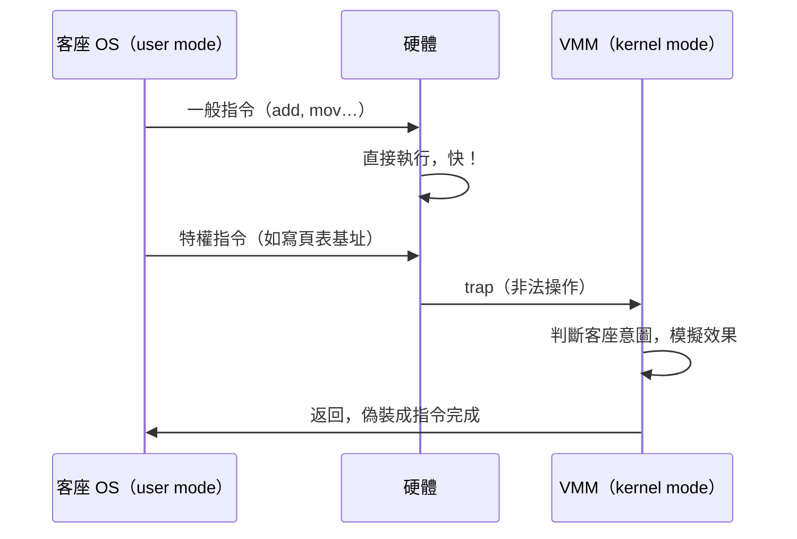

# 5.1 Popek-Goldberg 虛擬化定理（1974）與 trap-and-emulate

## 一條定義了整個領域的定理

1974 年，Gerald Popek 與 Robert Goldberg 在 Communications of the ACM 發表《Formal Requirements for Virtualizable Third Generation Architectures》，首次以嚴格形式刻劃「什麼樣的指令集架構可以被虛擬化」。這篇論文把 CP/CMS 五年的工程經驗提煉成理論，成為系統虛擬化領域的奠基文獻，也解釋了為什麼 x86 在 1998 年之前無法被純軟體高效虛擬化。

## 定義與定理內容

Popek-Goldberg 定義虛擬機監督器（VMM）須滿足三條性質：

1. **等價性（fidelity/equivalence）**：VMM 之上執行的軟體，行為與直接跑在等價實體機上完全相同（僅資源量與時間可能不同）。
2. **資源控制（resource control）**：VMM 對實體資源擁有完全控制權，客座軟體不能直接接觸。
3. **效率（efficiency）**：絕大多數（統計上佔絕對多數的）指令由硬體直接執行，不經 VMM 介入。

在此基礎上，把指令集分為三類：

- **特權指令（privileged）**：僅在特權態（supervisor mode）可執行，用戶態執行即觸發陷阱（trap）。
- **敏感指令（sensitive）**：行為依賴系統組態（如存取重定位表、改變記憶體映射、改變特權態）或其結果受組態影響。
- **良性指令（innocuous）**：既非特權也非敏感。

**定理（Popek-Goldberg）**：一個 ISA 若要支援「效率化的 VMM」，其充分條件是：**所有敏感指令都是特權指令**（sensitive ⊆ privileged）。

證明思路直觀：VMM 以用戶態執行客座碼、自己佔據特權態。當客座 OS（以為自己在特權態）執行敏感指令時，若該指令同時是特權指令，硬體會觸發 trap，控制權回到 VMM，VMM 便可模擬該指令的正確效果（trap-and-emulate）。若存在某個敏感指令在用戶態**不觸發陷阱**、且行為與特權態下不同（或需要被 VMM 攔截才能維持資源控制），VMM 就無法「及時知道並糾正」，要嘛等價性破功、要嘛必須付出逐條檢查/逐條轉譯的代價，效率性破功。

## Trap-and-Emulate：經典虛擬化的執行模型

以 VM/370 為例：客座 OS 執行 `LPSW`（載入程式狀態字，改變中斷遮罩與定址模式）是特權指令，在 VMM 管理的用戶態執行會 trap，VMM 讀取該 PSW 內容、把它存到該虛擬機的「影子狀態」中，並判斷是否需要調整真實硬體的狀態。I/O 與中斷的虛擬化同樣走此模型：客座 OS 對虛擬設備下命令 → trap 或特殊通道 → VMM 驅動真實設備或排程虛擬磁碟 → 以虛擬中斷注入客座。記憶體虛擬化則以 **shadow page table**（影子頁表）實現：VMM 維護「虛擬位址 → 機器位址」的直接映射表，使 MMU 不需兩層轉換（1970 年代尚無兩層轉譯硬體），客座的頁表寫入則被 trap 後同步到影子表。

## 定理的歷史意義：x86 的三十年困境

System/360 及其後繼者（以及 1970 年代多數大型機）滿足 sensitive ⊆ privileged，因此可虛擬。但 1980 年代後的 x86 踩進了經典陷阱：為了相容早期 8086（無特權態），x86 有若干指令在用戶態執行時**不觸發 trap 而是默默降級執行**。最著名的例子：

- `POPF`（自堆疊彈出旗標暫存器，可改變中斷旗標 IF）：在 Ring 0 是敏感指令；在 Ring 3 執行時**不 trap、也不會真的改 IF**，默默失敗。VMM 無法察覺客座意圖，敏感但非特權 → 違反定理。
- `SGDT`、`SIDT`、`PUSHF` 等在用戶態可執行且洩漏系統組態。

因此在純 trap-and-emulate 下，x86 無法有效率地虛擬化（除非犧牲等價性或做昂貴的逐指令檢查）。這正是 1998 年 VMware 的工程突破（見 5.2 節）以二進位轉譯繞過的原因，也是 2005-2006 年 Intel VT-x / AMD-V 硬體輔助虛擬化（見 5.3 節）出現的根本動機——硬體為每個敏感指令增加了 trap 能力，把 x86 「修正」回滿足 Popek-Goldberg 條件的架構。回顧歷史相當諷刺：1970 年代 IBM 為了賣 VM 產品「加強」硬體虛擬化能力；1980-90 年代 PC 產業把這些能力省掉；2005 年後又為了雲端把它們加回來。

## 定理的修正與延伸

Popek-Goldberg 定理也常被誤讀，值得釐清三點。第一，它是**充分條件而非必要條件**——違反的架構仍可能被虛擬化，只是無法以「純 trap-and-emulate、不修改客座碼」的高效方式達成（x86 的歷史正是如此）。第二，「效率」的定義隨硬體演化而漂移：當硬體提供 VT-x 之後，過去需軟體處理的路徑變成硬體路徑，定理的實務疆界不斷重劃。第三，定理針對的是 CPU 指令集；完整系統虛擬化還涉及中斷/例外模型、記憶體管理單元（巢狀分頁）、I/O 裝置模型等，每一項都有對應的虛擬化策略（影子表 vs 硬體巢狀分頁、全模擬 vs 半虛擬設備 vs 硬體直通 pass-through / SR-IOV）。

## 與作業系統/編譯器的關聯

trap-and-emulate 的本質與作業系統的系統呼叫機制完全同構：都是「用戶態請求 → 陷入特權態 → 服務 → 返回」，差別只在陷入的原因是「模擬一台機器」還是「服務一個程序」。也正因為這種同構，虛擬化的效能問題（context switch、TLB 命中率、中斷注入延遲）與 OS 的效能問題共享同一批解法（大頁、延遲批處理、paravirtual 通道）。而從編譯器視角，VMM 的「攔截—模擬」其實是一個極度惰性的動態翻譯器：不轉譯程式碼，只轉譯「程式碼產生的副作用」。理解 Popek-Goldberg，等於拿到了分析任何虛擬化方案（包括 5.2、5.3 的變體）的理論座標系。

## 小結

1974 年的這條定理告訴我們：虛擬化不是萬能魔術，而是一個有明確數學邊界的架構性質。大型機時代的黃金 ISA、x86 的三十年禁區、以及硬體輔助虛擬化的必然到來，都能從 sensitive ⊆ privileged 這一條件推導而出。
