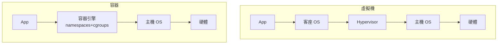

# 5.3 硬體輔助虛擬化與容器（Intel VT-x 2005、Docker 2013）

## 硬體輔助虛擬化：把定理還給 x86

軟體路線（BT、半虛擬化）的成功反而證明了它們的昂貴：轉譯器與客座修改都是巨大的工程負擔。根本解法是讓硬體自己提供「可虛擬性」。2005-2006 年，Intel VT-x（Vanderpool 技術，2005 年隨 Pentium 4/D 系列與 Xeon 陸續出貨）與 AMD-V（2006 年於 Opteron/Athlon 64 出貨）把 x86 的虛擬化條件補齊。兩者思路相同，以 VT-x 為例：

1. **新增 root / non-root 兩種操作模式**：VMM 跑在 root mode，客座（含其核心）跑在 non-root mode。non-root 之下，**所有**敏感與特權指令都會觸發 **VM exit**，控制權交給 VMM——敏感 ⊆ privileged 的問題在硬體層面直接消失，x86 終於滿足 Popek-Goldberg 條件。
2. **VMCS（Virtual Machine Control Structure）**：每個虛擬機的狀態（暫存器、控制暫存器、中斷資訊）由硬體管理的資料結構保存；`VMRESUME`/`VMLAUNCH` 指令一次完成 VM entry。這把過去 BT 需要軟體維護的「影子狀態」變成硬體狀態，切換開銷從數千個週期級的軟體模擬降為千級週期的硬體切換。
3. **可設定的退出位圖**：VMM 可以選擇哪些事件造成 VM exit（例如讓某些不敏感的操作不退出），實現「大多數指令不介入」的效率要求。
4. **EPT/NPT（Extended/Nested Page Tables）**：2008 年前後 Intel EPT 與 AMD NPT 提供**兩層位址轉譯**：客座虛擬位址 → 客座物理位址（客座頁表）→ 機器位址（EPT），由硬體 MMU 一次完成。這淘汰了影子頁表——那個過去 VMM 最大的效能與複雜度黑洞（每次客座切頁表都要同步影子表、TLB 命中率慘淡）。
5. **中斷虛擬化（posted interrupts）、IOMMU（Intel VT-d，2008）**：把 DMA 與中斷的安全直通（pass-through）納入硬體，使 I/O 虛擬化從模擬走向接近原生（SR-IOV，2007 年 PCI-SIG 規範，讓一張實體網卡呈現多個虛擬功能 VF 直接分配給 VM）。

有了這些，現代 hypervisor（KVM 2006 年併入 Linux 核心、Xen HVM、Hyper-V 2008、bhyve 2012）的結構變得優雅：KVM 本身只是 Linux 的一個模組，把每個 VM 變成一個程序、每個 vCPU 變成一條執行緒，VM exit 時回到 KVM 模組處理，I/O 則重用 QEMU 的設備模型。**「虛擬機 = 程序、vCPU = 執行緒」**這個抽象使 VM 享用 Linux 既有的排程器、記憶體管理與 cgroup——系統虛擬化與作業系統在工程上合流了。

半虛擬化技術並未消失，而是轉向 I/O 與通知層：**virtio**（Rusty Russell，2007 年起，Linux 虛擬 I/O 標準）繼承 Xen split-driver 的共享環設計，成為 KVM/QEMU 生態的標準半虛擬設備介面；主流雲端作業系統至今仍以「硬體輔助 CPU + 半虛擬化 I/O」為標準配方。

## 容器：第三種虛擬化

在 hypervisor 演化的同時，另一條更輕量的路線成形。**作業系統層虛擬化**的先驅是 FreeBSD jail（2000）與 Solaris Zones（2004）；Linux 世界的關鍵積木是 2002-2008 年間逐步進入核心的 **namespaces**（pid、net、mnt、uts、ipc、user——把程序的視野「命名空間化」，使每個容器擁有獨立的程序表、網路堆疊、掛載樹）與 **cgroups**（2008 年進入 2.6.24，Google 工程師主導，用來限制與核算一組程序的 CPU/記憶體/I/O）。這些都是既有 OS 機制的組合：**容器不模擬硬體、也不需要 hypervisor，只是把「一個 OS 上的多組程序」隔離成看似多台機器**。

2013 年，Solomon Hykes 的 dotCloud 公司把這些積木包裝成 **Docker**：以 Dockerfile 描述映像檔、以分層聯合檔案系統（UnionFS/OverlayFS）實現映像的共享與增量、以 Docker Hub 實現映像的發行。Docker 的貢獻與其在 VM 史上的定位在於**工程與生態**而非技術原創——它把「打包一次、到處執行」的承諾從程式層（Java 的 WORA）提升到「整個應用執行環境」層，並以秒級啟動、近乎零開銷的體驗擊敗了 VM 在部署場景中的笨重。2015 年起 Kubernetes（Google，繼承其內部 Borg 系統的經驗）確立了容器編排的標準，容器成為雲原生（cloud native）架構的基本單位。

## VM vs 容器：抽象層與隔離強度的取捨

- **隔離強度**：VM 的隔離邊界是 hypervisor + 硬體（較強）；容器共享主機核心，核心漏洞可能擊穿所有容器（需以 user namespace、rootless 容器、以及 **gVisor**（2018，Google，以用戶態核心攔截系統呼叫）或 **Kata Containers**（每容器一個輕量 VM）強化——有趣的是，這兩個方案正是「容器與 VM 的融合」）。
- **開銷與密度**：容器啟動毫秒級、單機可跑數百個；VM 啟動數秒至數十秒，密度受限。
- **應用場景**：VM 適合異構 OS、強租戶隔離（公有雲 IaaS）；容器適合同構應用的快速部署與高密度排程（PaaS/雲原生）。主流公有雲的現代架構常是「VM 為租戶邊界、VM 內再跑容器承載應用」的疊加。

## 與作業系統的關聯與本書總結

從 1967 年 CP/CMS 的「一台機器變多台」，到 2013 年 Docker 的「一個 OS 變多個視野」，虛擬化技術畫出了一條清晰的鐘擺軌跡：**大型機（分層多）→ PC 時代（扁平）→ 雲端（重新分層）**。而技術的消長反覆驗證本書的核心命題：

1. **虛擬化的本質是「精確規格 + 間接層」**：無論對象是硬體 ISA（第 1、5 章）、語言位元碼（第 2-4 章）或 OS 介面（本章），成功與否都取決於規格是否清晰、間接層是否夠薄。
2. **硬體與軟體的責任劃分會擺盪**：trap-and-emulate → BT → VT-x 的歷史，與 JIT 從直譯到 AOT-like 的分層編譯，都顯示「軟體先探路、硬體再收編」是系統演化的常態。
3. **虛擬機與編譯器、作業系統是同一門學問的三個切面**：位元碼驗證對應型別系統，JIT 對應程式碼生成，GC 對應記憶體管理，hypervisor 對應核心的保護與排程。掌握了虛擬機，就掌握了貫穿這三個領域的抽象與實作能力。

## 小結

Intel VT-x 於 2005 年把 x86 修回可虛擬架構，使 hypervisor 從「工程奇技」回歸「薄且快的資源分割層」；Docker 於 2013 年以 namespaces/cgroups 這套 OS 原生機制開創了第三種虛擬化，並以生態工程改寫了軟體交付。兩者的融合（gVisor、Kata、雲原生的 sandbox runtime）持續推進，而它們共同的理論起點，仍是 1974 年那條關於敏感指令的定理。
