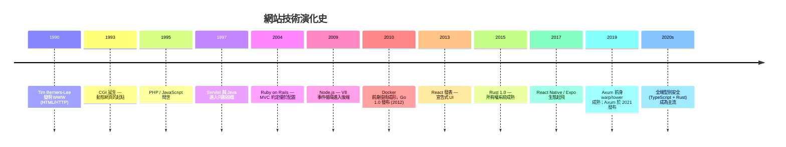
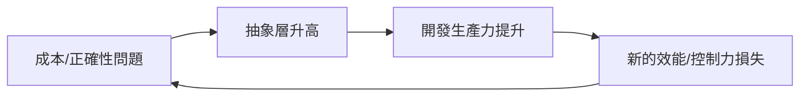

# 1.1 網站技術七十年：從 CGI 到全端框架

## 為什麼要回顧歷史？

技術不會憑空出現。每一代框架都是對上一代「痛點」的回答。要理解為什麼 2020 年代的全端開發會走向「Rust 後端 + React 前端」，必須先看清這條演化的因果鏈。

## 演化時間軸

## 各階段的因果關係

### 1. CGI 時代（1993）：每個請求一個行程

CGI（Common Gateway Interface）的做法極其簡單：每個 HTTP 請求都 fork 一個新的作業系統行程，執行腳本，輸出 HTML，然後結束。

$$\text{成本} \propto \text{行程建立開銷} \times \text{請求數}$$

當流量成長，這個模型徹底崩潰 —— 行程建立的成本是 $O(\text{ms})$ 級，而處理一個請求本身可能只要 $O(\mu s)$ 級。

**因果驅動**：成本問題 → 促成「常駐行程 + 執行緒池」的 Servlet（1997）與 FastCGI。

### 2. 直譯腳本時代（1995–2004）：生產力優先

PHP 的成功證明：**開發速度有時比執行速度更重要**。但動態型別、全域狀態、SQL 注入等問題累積了巨大的維護債。

**因果驅動**：維護債 → Rails（2004）以 MVC 架構與「約定優於配置」整頓大型專案；同時靜態型別陣營（Java、C#）以 IDE 工具鏈證明型別即文件。

### 3. 事件循環時代（2009）：C10K 問題的 JavaScript 解

1999 年提出的 [C10K 問題](http://www.kegel.com/c10k.html) 問的是：一台機器如何同時服務一萬個連線？執行緒模型下，一萬個執行緒的記憶體與排程開銷過大。

Node.js（2009）給出的答案是**單執行緒事件循環（event loop）+ 非同步 I/O**：

$$\text{記憶體} \approx O(\text{連線數}) \quad \text{而非} \quad O(\text{執行緒數} \times \text{堆疊大小})$$

但 Node.js 的弱點也很清楚：單執行緒無法利用多核心、callback 地獄、以及 JavaScript 本身缺乏對數值與記憶體的精確控制。

**因果驅動**：C10K + 多核心 → Rust 的 `async/await`（2019 穩定）+ Tokio 多執行緒工作竊取排程器，達成「事件循環的效率 + 執行緒的運算力」。

### 4. 前端革命（2013）：從操作 DOM 到宣告狀態

jQuery 時代，開發者手動命令式地操作 DOM。狀態散落在 DOM 各處，程式與介面互相糾纏。React（2013）提出反向思考：

$$\text{UI} = f(\text{state})$$

介面是狀態的純函數，開發者只管理狀態，渲染交給框架。Virtual DOM 的 diffing 演算法以 $O(n)$ 取代直接操作的複雜性（詳見 [4.1 節](04.1-React的核心思想：UI=f(state).md)）。

### 5. 全端整合時代（2015–至今）：型別跨越邊界

前後端分離後，最大的摩擦點變成**兩端型別不一致**。這催生了兩個方向：

1. 前端：TypeScript（2012 發布、2014 年後爆發）為 JavaScript 加上靜態型別。
2. 後端：Rust 以零成本抽象提供「C 的效能 + Haskell 的型別」。

當後端用 Rust（強型別、可序列化為 JSON Schema）而前端用 TypeScript，型別可以**自動從後端推導到前端**，這是本書架構的核心優勢（見 [4.4 節](04.4-前後端整合：型別共享、資料抓取與序列化.md)）。

## 演化的共同規律

每一次革命都在「抽象」與「控制」之間擺盪。Rust 的獨特之處在於它宣稱同時擁有兩者 —— **零成本抽象**：高階的型別與所有權語意在編譯後不留任何執行期開銷。這正是本書選擇 Rust 的理由，下一節將深入其理論根基。

## 習題

1. 解釋 CGI 的效能瓶頸，並說明 FastCGI 與 Servlet 如何解決。
2. C10K 問題的本質是什麼？Node.js 與 Rust+Tokio 各自如何解決？兩者的取捨為何？
3. 畫出「抽象層升高 → 生產力提升 → 控制力下降」在你熟悉的一個技術上的具體例子。
