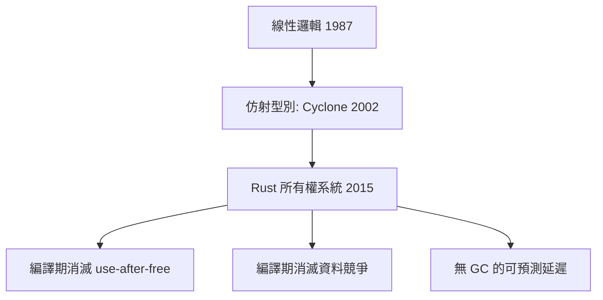

# 1.2 為什麼是 Rust：記憶體安全與效能的理論根基

## 三十年記憶體安全戰爭的終點

1988 年的莫里斯蠕蟲利用 `gets()` 的緩衝區溢位攻擊了當時網際網路 10% 的機器。此後三十年，微軟與 Google 的統計一致顯示：**約 70% 的嚴重資安漏洞源自記憶體安全問題**（use-after-free、buffer overflow、data race）。

| 解法 | 年代 | 代價 |
|------|------|------|
| 手動管理（C/C++） | 1972– | 開發者負責，極易出錯 |
| 垃圾回收（Java/Go/JS） | 1995– | 執行期 GC 開銷與延遲抖動 |
| 所有權系統（Rust） | 2015 | 編譯期學習曲線，執行期零成本 |

Rust 的回答是：**把記憶體管理從執行期搬到編譯期**。用型別系統在編譯時證明程式正確，而非在執行時偵測錯誤。

## 理論根基：線性型別與區域推理

Rust 的所有權系統源自 **線性型別理論（linear type theory）** 與 **仿射型別（affine types）**：每個值恰好被使用一次（線性）或至多一次（仿射）。這個理論来自 Girard 的線性邏輯（1987），Wadler 等人將其引入程式語言設計。

### 三條規則

1. 每個值有唯一的**所有者（owner）**。
2. 所有者離開作用域，值被**釋放（drop）**。
3. 賦值或傳參**移動（move）**所有權，原變數失效。

```rust
fn main() {
    let s = String::from("hello");
    let t = s;            // 所有權移動給 t
    // println!("{}", s); // 編譯錯誤：s 已失效
    println!("{}", t);
}   // t 離開作用域，記憶體在此釋放 — 沒有 GC，也沒有洩漏
```

### 借用檢查器：Aliasing XOR Mutability

$$\text{對任意值}：(\text{多個不可變借用}) \oplus (\text{一個可變借用})$$

「共享不可變，可變不共享」這條規則在編譯期**消滅了資料競爭（data race）**。資料競爭的兩個必要條件 —— 別名（aliasing）與可變性（mutability）—— 被型別系統強制互斥。



## 效能的理論基礎：零成本抽象

「零成本抽象」原則（Stroustrup 提出）：

> 你不使用的東西，不必付出代價；你使用的東西，手寫也無法更好。

以迭代器為例：

```rust
let sum: i64 = (0..1_000_000).filter(|x| x % 2 == 0).sum();
```

這段高階程式碼經過 LLVM 最佳化後，與手寫的彙編級迴圈**完全相同** —— 因為迭代器在編譯期被單態化（monomorphization）並內聯（inlining），抽象在執行期蒸發。

$$T_{\text{抽象}} = T_{\text{手寫}} + \epsilon, \quad \epsilon \approx 0$$

這對 Web 後端至關重要：請求處理熱路徑（parsing、序列化、資料庫驅動）全是抽象密集的程式碼。

## 為什麼 Web 後端需要這些？

| 需求 | GC 語言的痛 | Rust 的解 |
|------|------------|----------|
| 低延遲 (P99) | GC 停頓抖動 | 無 GC，延遲可預測 |
| 高併發 | 資料競爭靠紀律 | 編譯期保證 |
| 資源效率 | 執行期 + GC 堆積 | 緊湊記憶體佈局 |
| 重構信心 | 動態型別易漏改 | 型別即規格 |

Axum 連續多年在 TechEmpower Benchmark 位於第一梯隊，同時不需像 Go/Java 那樣調校 GC 參數。

## 心理帳：學習曲線的前因後果

Rust 的學習曲線陡峭，原因是**借用檢查器把執行期 bug 提前到編譯期**。你並沒有「多學」東西，而是把原本在 production 除錯的時間，轉移到編譯階段：

$$\text{總成本} = \underbrace{T_{\text{compile errors}}}_{\text{前置}} + \underbrace{T_{\text{debug}}}_{\text{大幅減少}}$$

實務經驗：借用檢查器的錯誤集中在學習的前 4–8 週，之後你會**主動設計出讓借用檢查器滿意的架構** —— 而這些架構（資料所有權清晰、狀態隔離）恰恰也是良好的併發架構。

## 習題

1. 說明「Alias XOR Mutability」為何能編譯期消滅資料競爭。給一個 C 語言中會出事、Rust 中編譯不過的例子。
2. 什麼是單態化？它與 Java 的型別擦除（type erasure）有何不同？對執行期效能的影響？
3. 為什麼 GC 的停頓對 Web 服務的 P99 延遲是問題，而對批次運算不是？
