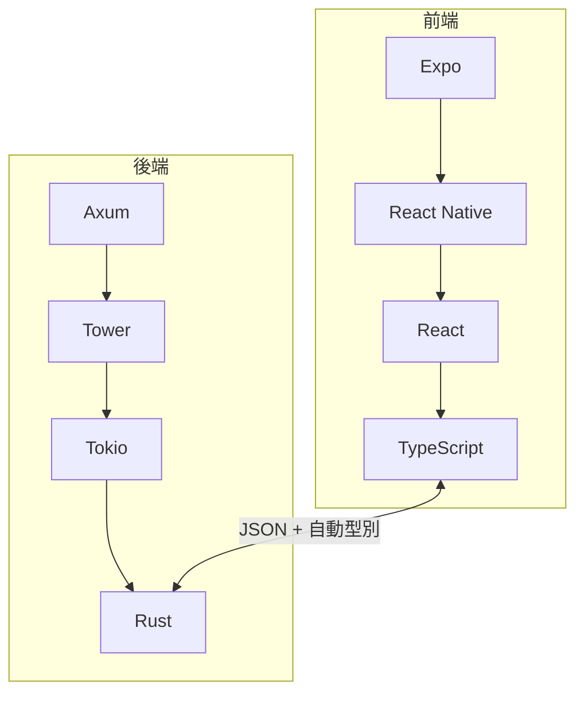

# 1.3 為什麼是 React 與 Expo：宣告式 UI 與跨平台革命

## 從命令式到宣告式的典範轉移

2013 年之前，主流前端框架（jQuery、Backbone）都是**命令式**的：開發者描述「如何改」介面。React 提出宣告式：描述「介面長什麼樣」，框架自己算出「如何改」。

$$\text{命令式：} \quad \text{state}_1 \xrightarrow{\text{手寫 DOM 操作}} \text{UI}_1 \xrightarrow{\text{手寫}} \text{UI}_2$$
$$\text{宣告式：} \quad \text{UI} = f(\text{state})$$

宣告式的理論優勢：UI 成為狀態的**純函數**，同一狀態永遠渲染同一介面 —— 這消滅了「狀態與畫面不同步」這一整類 bug，也是函數式程式設計「引用透明（referential transparency）」在 UI 領域的應用。

## React 的三個理論支柱

### 1. Virtual DOM 與 O(n) Diffing

直接比較兩棵 DOM 樹是 $O(n^3)$ 。React 依靠兩個啟發式將其降到 $O(n)$ ：

1. **不同型別的元素產生不同的樹**（直接重建子樹）
2. **同層級以 `key` 標記子元素**（列表重排用移動代替重建）

```mermaid
flowchart LR
    A[state 變更] --> B[重新執行元件函數]
    B --> C[產生新的 Virtual DOM]
    C --> D[Diff 舊樹 vs 新樹 O(n)]
    D --> E[最小化 DOM 操作]
```

### 2. 單向資料流（Unidirectional Data Flow）

資料只能從父元件流向子元件（props），子元件透過 callback 回報。這讓資料流成為**有向無環圖（DAG）**，除錯時可以單向追蹤，不存在雙向綁定的循環依賴問題。

### 3. 元件組合（Composition over Inheritance)

UI 被拆成可組合的函數元件，複用靠組合而非繼承 —— 這是物件導向設計原則在 UI 領域的翻轉，也讓元件成為可獨立測試的純函數單元。

## 為什麼前端需要 TypeScript？

JavaScript 的動態型別在小型腳本中靈活，但在數萬行的前端應用中成為負債。TypeScript（2012，Anders Hejlsberg，同為 C# 之父）提供**結構化型別系統（structural typing）** + 漸進式型別（gradual typing）：

$$\text{型別 } A \text{ 相容 } B \iff A \text{ 具備 } B \text{ 所需的全部成員}$$

結構化型別與 JSON 天然契合 —— JSON 物件就是結構型別的值。這是前後端型別共享（[4.4 節](04.4-前後端整合：型別共享、資料抓取與序列化.md)）能自動化的理論基礎。

## Expo：把 React Native 的複雜度藏進約定

2015 年 React Native 讓「用 React 寫 iOS/Android 原生應用」成真，但原生編譯、憑證簽署、版本升級的痛點讓許多團隊卻步。Expo（2015 年成立）的回答是**平台即服務**：

| 痛點 | Expo 的解法 |
|------|-------------|
| Xcode/Android Studio 環境地獄 | 雲端建置 EAS Build |
| 原生模組整合 | `expo-*` 預封裝模組 + autolinking |
| 版本升級断裂 | SDK 受控升級路徑 |
| 無法寫原生碼？ | Development Build 允許 eject 原生層 |

**抽象層次的取捨**：Expo 蓋掉平台差異，代價是初期對底層控制較少；但 2020 年代 Exno 的 development build 已允許「需要時下沉到原生」，抽象不再是單行道。

## 本書的選型組合



選擇的邏輯：

- **React**：宣告式 UI 是當代 UI 開發的共識正解。
- **TypeScript**：為跨邊界型別共享提供可能。
- **Expo**：以最低維運成本同時覆蓋 Web 與行動裝置。
- **Rust/Axum**：以最高可靠性與效能承載 API。
- **共同語言 JSON**：兩端型別系統都對 JSON 序列化有第一級支援。

## 習題

1. 解釋 Virtual DOM 為何存在。若目標平台是原生 View 而非 DOM，同樣思想如何適用？
2. 結構化型別系統如何使「後端 Rust struct → 前端 TypeScript interface」的自動轉換成為可能？
3. 比較 Expo 管理式工作流程（managed workflow）與裸工作流程（bare workflow）的抽象取捨。
