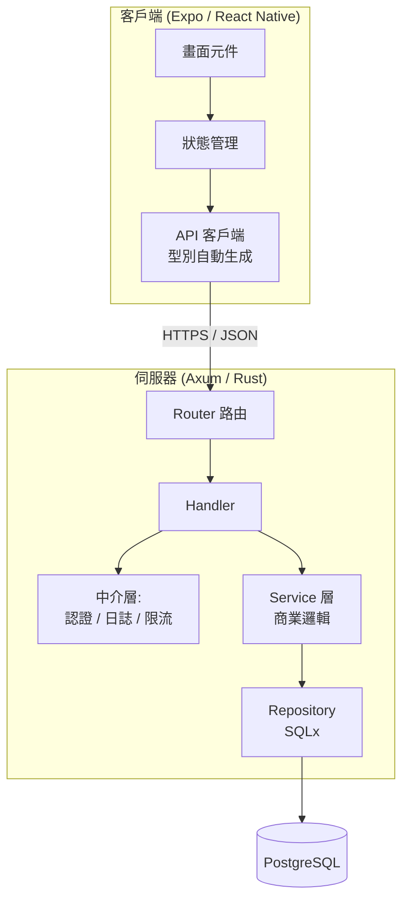

# 1.4 開發環境建置與系統架構總覽

## 全書系統架構

在動手之前，先看見全景。本書最終要建構的系統：



核心原則：**資料由下而上流動，請求由上而下穿越**。每層只依賴相鄰層，這是分層架構（layered architecture）的依賴不變式。

## 工具鏈安裝

### Rust

```bash
# rustup = Rust 的版本管理器（類似 nvm + npm 的合體）
curl --proto '=https' --tlsv1.2 -sSf https://sh.rustup.rs | sh
rustc --version    # 檢查編譯器
cargo --version    # 建構工具 + 套件管理器
```

Cargo 的角色相當於 Node.js 生態中 `npm + webpack + jest` 的總和 —— 這種「官方統一工具鏈」是 Rust 開發體驗流暢的主因。

### Node.js 與 Expo

```bash
# 建議使用 nvm 管理版本
brew install nvm && nvm install --lts
npm --version

# 建立 Expo 專案
npx create-expo-app@latest my-app
cd my-app && npx expo start
```

### PostgreSQL

```bash
brew install postgresql@16
brew services start postgresql@16
createdb mydb
```

## 版本矩陣

| 工具 | 本書使用的版本 | 說明 |
|------|---------------|------|
| Rust | 1.75+ | 需要 async fn in trait 穩定版 |
| Axum | 0.7+ | 與 tower 0.4 配套 |
| Tokio | 1.x | 執行期 |
| SQLx | 0.7+ | 編譯期 SQL 檢查 |
| Node.js | 20 LTS | |
| Expo SDK | 50+ | |

## 專案佈局（Monorepo）

```
myapp/
├── backend/              # Rust + Axum
│   ├── Cargo.toml
│   ├── migrations/       # 資料庫遷移
│   └── src/
│       ├── main.rs       # 組裝路由與中介層
│       ├── routes/       # HTTP 層
│       ├── models/       # 資料模型
│       └── error.rs      # 統一錯誤型別
├── frontend/             # Expo + React Native
│   ├── package.json
│   ├── app/              # 檔案式路由 (expo-router)
│   ├── api/              # 自動生成的 API 客戶端
│   └── components/
├── openapi.json          # 後端導出的 API 規格（型別橋樑）
└── docker-compose.yml
```

**openapi.json 是前後端的型別橋樑**：後端由 Rust 型別生成規格，前端由規格生成 TypeScript 客戶端（見 4.4 節）。這讓「後端改了一個欄位」在 CI 階段就讓前端編譯失敗，而非在 production 才爆炸。

## 核心相依套件

### backend/Cargo.toml

```toml
[dependencies]
axum = "0.7"
tokio = { version = "1", features = ["full"] }
tower = "0.4"
tower-http = { version = "0.5", features = ["cors", "trace"] }
serde = { version = "1", features = ["derive"] }
serde_json = "1"
sqlx = { version = "0.7", features = ["runtime-tokio", "postgres", "chrono", "uuid"] }
jsonwebtoken = "9"
chrono = { version = "0.4", features = ["serde"] }
uuid = { version = "1", features = ["v4", "serde"] }
```

### frontend 關鍵依賴

```bash
npx expo install expo-router react-native-safe-area-context
npm install zod @tanstack/react-query
```

- `zod`：執行期資料驗證 —— 編譯期型別無法驗證外部輸入，需要運行時檢查。
- `@tanstack/react-query`：伺服器狀態管理（快取、重試、失效），見 4.2 節。

## 驗證環境

```bash
cd backend && cargo run &        # 啟動後端
cd frontend && npx expo start    # 啟動前端開發伺服器
curl http://localhost:3000/health   # 應回 {"status":"ok"}
```

## 理論視角：為什麼是「分層 + 型別邊界」？

分層的本質是**控制耦合度（coupling）**。耦合度越低，可修改性越高。而型別邊界把「契約」從文件（人會讀錯）升級為編譯器強制檢查的規格：

$$\text{錯誤發現時間}： \text{production} \gg \text{測試} \gg \text{CI} \gg \text{編譯期}$$

越早發現越便宜，這是本書所有工程決策背後共同的經濟學。

## 習題

1. 畫出你目前工作專案的架構圖，標出層與依賴方向，找出違反「依賴不變式」的地方。
2. 為什麼 openapi.json 放在 monorepo 根目錄，而不是各自資料夾內？
3. zod 存在的理由是什麼？TypeScript 型別在執行期發生了什麼？
