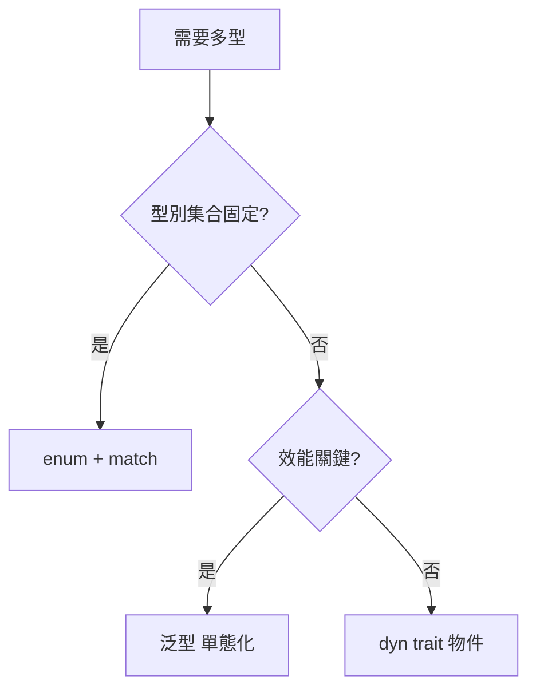

# 2.2 型別系統、Trait 與泛型：多型之三種形態

## 型別即規格

靜態型別系統的本質是**以機器可檢查的方式寫下程式的規格**。型別越精確，規格越完整，編譯器能捕捉的錯誤越多。Rust 的型別系統擁有現代語言中幾乎全套的武器：

- 代數資料型別（ADT）：enum + struct
- Trait：類似 typeclass 的多型約束
- 泛型與單態化：零成本的編譯期多型
- 型別狀態（typestate）：以型別編碼狀態機

## 代數資料型別：和與積

$$\text{Sum: } T = A + B \quad(\text{enum，值屬於其中一種})$$
$$\text{Product: } T = A \times B \quad(\text{struct，同時持有全部欄位})$$

以 ADT 精確建模領域，是 Rust 開發的核心功夫。例：一個使用者帳號有三種狀態：

```rust
enum AccountState {
    Pending { email: String },          // 未驗證：只有 email
    Active  { email: String, plan: Plan },
    Suspended { reason: String },
}
```

對比 JavaScript 常見的寫法（`status` 字串 + 可選欄位），ADT 讓「Pending 狀態下不可能有 plan」成為**編譯期事實**。這叫**讓非法狀態不可表示（make illegal states unrepresentable）**。

## Trait：編譯期多型

Trait 定義行為契約，類似 Haskell typeclass 或 Java interface，但有三點關鍵差異：

1. 可以為**外部型別**實作自己的 trait（孤兒規則管理一致性）
2. 泛型約束在編譯期**單態化**，無虛函數表開銷
3. trait 可以有關聯型別與關聯常數

```rust
trait Repository {
    type Item;
    type Error;
    async fn find(&self, id: Uuid) -> Result<Option<Self::Item>, Self::Error>;
}
```

## 多型的三種形態與成本模型

| 形態 | 機制 | 成本 | 適用 |
|------|------|------|------|
| 泛型（`fn f<T: Repo>`） | 單態化 | 零執行期成本，編譯變慢、體積變大 | 熱路徑 |
| Trait 物件（`dyn Repo`） | 虛表動態分派 | 一次間接呼叫，無法內聯 | 需執行期多型 |
| Enum 分派 | match | 最快，但型別集合封閉 | 型別集合已知 |

**選擇法則**：型別集合編譯期已知 → enum；熱路徑泛型抽象 → 泛型；需要插件式擴展 → `dyn`。



## 泛型與單態化

```rust
fn to_json<T: Serialize>(item: &T) -> String {
    serde_json::to_string(item).unwrap()
}
// 編譯器為每個用到的 T 生成一份專屬程式碼：
// to_json::<User>, to_json::<Order>, ...
```

這是 C++ 模板與 Haskell 型別類的混合體。代價是**編譯時間與二進位體積**，收益是零成本抽象 + 完整內聯最佳化。

## 型別狀態模式：把狀態機寫進型別

Web 開發中的經典需求：只有「已取得連線」的物件才能發查詢；只有「已驗證」的請求才能進入受保護的路由。

```rust
struct Unverified;
struct Verified;

struct Request<State> {
    body: String,
    _state: PhantomData<State>,
}

impl Request<Unverified> {
    fn verify(self, token: &str) -> Option<Request<Verified>> { /* ... */ }
}

impl Request<Verified> {
    fn process(self) { /* 只有 Verified 能呼叫 */ }
}
```

呼叫 `Request::<Unverified>::process()` 直接編譯失敗 —— 狀態轉移規則被編碼進型別系統，編譯器成為狀態機的驗證者。

## Serde：序列化即型別推導

本書前後端通訊全賴 `serde`（serialize/deserialize）：

```rust
#[derive(Serialize, Deserialize)]
struct User {
    id: Uuid,
    name: String,
    #[serde(skip_serializing)]
    password_hash: String,   // 永不出現在 JSON 中
}
```

一次 derive，同時獲得 JSON 序列化與反序列化，且**欄位與型別由編譯器保證與 struct 一致**。這是 4.4 節型別共享管道的基礎。

## 習題

1. 用 ADT 重新設計「訂單狀態：待付款/已付款/已出貨/已取消」，寫出 Rust enum，並說明哪些非法轉移被型別擋住。
2. 何時應該用 `dyn Trait` 而非泛型？舉一個 Web 應用中的實例。
3. 型別狀態模式如何用於「資料庫交易」的型別建模（未提交前不能查新資料）？
