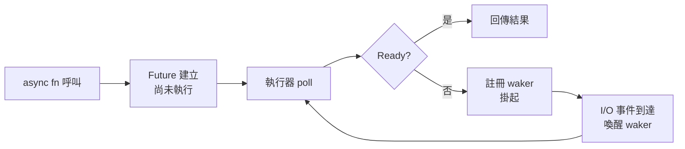

# 2.3 非同步程式設計：Future 狀態機與事件循環

## 問題：併發的成本曲線

服務一萬個連線的三種模型：

| 模型 | 記憶體成本 | 切換成本 | 程式模型 |
|------|-----------|---------|---------|
| 行程/執行緒 | ~8MB/執行緒（預設堆疊） | 核心態切換 | 同步、直觀 |
| 事件循環（Node.js） | O(連線數) | 使用者態 | 回呼地獄 |
| Rust async | O(狀態機大小)，數百 bytes | 使用者態 | `async/await` 同步風格 |

Rust async 的目標：**取得事件循環的資源效率，同時保留同步程式碼的可讀性**。

## Future：惰性的狀態機

Rust 的 `Future` 與 JavaScript Promise 的根本差異：

- JS Promise：建立即執行（eager）
- Rust Future：**惰性**，被 poll 才前進（lazy）

```rust
pub trait Future {
    type Output;
    fn poll(self: Pin<&mut Self>, cx: &mut Context<'_>) -> Poll<Self::Output>;
}

enum Poll<T> { Ready(T), Pending }
```

每個 `async fn` 編譯後是一個**狀態機**：每個 `.await` 點是狀態轉移，函數的局部變數被存進狀態機結構體 —— 這就是為何 async 任務只需數百 bytes（對比執行緒的 MB 級堆疊）。

$$\text{記憶體} = \text{狀態機大小} = \sum_{\text{局部變數}} \text{size} \quad \text{而非} \quad 8\,\text{MB 堆疊}$$



## Tokio：多執行緒工作竊取排程器

Tokio 是 Rust 的事實標準執行期（runtime），包含：

1. **反應器（reactor）**：以 epoll/kqueue 監聽 I/O 事件
2. **排程器（scheduler）**：多 worker 執行緒 + 工作竊取（work-stealing）
3. **計時器**：階梯式 timer wheel

工作竊取：每個 worker 有本地佇列，閒置時從其他 worker **竊取**任務 —— 這是多核心負載平衡的經典演算法（Java ForkJoinPool 同源），在「任務數多且不均」的 Web 負載下表現極佳。

## async/await 的語意

```rust
async fn get_user(pool: &PgPool, id: Uuid) -> Result<User> {
    let user = sqlx::query_as!(User, "SELECT * FROM users WHERE id=$1", id)
        .fetch_one(pool)
        .await?;      // await 點：讓出執行緒，狀態機暫停
    Ok(user)
}
```

`.await` 的意義：**「此處可能需要等待，期間把執行緒讓給別的任務」**。注意兩個陷阱：

### 陷阱一：跨 await 持有鎖

```rust
let guard = state.lock().await;     // MutexGuard 跨越 await
do_something(&guard).await;         // 若 Mutex 是 std::sync，編譯器會擋下
```

std 的 `MutexGuard` 不是 `Send`，跨 await 會編譯失敗 —— 型別系統再次拯救併發正確性。

### 陷阱二：在同步迴圈中 await

```rust
// 錯誤：序列請求，總延遲 = n × RTT
for id in ids { get_user(&pool, id).await?; }

// 正確：併發，總延遲 ≈ max(RTT)
let users = futures::future::try_join_all(
    ids.iter().map(|id| get_user(&pool, *id))
).await?;
```

$$T_{\text{序列}} = \sum_i t_i \quad\quad T_{\text{併發}} = \max_i t_i$$

## Send 與 'static：Axum Handler 的約束

Axum 要求 handler 是 `Send + 'static`，因為任務會在多執行緒間移動。這帶來一條實戰規則：**不要跨 await 持有非 Send 的引用**。違反時的編譯錯誤資訊很長，核心通常是 `future cannot be sent between threads safely`。

## 與 Node.js 事件循環的對照

| 面向 | Node.js | Rust + Tokio |
|------|---------|--------------|
| 執行模型 | 單執行緒事件循環 | 多執行緒工作竊取 |
| 阻塞主執行緒 | 毀掉整個服務 | 只毀一個 worker |
| 顏色函數問題 | async 傳染（同樣存在） | 同樣存在，但型別系統顯式化 |
| CPU 密集任務 | worker_threads / 集群 | `spawn_blocking` / rayon |

## 習題

1. 畫出 `async fn fetch_two(a, b)`（兩個 sequential await）編譯後狀態機的狀態圖。
2. 為什麼 Rust 選擇惰性 Future 而 JS 選擇 eager Promise？各舉一個因此產生的陷阱。
3. 解釋工作竊取演算法，以及為何它比全域單一佇列有更好的快取局部性。
