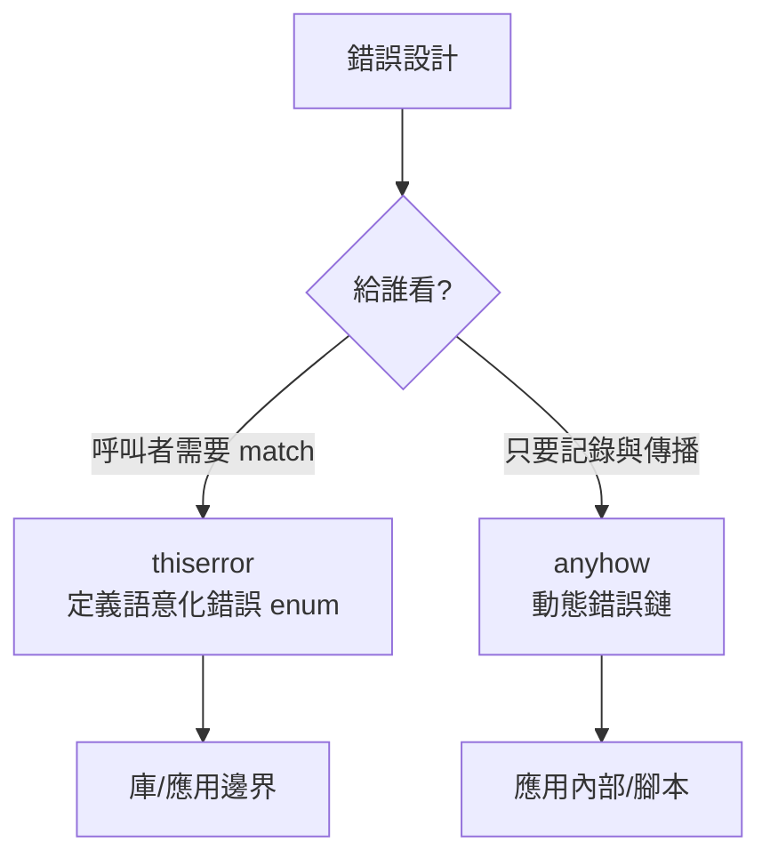

# 2.4 錯誤處理：從例外到代數資料型別

## 錯誤處理的兩大陣營

| 陣營 | 代表 | 機制 | 問題 |
|------|------|------|------|
| 例外（exception） | Java, Python, C++ | 堆疊解卷 | 控制流不可見、型別系統不管 |
| 傳回值（result） | Go, Rust, C | 傳回值攜帶錯誤 | Go 的 `if err != nil` 樣板 |

理論上的關鍵差異：**例外的存在不反映在函數型別上**。呼叫 `parse_int(s)` 的型別簽名看不出它會丟例外 —— 規格與型別脫節。Rust 把錯誤編碼進回傳型別：

$$\text{Result}<T, E> = T + E \quad(\text{和型別：成功或失敗})$$

## Result 與 Option：可判別的成功/失敗

```rust
enum Result<T, E> { Ok(T), Err(E) }
enum Option<T> { Some(T), None }   // 「可能有值」與錯誤是不同概念
```

`Option` 與 `Result` 的區分是實務上重要的設計紀律：「查無此人」是 `Option`（正常業務路徑），「資料庫掛了」是 `Result`（基礎設施故障）。混用會讓監控與重試策略失焦。

## `?` 運算子：錯誤傳播的語法糖

```rust
fn load_user(id: Uuid) -> Result<User, AppError> {
    let conn = connect().await?;        // Err 則提前 return Err(... From::from(e))
    let user = query(conn, id).await?;
    Ok(user)
}
```

`?` 等價於 match + 提前返回，且自動呼叫 `From::from` 做錯誤型別轉換。這解決了 Go 的樣板問題，同時保持錯誤路徑在型別簽名上完全可見：

$$\text{規格} = \text{簽名} \Rightarrow \text{編譯器強制處理所有錯誤分支}$$

## 錯誤分層：領域錯誤 vs 基礎設施錯誤

Web 應用的錯誤應該分層 —— 這是錯誤處理架構的核心設計：

```rust
// 統一的應用層錯誤，直接映射 HTTP 狀態碼
#[derive(Debug, thiserror::Error)]
pub enum AppError {
    #[error("not found")]
    NotFound,                                  // → 404
    #[error("validation: {0}")]
    Validation(String),                        // → 422
    #[error("unauthorized")]
    Unauthorized,                              // → 401
    #[error("conflict: {0}")]
    Conflict(String),                          // → 409
    #[error(transparent)]
    Internal(#[from] anyhow::Error),           // → 500，內部細節不外洩
}

impl IntoResponse for AppError {
    fn into_response(self) -> Response {
        let (status, msg) = match &self {
            AppError::NotFound => (StatusCode::NOT_FOUND, self.to_string()),
            AppError::Validation(m) => (StatusCode::UNPROCESSABLE_ENTITY, m.clone()),
            AppError::Internal(e) => {
                tracing::error!("internal: {e:?}");   // 記錄細節
                (StatusCode::INTERNAL_SERVER_ERROR, "internal error".into()) // 外洩最小化
            }
            _ => (StatusCode::BAD_REQUEST, self.to_string()),
        };
        (status, Json(json!({ "error": msg }))).into_response()
    }
}
```

兩條安全原則：

1. **內部錯誤細節不外洩**：SQL 錯誤訊息可能洩漏 schema，回給客戶端的只有籠統訊息。
2. **完整鏈路進日誌**：用 `anyhow` 的錯誤鏈（context）保留根因。

## thiserror vs anyhow 的分工



法則：**庫與 API 邊界用語意化型別（thiserror），應用內部傳播用 anyhow**。Axum 只要求最終錯誤實作 `IntoResponse`。

## 與前端的錯誤契約

後端錯誤的 JSON 形狀（`{ "error": string }`）是一份**跨邊界契約**，前端據此建立對應的 TypeScript 判別聯集（discriminated union）：

```typescript
type ApiError = { error: string; status: number };
// fetch 包裝層：非 2xx 一律拋出 ApiError，由 react-query 統一處理
```

錯誤處理因此成為全端一致的型別問題，而非兩端各自的 afterthought。

## 習題

1. 為什麼「查無資料」應該是 `Option` 而不是自訂 `NotFound` 錯誤？何時例外？
2. `?` 運算子的 `From::from` 轉換如何讓「一個函數回傳統一錯誤型別，內部呼叫多種錯誤來源」可行？
3. 設計一個檔案上傳 API 的錯誤 enum，列出每個變體對應的 HTTP 狀態碼與理由。
