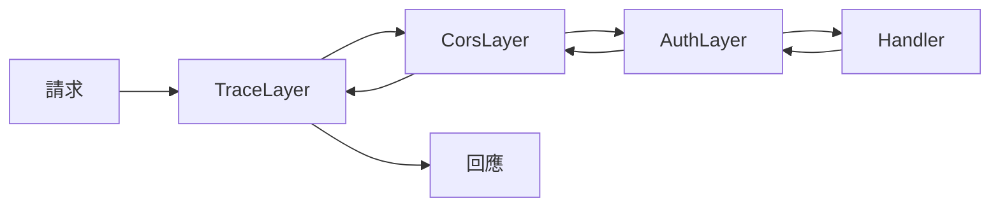
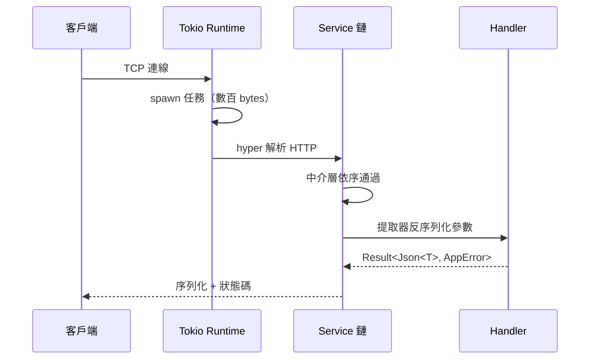

# 3.1 Tokio 與 Axum：Tower 中介層的函數式理論

## Tower：把中介層變成數學

所有 Web 框架都有中介層（middleware），但多半是框架私有的概念（Express 的 `app.use`、ASP.NET 的 pipeline）。Tower（2019）的企圖更大：**把「服務」抽象成一個統一的數學形態**，使中介層與框架解耦。

$$\text{Service}： \text{Request} \to \text{Future}<\text{Response}>$$

一個 Service 就是一個非同步函數：

```rust
pub trait Service<Request> {
    type Response;
    type Error;
    type Future: Future<Output = Result<Self::Response, Self::Error>>;
    fn poll_ready(&mut self, cx: &mut Context<'_>) -> Poll<Result<()>>;
    fn call(&mut self, req: Request) -> Self::Future;
}
```

### 中介層 = Service 的函子

中介層是「吃一個 Service，吐一個 Service」的**高階函數**：

$$\text{Middleware}(S) = S'$$

組合多個中介層就是函數複合：

$$\text{Handler} \xrightarrow{\text{Auth}} \xrightarrow{\text{Logging}} \xrightarrow{\text{Compression}} \text{網路}$$



這正是函數式程式中 monad transformer / functor composition 的思想：用可組合的抽象取代命令式的管線程式碼。

## Axum：Tower 之上的 Web 框架

Axum（2021，Tokio 團隊出品）的設計哲學：

1. **無巨集路由**：路由即 API，型別即文件（對比 actix-web 的巨集魔法）
2. **中介層即 Tower**：直接復用整個 Tower 生態（超時、限流、追蹤……）
3. **提取器（extractor）**：以函數參數宣告式地取得請求資料
4. **錯誤即回應**：`IntoResponse` 統一錯誤輸出

### 一個最小的 Axum 服務

```rust
use axum::{routing::get, Router, Json};

#[tokio::main]
async fn main() {
    let app = Router::new()
        .route("/health", get(|| async { Json(serde_json::json!({"status": "ok"})) }));

    let listener = tokio::net::TcpListener::bind("0.0.0.0:3000").await.unwrap();
    axum::serve(listener, app).await.unwrap();
}
```

短短幾行，背後發生了：Tokio 啟動 worker pool、非同步 accept 迴圈、每個連線 spawn 任務、Tower 服務鏈執行。**框架把所有併發細節封裝成「寫 handler 就好」**。

## 請求的生命週期



## 為什麼 Axum 而非其他 Rust 框架

| 框架 | 特點 | 取捨 |
|------|------|------|
| actix-web | 最快、成熟 | 巨集路由、自有 runtime 抽象（早期） |
| warp | Filter 組合子 | 學習曲線陡，錯誤訊息難讀 |
| rocket | 最友善 | 早期不支援 async |
| **axum** | Tower 生態、無巨集、Tokio 官方 | 較新（2021） |

Axum 的勝出關鍵是**站在 Tower 生態上**：任何 Tower 中介層立即可用，社群不再各自造輪子 —— 這是「標準化抽象」的網絡效應，正如 HTTP 成為標準後 Web 爆發。

## 背壓（Backpressure）：poll_ready 的深意

Tower Service 的 `poll_ready` 讓中介層可以**拒絕過載**：連線池滿了、限流器滿了，服務在呼叫前就回報「未就緒」，請求被暫停而非爆炸。

$$\text{穩定系統}： \lambda_{\text{in}} \le \lambda_{\text{capacity}}$$

這是反應式系統宣言（Reactive Manifesto, 2014）「回彈性（resilient）」的具體實現 —— 對比許多框架「接受所有請求然後超時」，Tower 的背壓是結構性的。

## 習題

1. 實作一個 Tower 中介層：為所有回應加上 `X-Request-Duration` 標頭。
2. 解釋 `poll_ready` 與 `call` 分離的原因。若合併為一個介面會失去什麼？
3. 比較 Axum 的提取器與 Express 的 `req.body` 在型別安全上的差異。
