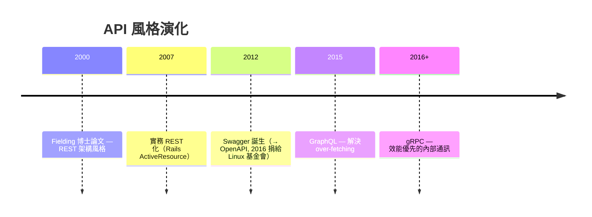
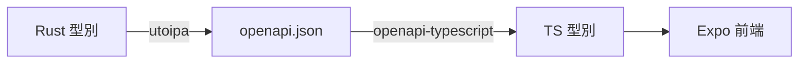

# 3.4 認證與 API 設計：REST、JWT 與 OpenAPI

## API 設計的演進因果



REST 贏得公開 Web API 的原因：零特殊基礎設施（HTTP 即協定）、快取友善、統一介面。GraphQL 與 gRPC 在特定場景（聚合查詢、內部微服務）更優，但對「前端 + 公開 API」的本書場景，REST + OpenAPI 是成本效益最優解。

## 認證 vs 授權：兩個不同的問題

- **認證（Authentication）**：你是誰 → session 或 token
- **授權（Authorization）**：你能做什麼 → 角色與策略

### Session vs JWT 的取捨

| | Session（伺服器狀態） | JWT（自含 token） |
|--|--|--|
| 撤銷 | 刪除 session 即可 | 難（需黑名單或短效期） |
| 水平擴展 | 需共享儲存 | 無狀態，天然擴展 |
| 大小 | 只傳 ID | 攜帶 claims，較大 |
| 適用 | 傳統 Web | SPA / 行動 App + API |

本書場景（Expo 行動端 + API）選 **JWT**：無狀態伺服器易於水平擴展，行動端儲存 token 也簡單。

## JWT 的結構與陷阱

$$\text{JWT} = \text{Base64Url}(\text{Header}) . \text{Base64Url}(\text{Payload}) . \text{Signature}$$

```rust
#[derive(Serialize, Deserialize)]
struct Claims {
    sub: Uuid,                                // 使用者 ID
    exp: i64,                                 // 過期時間（必要！）
    iat: i64,
}

pub fn create_token(user_id: Uuid, secret: &str) -> Result<String> {
    let claims = Claims {
        sub: user_id,
        exp: (Utc::now() + Duration::hours(24)).timestamp(),
        iat: Utc::now().timestamp(),
    };
    encode(&Header::default(), &claims, &EncodingKey::from_secret(secret.as_bytes()))
}

pub fn verify_token(token: &str, secret: &str) -> Result<Claims> {
    let data = decode::<Claims>(token, &DecodingKey::from_secret(secret.as_bytes()),
        &Validation::default())?;
    Ok(data.claims)
}
```

三大陷阱：

1. **不放敏感資料**：payload 只是 Base64，**不是加密**。
2. **必須驗 `exp` 與簽名**：演算法混淆攻擊（`alg: none`）曾令多個庫淪陷。
3. **無法主動撤銷**：對策是短效 access token（15 分鐘）+ 長效 refresh token（可撤銷、存 DB）。

## 中介層實作：認證即 Tower Layer

```rust
pub async fn require_login(
    State(state): State<AppState>,
    mut req: Request,
    next: Next,
) -> Result<Response, AppError> {
    let token = req.headers()
        .get(AUTHORIZATION)
        .and_then(|v| v.to_str().ok())
        .and_then(|v| v.strip_prefix("Bearer "))
        .ok_or(AppError::Unauthorized)?;

    let claims = auth::verify_token(token, &state.jwt_secret)
        .map_err(|_| AppError::Unauthorized)?;

    req.extensions_mut().insert(claims);   // 往下游傳遞身分
    Ok(next.run(req).await)
}
```

Handler 端用提取器取得身分：

```rust
async fn me(Extension(claims): Extension<Claims>) -> Json<Claims> {
    Json(claims)
}
```

**授權邏輯與業務邏輯正交分離** —— 這是中介層架構的價值：橫切關注點（cross-cutting concerns）抽離後，handler 保持純粹。

## OpenAPI：讓 API 規格成為一等公民

用 `utoipa` 從 Rust 型別生成 OpenAPI 規格：

```rust
#[derive(Serialize, Deserialize, ToSchema)]
#[serde(rename_all = "camelCase")]
pub struct UserDto {
    pub id: Uuid,
    pub name: String,
    pub email: String,
}

#[utoipa::path(get, path = "/users/{id}", responses(
    (status = 200, body = UserDto),
    (status = 404, description = "not found"),
))]
async fn get_user(...) -> ... { ... }
```

產出的 `openapi.json` 餵給前端：



**API 文件不再可能過期** —— 文件由型別生成，型別由編譯器保證。這是 1.4 節「型別即規格」的全面落實。

## 安全清單

- 密碼：Argon2 雜湊（`argon2` crate），絕不存明文
- 傳輸：全站 HTTPS；CORS 白名單明確設定
- 輸入：提取器 + validator（見 3.2）
- 限流：`tower_governor` 防暴力破解
- 祕鑰：環境變數 / secret manager，絕不進 git

## 習題

1. 設計 refresh token 輪換機制，並說明如何偵測 token 被竊（重複使用）。
2. 為什麼 JWT payload 不能存信用卡號？
3. 比較 REST、GraphQL、gRPC 三者在「行動 App → 公開 API」場景的取捨。
