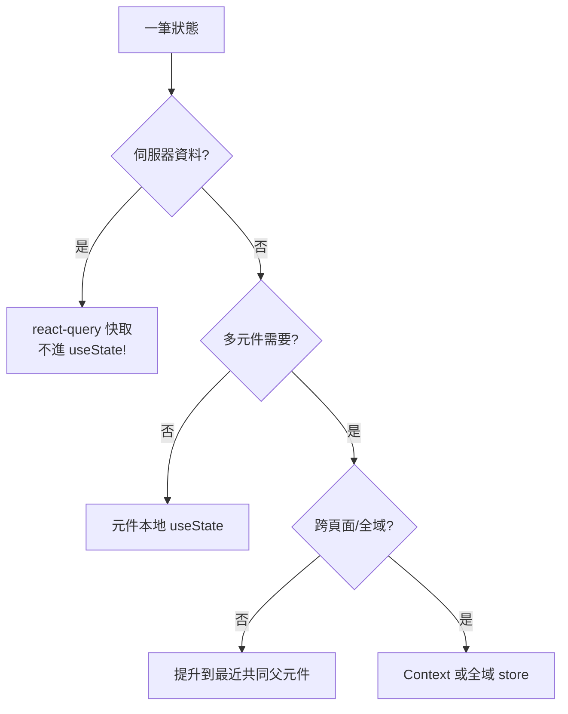

# 4.1 React 的核心思想：UI = f(state)

## 從 1.3 節的承諾說起

[1.3 節](01.3-為什麼是React與Expo：宣告式UI與跨平台革命.md) 給出了公式 $\text{UI} = f(\text{state})$。本節拆解這個公式在程式碼中的完整實現。

## 函數元件：UI 是純函數

```tsx
type Todo = { id: string; title: string; done: boolean };

function TodoItem({ todo, onToggle }: {
  todo: Todo;
  onToggle: (id: string) => void;
}) {
  return (
    <Pressable onPress={() => onToggle(todo.id)}>
      <Text style={todo.done ? styles.done : styles.active}>
        {todo.done ? '✓ ' : '· '}{todo.title}
      </Text>
    </Pressable>
  );
}
```

純函數性帶來三個工程紅利：

1. **可測試**：給定 props，斷言輸出，無需模擬環境
2. **可快取/跳過**：相同 props 不需重算（`React.memo` 的理論基礎）
3. **可推理**：bug 只能來自輸入或函數本身，沒有隱藏的時序

## State：唯一的事實來源

```tsx
function TodoList() {
  const [todos, setTodos] = useState<Todo[]>([]);

  const toggle = (id: string) =>
    setTodos(prev => prev.map(t => t.id === id ? { ...t, done: !t.done } : t));

  return (
    <>
      {todos.map(t => <TodoItem key={t.id} todo={t} onToggle={toggle} />)}
    </>
  );
}
```

關鍵紀律：

- **不可變更新**：`map` 產生新陣列，而非 `push` 原地改。這是因為 React 以**引用相等性**偵測變更：

$$\text{dirty}(x) \iff x_{\text{new}} \neq x_{\text{old}} \ (\text{object identity})$$

$O(1)$ 的引用比較取代深比較 —— 責任轉移給開發者「製造新物件」，換取框架的快速判斷。

- **key 的理論**：列表 diff 靠 key 對齊新舊子樹。用陣列索引當 key 會在「插入頭部」時讓所有元素錯配 → 狀態錯亂。key 必須是**穩定的資料識別碼**。

## 渲染流程全圖

```mermaid
flowchart TD
    A[setState 觸發] --> B[標記元件 dirty]
    B --> C[渲染階段\n執行元件函數 產生新樹]
    C --> D[Diff 新舊樹 O(n)]
    D --> E[提交階段\n最小化平台操作]
    E --> F[DOM / 原生 View 更新]
    F --> G[瀏覽器繪製 / 原生渲染]
```

**渲染階段必須是純的**：React 可能呼叫元件函數多次（StrictMode、併發渲染中斷重啟）。副作用（fetch、計時器）絕不能出現在渲染主體 —— 這是 useEffect 存在的原因（見 4.2）。

## 併發渲染：可中斷的渲染（React 18）

React 18（2022）引入併發特性：渲染可以**暫停、丟棄、重啟**。這讓「優先級調度」成為可能：

- `useTransition`：把低優先更新（搜尋結果）讓路給高優先（輸入框回顯）
- 理論基礎：協作式排程（cooperative scheduling）—— 類似 OS 的時間片，但以「渲染單元」為單位

$$\text{感知延遲} = \text{高優先回應時間} \quad \text{與批次計算解耦}$$

## 狀態應該放在哪裡：層次決策



最重要的規則：**伺服器資料不是客戶端狀態**。它有快取、失效、重試的問題，用 `useState` 手寫會重蹈 2010 年代 jQuery 時代資料同步的覆轍 —— 這正是 react-query（4.2 節）存在的理由。

## 習題

1. 解釋為什麼「不可變更新 + 引用比較」比「深比較」效能更好？何時反而更差？
2. 以下程式碼的 bug 是什麼？
   ```tsx
   const [items, setItems] = useState<number[]>([]);
   const add = () => { items.push(items.length); setItems(items); };
   ```
3. 為什麼在渲染函數主體呼叫 `fetch` 在 StrictMode 下會發兩次？這暴露了什麼設計問題？
