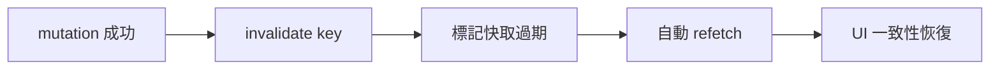

# 4.2 Hooks 與狀態管理：從代數效應到一致性感

## Hooks 解決了什麼問題

Class 元件時代（2013–2019）的三大痛：

1. **邏輯複用困難**：mixin 與 HOC 的巢狀地獄（wrapper hell）
2. **生命週期碎片化**：一個訂閱邏輯散落在 `componentDidMount` / `componentDidUpdate` / `componentWillUnmount` 三處
3. **this 陷阱**：綁定錯誤、類別心智負擔

Hooks（2019，React 16.8）的答案是**把狀態與副作用變成可組合的函數呼叫**。理論上它與 **代數效應（algebraic effects）** 相關：`useState` 像是一個「向框架請求狀態」的效應操作，框架（效應處理器）決定如何回應 —— 這讓元件程式碼不需知道狀態儲存在哪。

## 核心 Hooks 的語意

```tsx
const [count, setCount] = useState(0);              // 狀態

useEffect(() => {
  const sub = subscribe(channel);
  return () => sub.unsubscribe();                   // 清理函數
}, [channel]);                                      // 依賴陣列

const memo = useMemo(() => expensive(a, b), [a, b]); // 計算快取
const cb = useCallback(() => send(memo), [memo]);    // 引用穩定
const ref = useRef<HTMLDivElement>(null);            // 可變引用（不觸發渲染）
```

### useEffect 的本質：與外部系統同步

官方文件（2023 重寫）的精確定位：**Effect 是讓元件與外部系統保持同步的逃生艙**，不是生命週期掛鉤。正確使用的判準：

| 情境 | 用 Effect? |
|------|-----------|
| 資料抓取（需快取/重試） | ❌ 用 react-query |
| 由 props/state 推導的值 | ❌ 直接在渲染中計算 |
| 訂閱 WebSocket、瀏覽器事件 | ✅（訂閱的是「React 之外」的系統） |
| 動畫、焦點管理 | ✅ |

「你或許不需要 Effect」：大多數 Effect 是把本可宣告式計算的東西寫成了命令式同步 —— 這是從宣告式典範的倒退。

### 依賴陣列的正確理論

依賴陣列不是「何時執行的提示」，而是**正確性約束**：

$$\text{Effect 讀取的每一個響應式值} \in \text{依賴陣列}$$

違反它 = 閉包捕獲了過期值（stale closure）。React 提供的 `lint` 規則（exhaustive-deps）把這條數學條件變成編譯期附近的靜態檢查 —— 又是「把錯誤往左移」。

## 自訂 Hook：行為的複用單位

```tsx
function useDebounced<T>(value: T, ms: number): T {
  const [v, setV] = useState(value);
  useEffect(() => {
    const t = setTimeout(() => setV(value), ms);
    return () => clearTimeout(t);
  }, [value, ms]);
  return v;
}
```

自訂 Hook 是「呼叫其他 Hook 的函數」—— 行為像 mixin，但沒有命名衝突與隱式依賴，因為資料流是顯式的參數與回傳值。

## 伺服器狀態：react-query 的理論

客戶端狀態（UI 開關）與伺服器狀態（資料庫的副本）是**本質不同的問題**。後者有：快取失效、競態條件、分頁、樂觀更新。手寫 `useEffect` + `useState` 管理，等於重新發明一個殘缺的快取系統。

```tsx
import { useQuery, useMutation, useQueryClient } from '@tanstack/react-query';

function useTodos() {
  return useQuery({
    queryKey: ['todos'],
    queryFn: api.listTodos,          // 型別自動推導
  });
}

function useToggleTodo() {
  const qc = useQueryClient();
  return useMutation({
    mutationFn: api.toggleTodo,
    onSuccess: () => qc.invalidateQueries({ queryKey: ['todos'] }),
  });
}
```

### 競態條件的消滅

使用者快速切換分頁時，兩個請求的回應可能亂序到達。手寫方案需 AbortController + 請求序號；react-query 內建：**queryKey 變更即取消舊查詢，且以 key 為單位快取** —— 競態條件被框架結構性消滅。



$$\text{最終一致性}： \text{本地快取} \xrightarrow{\text{失效機制}} \text{伺服器事實}$$

## 全域狀態：Context 與其代價

```tsx
const AuthContext = createContext<Auth | null>(null);

function App() {
  const [auth] = useState(loadAuth);
  return <AuthContext.Provider value={auth}>{children}</AuthContext.Provider>;
}
```

Context 的理論限制：**value 變更會重渲染所有消費者**。因此它適合低頻變更（登入狀態、主題），不適合高頻資料 —— 那是 react-query 或 Zustand 的領域。

## 習題

1. 把「點擊外部關閉下拉選單」寫成自訂 Hook，標出 Effect 的清理邏輯。
2. 說明 react-query 如何同時解決快取與競態兩個問題。
3. 以下程式碼的 stale closure 問題在哪？如何修？
   ```tsx
   const [count, setCount] = useState(0);
   useEffect(() => {
     const t = setInterval(() => setCount(count + 1), 1000);
     return () => clearInterval(t);
   }, []);
   ```
