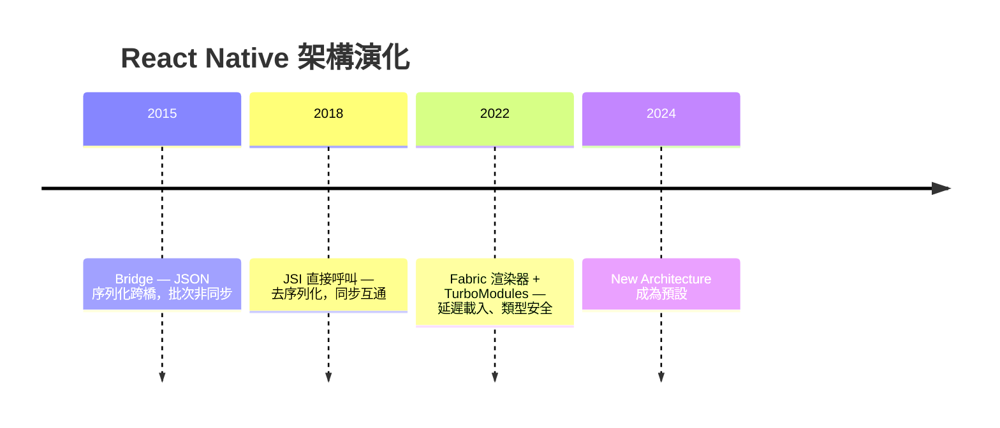
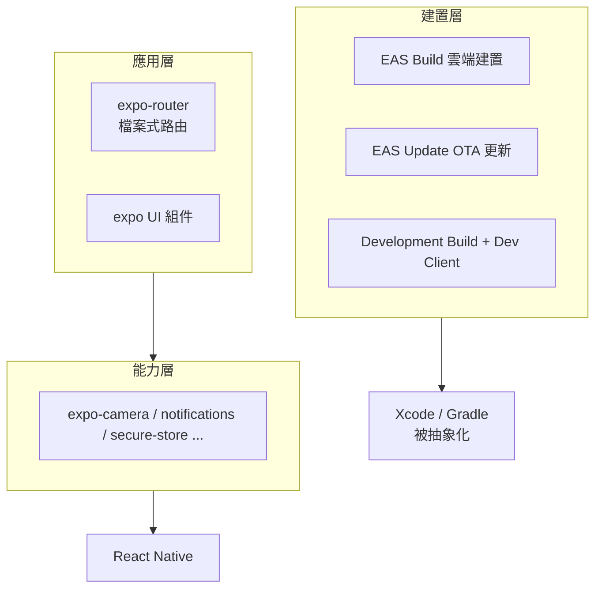

# 4.3 Expo 與 React Native：跨平台的抽象層次

## 跨平台的三代技術路線

| 路線 | 代表 | 機制 | 取捨 |
|------|------|------|------|
| WebView 混合 | Cordova (2011) | 網頁包殼 | 效能/體驗差 |
| 編譯成原生碼 | Xamarin (2011)、Flutter (2017 自繪) | 各自編譯/自繪引擎 | 生態隔離 |
| **橋接原生元件** | **React Native (2015)** | JS 驅動原生 View | 平台一致感 + React 生態 |

React Native 的洞見：**不要畫一個假的原生界面，直接使用真的原生元件**。`<Text>` 映射到 iOS `UITextView` / Android `TextView` —— 使用者得到平台級的滾動、無障礙與字型渲染。

### 橋接架構的演化（因果鏈）



舊 Bridge 的瓶頸：每次通訊需 JSON 序列化，批次非同步導致 UI 高頻互動（滾動跟手）出現延遲。JSI（JavaScript Interface，2022 主導）讓 JS 直接持有 C++ 物件引用，**同步呼叫、零序列化** —— 效能問題被架構修復而非調參修復。

## Expo：從「工具集」到「平台」

Expo 的分層抽象：



### 檔案式路由（expo-router）

```
app/
├── _layout.tsx        # 根布局（Provider、導航容器）
├── index.tsx          # /
├── todos/
│   ├── index.tsx      # /todos
│   └── [id].tsx       # /todos/:id — 動態路由
└── login.tsx          # /login
```

檔案結構即路由表 —— 與 Next.js 同源的約定，讓「URL 可分享、深度連結免設定」成為預設能力。

### 型別安全的導航

```tsx
import { Link, router } from 'expo-router';

// 宣告式跳轉，參數有型別
<Link href={{ pathname: '/todos/[id]', params: { id: todo.id } }}>
  <TodoCard todo={todo} />
</Link>

// 命令式
router.push('/todos');
```

## OTA 更新：原生 App 的「熱修復」能力

EAS Update 讓 JS 層的修正**繞過應用商店審核**直接推送到裝置：

$$\text{修復時間}： \text{商店審核（數天）} \Rightarrow \text{OTA（分鐘級）}$$

限制：僅限 JS/資源層；原生碼變更仍需重新建置上架 —— 抽象層的邊界就是更新能力的邊界。

## 網路層：與 Axum 後端整合

```tsx
// api/client.ts
const BASE_URL = process.env.EXPO_PUBLIC_API_URL ?? 'http://localhost:3000';

export async function apiFetch<T>(path: string, init?: RequestInit): Promise<T> {
  const res = await fetch(`${BASE_URL}${path}`, {
    ...init,
    headers: { 'Content-Type': 'application/json', ...init?.headers },
  });
  if (!res.ok) throw new ApiError(res.status, await res.text());
  return res.json();    // TS 型別由 openapi 生成（見 4.4）
}
```

注意 `EXPO_PUBLIC_` 前綴的環境變數會**被內聯進 bundle** —— 所以絕不能放機密；機密永遠只該在後端。

## 平台差異的處理策略

```tsx
import { Platform } from 'react-native';

const styles = StyleSheet.create({
  header: {
    paddingTop: Platform.OS === 'ios' ? 44 : 24,   // 狀態列差異
    ...Platform.select({ ios: { fontFamily: 'Menlo' }, android: { fontFamily: 'monospace' } }),
  },
});
```

原則：**90% 程式碼共享，10% 平台分支**。當平台分支超過 30%，應考慮把差異下沉到元件或原生模組，而不是讓業務代碼長滿 `if (Platform.OS)`。

## 習題

1. 畫圖比較舊 Bridge 與 JSI 的通訊路徑，說明序列化瓶頸消失的原因。
2. 哪些變更可以用 EAS Update 推送？哪些不行？為什麼？
3. 設計一個在 iOS/Android/Web 三端都可用的登入頁，標出需要平台分支的部分。
