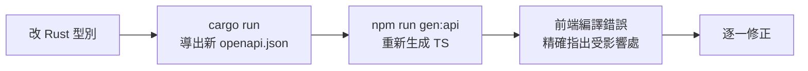
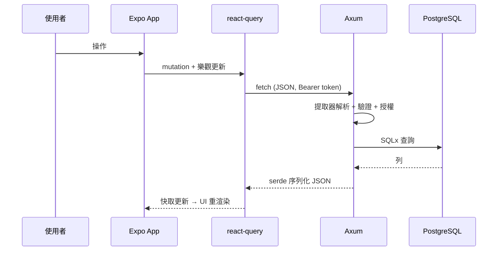

# 4.4 前後端整合：型別共享、資料抓取與序列化

## 全書核心論點的匯流

本書選 Rust + TypeScript 的終極理由在此匯流：**讓 API 契約成為兩端共享、編譯器強制的型別**。

$$\underbrace{\text{Rust struct}}_{\text{編譯器保證}} \Rightarrow \underbrace{\text{OpenAPI 規格}}_{\text{單一事實來源}} \Rightarrow \underbrace{\text{TS 型別}}_{\text{前端編譯器保證}}$$

契約錯誤的發現時點：production（ Runtime 崩潰）→ CI（前端編譯失敗）。

## 管道一：從 Rust 到 OpenAPI

```rust
#[derive(Serialize, Deserialize, ToSchema)]
#[serde(rename_all = "camelCase")]
pub struct TodoDto {
    pub id: Uuid,
    pub title: String,
    pub done: bool,
    #[serde(skip_serializing_if = "Option::is_none")]
    pub due_date: Option<NaiveDate>,
}

#[utoipa::path(
    get, path = "/todos",
    responses((status = 200, body = Vec<TodoDto>))
)]
```

**camelCase 對齊前端慣例**：後端 Rust 用 snake_case，序列化層統一轉換 —— 兩端各自的語言慣例不被破壞，轉換集中在一處。

## 管道二：從 OpenAPI 到 TypeScript

```bash
npx openapi-typescript openapi.json -o frontend/api/schema.d.ts
```

```typescript
export interface paths {
  "/todos": { get: { responses: { 200: { content: { "application/json": components["schemas"]["TodoDto"][] } } } } };
}
export interface components {
  schemas: {
    TodoDto: { id: string; title: string; done: boolean; dueDate?: string };
  };
}
```

開發流程變成：



**「改了後端欄位，前端哪裡會壞？」由編譯器回答** —— 這在動態型別時代是靠整合測試甚至用戶回報發現的。

## 序列化的理論：跨越邊界時資料發生了什麼

序列化不只是「轉字串」，它是**型別系統邊界**：

| 轉換點 | 風險 | 對策 |
|--------|------|------|
| Rust struct → JSON | `Option` 變 `undefined`? 缺欄位? | serde 屬性明確化 |
| JSON → TS 物件 | **執行期無型別** | zod 驗證 |
| 日期/時間 | ISO 8601 字串 vs 時區 | 統一 UTC + 前端本地化 |
| 浮點 | 金額精度 | 金額用整數分 / i64 |

**TypeScript 的型別在執行期完全消失**（型別擦除）。`as TodoDto` 只是告訴編譯器閉嘴 —— 資料壞了照樣崩潰。因此**跨邊界的每個入口都必須有執行期驗證**：

```tsx
import { z } from 'zod';

const TodoSchema = z.object({
  id: z.string().uuid(),
  title: z.string(),
  done: z.boolean(),
  dueDate: z.string().optional(),
});
export type Todo = z.infer<typeof TodoSchema>;   // 型別與驗證同源！

export async function listTodos(): Promise<Todo[]> {
  const data = await apiFetch<unknown>('/todos');
  return z.array(TodoSchema).parse(data);          // 執行期強制
}
```

$$\text{完整防線}： \text{編譯期型別} + \text{執行期 zod} = \text{trust no one}$$

## 資料抓取的完整模式：react-query + 生成型別

```tsx
export function useTodos() {
  return useQuery({
    queryKey: ['todos'],
    queryFn: listTodos,       // 回傳已驗證、型別正確的 Todo[]
  });
}

export function useCreateTodo() {
  const qc = useQueryClient();
  return useMutation({
    mutationFn: (input: CreateTodoInput) => api.createTodo(input),
    onSuccess: (created) => {
      // 樂觀更新：先改 UI，失敗自動回滾
      qc.setQueryData<Todo[]>(['todos'], (old) => [...(old ?? []), created]);
    },
  });
}
```

## 樂觀更新的理論：UI 先行，事實後到

```
使用者點擊 → 立即更新本地快取（樂觀）→ 發請求
  ├─ 成功：用伺服器回應校正快取
  └─ 失敗：回滾 + 顯示錯誤
```

$$\text{感知延遲}： \text{RTT} \Rightarrow 0 \quad(\text{代價：需要回滾邏輯})$$

取捨法則：高頻、低風險操作（按讚、勾選）用樂觀更新；金流類操作永遠悲觀（等伺服器確認）。

## 版本化與相容性策略

API 演進的相容法則（Postel's Law 的工程化）：

1. **只加欄位，不刪不改語意** → 舊前端不受影響
2. 破壞性變更走 `/v2/` 或要求客戶端升級
3. OpenAPI 規格 diff 進 CI：**偵測意外的不相容變更**

## 端對端流程總結



## 習題

1. 為什麼 `as TodoDto` 不夠，必須 zod？給一個後端改欄位而前端 `as` 掩蓋錯誤的場景。
2. 設計金額欄位的跨端表示法，論證為何不用 `f64`。
3. 實作「勾選待辦」的樂觀更新含失敗回滾。
