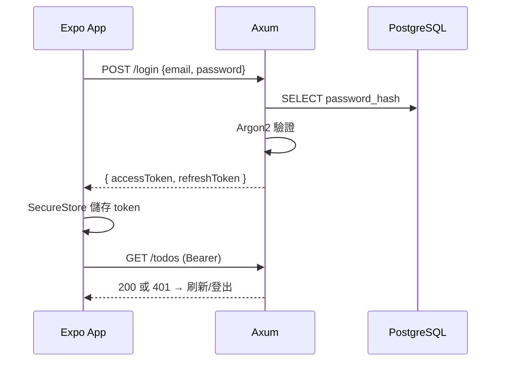

# 5.1 實戰：建立待辦事項全端應用

## 專案目標與範圍

綜合前四章的理論，建構一個完整的 Todo 應用：

- 後端：Axum + SQLx + PostgreSQL + JWT
- 前端：Expo + expo-router + react-query + zod
- 端對端型別共享（4.4 節管道）

## 第一步：資料模型

```sql
-- migrations/0001_init.sql
CREATE TABLE users (
    id UUID PRIMARY KEY DEFAULT gen_random_uuid(),
    email TEXT NOT NULL UNIQUE,
    password_hash TEXT NOT NULL,          -- Argon2
    created_at TIMESTAMPTZ NOT NULL DEFAULT now()
);

CREATE TABLE todos (
    id UUID PRIMARY KEY DEFAULT gen_random_uuid(),
    user_id UUID NOT NULL REFERENCES users(id) ON DELETE CASCADE,
    title TEXT NOT NULL CHECK (length(title) BETWEEN 1 AND 200),
    done BOOLEAN NOT NULL DEFAULT false,
    created_at TIMESTAMPTZ NOT NULL DEFAULT now()
);
CREATE INDEX idx_todos_user ON todos(user_id, created_at DESC);
```

設計決策的理論依據：

- `ON DELETE CASCADE`：刪除使用者時待辦一併消失 —— 資料完整性的宣告式表達
- `CHECK` 約束：最後一道防線（3.2 節三道防線的最內層）
- 複合索引：查詢模式（某使用者的列表、按時間倒序）決定索引設計

## 第二步：領域層（Repository）

```rust
// src/models/todo.rs
#[derive(Serialize, Deserialize, sqlx::FromRow, ToSchema)]
#[serde(rename_all = "camelCase")]
pub struct Todo {
    pub id: Uuid,
    pub user_id: Uuid,
    pub title: String,
    pub done: bool,
    pub created_at: DateTime<Utc>,
}

#[derive(Deserialize, Validate, ToSchema)]
pub struct CreateTodo {
    #[validate(length(min = 1, max = 200))]
    pub title: String,
}

// src/repo/todo.rs
pub async fn list(pool: &PgPool, user_id: Uuid) -> Result<Vec<Todo>, AppError> {
    let todos = sqlx::query_as!(
        Todo,
        r#"SELECT id, user_id, title, done, created_at
           FROM todos WHERE user_id = $1 ORDER BY created_at DESC"#,
        user_id
    ).fetch_all(pool).await?;
    Ok(todos)
}

pub async fn create(pool: &PgPool, user_id: Uuid, input: &CreateTodo)
    -> Result<Todo, AppError> {
    let todo = sqlx::query_as!(Todo,
        r#"INSERT INTO todos (user_id, title) VALUES ($1, $2)
           RETURNING id, user_id, title, done, created_at"#,
        user_id, input.title
    ).fetch_one(pool).await?;
    Ok(todo)
}
```

注意分層：**repo 函數不知道 HTTP 的存在**（不回 `Response`，不碰 status code）—— 層間依賴方向單一（1.4 節不變式）。

## 第三步：路由與授權整合

```rust
pub fn router() -> Router<AppState> {
    Router::new()
        .route("/todos", get(list).post(create))
        .route("/todos/:id", patch(toggle).delete(remove))
}

async fn list(
    State(pool): State<PgPool>,
    Extension(claims): Extension<Claims>,       // 3.4 節中介層注入的身分
) -> Result<Json<Vec<Todo>>, AppError> {
    Ok(Json(repo::list(&pool, claims.sub).await?))
}

async fn toggle(
    State(pool): State<PgPool>,
    Extension(claims): Extension<Claims>,
    Path(id): Path<Uuid>,
) -> Result<Json<Todo>, AppError> {
    let todo = sqlx::query_as!(Todo,
        "UPDATE todos SET done = NOT done
         WHERE id = $1 AND user_id = $2
         RETURNING id, user_id, title, done, created_at",
        id, claims.sub
    ).fetch_optional(pool).await?
    .ok_or(AppError::NotFound)?;      // 404 同時涵蓋「不存在」與「不是你的」
    Ok(Json(todo))
}
```

`WHERE ... AND user_id = $2` 把**授權下沉進查詢** —— 水平越權（IDOR，OWASP Top 10 常客）被資料層結構性防堵：不存在「先查再檢查」的時間差。

## 第四步：前端畫面

```tsx
// app/todos/index.tsx
import { View, FlatList } from 'react-native';
import { useTodos, useToggleTodo, useCreateTodo } from '../../hooks/useTodos';

export default function TodoListScreen() {
  const { data: todos, isLoading } = useTodos();
  const toggle = useToggleTodo();
  const create = useCreateTodo();

  if (isLoading) return <Spinner />;

  return (
    <View style={styles.container}>
      <TodoInput onSubmit={(title) => create.mutate({ title })} />
      <FlatList
        data={todos}
        keyExtractor={(t) => t.id}
        renderItem={({ item }) => (
          <TodoItem todo={item} onToggle={(id) => toggle.mutate(id)} />
        )}
      />
    </View>
  );
}
```

```tsx
// hooks/useTodos.ts — 資料層與畫面層分離（4.2 節）
import { useQuery, useMutation, useQueryClient } from '@tanstack/react-query';

export function useTodos() {
  return useQuery({ queryKey: ['todos'], queryFn: api.listTodos });
}

export function useToggleTodo() {
  const qc = useQueryClient();
  return useMutation({
    mutationFn: api.toggleTodo,
    onMutate: async (id) => {                          // 樂觀更新（4.4 節）
      await qc.cancelQueries({ queryKey: ['todos'] });
      const prev = qc.getQueryData<Todo[]>(['todos']);
      qc.setQueryData<Todo[]>(['todos'],
        (old) => old?.map((t) => (t.id === id ? { ...t, done: !t.done } : t)));
      return { prev };
    },
    onError: (_e, _id, ctx) => qc.setQueryData(['todos'], ctx?.prev),  // 回滾
    onSettled: () => qc.invalidateQueries({ queryKey: ['todos'] }),
  });
}
```

## 第五步：登入流程



```tsx
// 認證 Context（4.2 節：低頻全域狀態用 Context）
const AuthContext = createContext<{
  signIn: (email: string, password: string) => Promise<void>;
  signOut: () => void;
  user: Claims | null;
} | null>(null);
```

## 全鏡重溫：理論到程式碼的映射

| 理論（章節） | 落地程式碼 |
|-------------|-----------|
| 所有權/借用（2.1） | State 提取、`body.name` move 進查詢 |
| ADT 錯誤（2.4） | `AppError` enum → HTTP 狀態碼 |
| 非同步（2.3） | `tokio::main`、`try_join_all` |
| Tower 中介層（3.1） | `require_login` 認證層 |
| 提取器（3.2） | `Path`/`Query`/`Json`/`Extension` |
| 型別即規格（2.2/3.3/3.4） | SQLx 編譯期檢查、utoipa |
| UI=f(state)（4.1） | 函數元件、不可變更新 |
| 伺服器狀態（4.2） | react-query 快取/失效 |
| 型別管道（4.4） | openapi.json → TS + zod |

## 習題

1. 加入「到期日」欄位：寫出遷移、Rust 型別、OpenAPI、前端，體驗一次完整的型別管道。
2. 為什麼 `toggle` 用 404 而非 403 回應「他人的待辦」？這對安全有何意義？
3. 給登入 API 加上失敗次數限流（提示：tower_governor + email 維度）。
