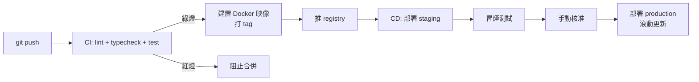

# 5.3 容器化與部署：Docker 與 CI/CD 流水線

## 為什麼需要容器：環境一致性的理論

「在我機器上能跑」的根因是**隱性依賴**：函式庫版本、OS 補丁、環境變數。容器以**映像檔（image）** 把整個使用者空間環境凍結為不可變的構建產物：

$$\text{部署單位}： \text{程式碼} \Rightarrow \text{不可變映像} \quad(\text{十二要素應用原則， 2011})$$

不可變性（immutability）的好處：部署 = 替換整體而非「原地修改」，回滾 = 換回舊映像，狀態漂移不可能發生。

## Rust 的多階段建置：映像極小化

```dockerfile
# ---- 階段一：建置 ----
FROM rust:1.79 AS builder
WORKDIR /app
COPY Cargo.toml Cargo.lock ./
RUN mkdir src && echo "fn main(){}" > src/main.rs && cargo build --release && rm -rf src
# ↑ 先只編依賴：src 不存在時走快取 —— 依賴不變就不重編（Docker 層快取）
COPY . .
RUN cargo build --release

# ---- 階段二：執行 ----
FROM debian:bookworm-slim
RUN apt-get update && apt-get install -y ca-certificates && rm -rf /var/lib/apt/lists/*
COPY --from=builder /app/target/release/backend /usr/local/bin/backend
USER 1000
EXPOSE 3000
CMD ["backend"]
```

成果對比：建置映像 ~2GB → 執行映像 **~80MB**。理論：**建置環境與執行環境分離**，執行時只攜帶最終二進位 —— 這是 Rust 靜態編譯相對 Node（需帶 node_modules）的部署優勢。

## docker-compose：本地全端拓撲

```yaml
services:
  db:
    image: postgres:16
    environment: { POSTGRES_PASSWORD: dev }
    volumes: [pgdata:/var/lib/postgresql/data]
    healthcheck:
      test: ["CMD", "pg_isready", "-U", "postgres"]
  backend:
    build: ./backend
    environment:
      DATABASE_URL: postgres://postgres:dev@db:5432/app
      JWT_SECRET: dev-secret
    depends_on:
      db: { condition: service_healthy }   # 等健康而非等啟動
    ports: ["3000:3000"]
  frontend:
    build: ./frontend
    ports: ["8081:8081"]
volumes: { pgdata: {} }
```

`service_healthy` 的意義：**依賴「可用」而非「程序存在」** —— 資料庫接受連線前，後端啟動必然失敗，這是競態條件在部署層的翻版。

## CI/CD 流水線全景



### GitHub Actions（節選）

```yaml
jobs:
  build-push:
    needs: [backend-tests, frontend-tests]
    runs-on: ubuntu-latest
    steps:
      - uses: actions/checkout@v4
      - uses: docker/build-push-action@v6
        with:
          context: ./backend
          push: true
          tags: ghcr.io/org/backend:${{ github.sha }}
```

**以 commit SHA 當映像 tag**：實現「一個 commit ↔ 一個映像」的雙射，審計與回滾都精確到提交。

## 部署策略的取捨

| 策略 | 機制 | 風險 | 適用 |
|------|------|------|------|
| 滾動更新 | 逐個替換舊實例 | 新舊版本共存，需向後相容 schema | 預設選擇 |
| 藍綠部署 | 兩套環境瞬間切換 | 資源雙倍 | 需零停機大改 |
| 金絲雀 | 小流量驗證後全量 | 需流量切分能力 | 高風險變更 |

**滾動更新的前提是 schema 向後相容**，因此資料庫遷移必須遵守「擴張—收縮」模式：

$$\text{遷移}： \underbrace{\text{加欄位(可空)}}_{N_1} \to \underbrace{\text{雙寫}}_{N_2} \to \underbrace{\text{切讀}}_{N_3} \to \underbrace{\text{刪舊欄位}}_{N_4}$$

每一步都與舊版程式碼相容 —— 因為滾動期間新舊實例**同時存活**。

## 前端部署：Expo 的兩條路

1. **Web 端**：`npx expo export` 產生靜態檔 → CDN（Cloudflare Pages / S3+CloudFront）
2. **行動端**：`eas build` 雲端建置 → 商店；JS 層修正走 `eas update`（4.3 節）

靜態站點 + CDN 是前端部署的終極形態：無伺服器、全球邊緣快取、部署即換檔案。

## 實務清單

- 祕鑰永不進映像；執行時注入（環境變數 / secret manager）
- 日誌輸出 stdout，交給平台聚合（十二要素 III）
- 健康檢查端點 `/health` + readiness/liveness 分離
- 資源限制（CPU/記憶體）防止 noisy neighbor

## 習題

1. 解釋 Docker 層快取為什麼要求「先 COPY 依賴清單再 COPY 原始碼」。
2. 設計一個「把 `title` 欄位改名為 `heading`」的擴張—收縮遷移計畫，標出每一步部署順序。
3. 藍綠部署為什麼解決不了 schema 不相容？與滾動更新比較。
